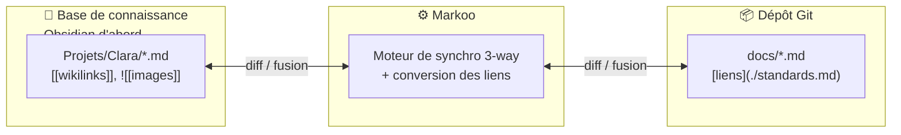
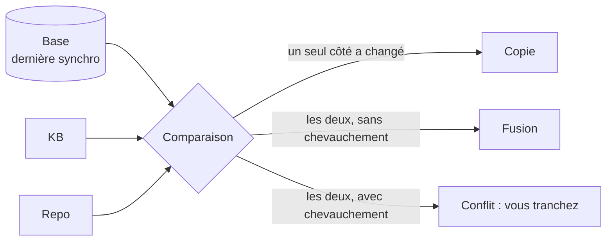

# Markoo

> 🇬🇧 [English version](README.md)

<p align="center">
  <picture>
    <source media="(prefers-color-scheme: dark)" srcset="assets/logo-mark-name-dark.svg">
    
  </picture>
</p>

**Garder sa base de connaissance et la documentation de ses projets synchronisées.**

Markoo est un connecteur bidirectionnel intelligent entre une **base de connaissance** et un **dépôt Git local**. Vous écrivez une note dans votre base de connaissance : elle arrive dans le `docs/` du repo, avec des liens Markdown qui fonctionnent. Vous récupérez la modification d'un collègue dans `docs/` : votre base de connaissance est mise à jour.

Les outils de base de connaissance sont pris en charge par des **adaptateurs**. **Obsidian est le premier implémenté** ; Logseq, Foam, Dendron et les simples dossiers Markdown sont prévus ensuite. Quand les deux côtés ont changé, Markoo fusionne comme le fait Git, et ne vous demande votre avis qu'en cas de vrai conflit.

> [!WARNING]
> **Phase de conception.** Markoo n'est pas encore utilisable : ce dépôt ne contient pour l'instant que la documentation de conception. Voir la [feuille de route](documentation/fr/07-feuille-de-route.md).



## Fonctionnalités (prévues)

- **N'importe quelle base de connaissance, via des adaptateurs** : Obsidian d'abord, les autres ensuite. Chaque adaptateur convertit le dialecte Markdown de son outil en Markdown standard, et inversement.
- **Trois sens de synchro par paire** : KB → repo, repo → KB, ou bidirectionnel.
- **Fusion 3-way** : les modifications des deux côtés sont fusionnées ligne à ligne par rapport à la dernière version synchronisée. Vous ne tranchez que les vrais conflits.
- **Aucune perte de données** : aperçu (dry-run) avant toute écriture, écritures atomiques, sauvegardes et corbeille. Markoo ne fait jamais de commit ni de push à votre place.
- **Conversion Obsidian ↔ GitHub** (premier adaptateur) : les `[[wikilinks]]` deviennent des liens Markdown standards, les pièces jointes sont copiées dans `assets/`, les callouts deviennent des alerts GitHub et le frontmatter propre à Obsidian est filtré, le tout de façon réversible.
- **Détection des renommages** : une note déplacée ou renommée l'est aussi de l'autre côté, et les liens qui pointent vers elle sont mis à jour.
- **Nombreux déclencheurs** : intervalle de temps, hooks Git (`post-merge`…), API HTTP locale, serveur MCP pour Claude et d'autres agents IA, CLI.
- **Application desktop** : état dans la barre de menus, assistant de création de paire, vue de conflit côte à côte.
- **Multi-plateforme** : macOS d'abord, puis Linux et Windows.

## Fonctionnement

Pour chaque fichier, Markoo compare trois versions : la base de connaissance, le repo et la **base**, c'est-à-dire le contenu lors de la dernière synchro réussie. La base indique quel côté a changé : Markoo peut ainsi copier, fusionner ou signaler un conflit sans deviner.



Détails : [algorithme de synchronisation](documentation/fr/03-algorithme-de-synchronisation.md).

## Utilisation prévue

Les commandes ci-dessous décrivent l'interface visée ; aucune n'existe encore.

```bash
markoo pair add clara --kb ~/Obsidian/Knowledge/Projets/Clara --kb-type obsidian --repo ~/code/clara/docs --direction both
```

```bash
markoo status
```

```bash
markoo sync --dry-run
```

```bash
markoo hook install --pair clara
```

La configuration tient dans un seul `markoo.toml`, modifiable à la main ou depuis l'application. Voir [configuration](documentation/fr/06-configuration.md).

## Stack technique

Rust (workspace Cargo) · Tauri 2 · SQLite · axum · MCP (`rmcp`)

```
crates/markoo-core     moteur de synchro (toute la logique)
crates/markoo-cli      commande `markoo`
crates/markoo-daemon   planificateur + API HTTP + hôte MCP
crates/markoo-mcp      outils MCP
app/                   application desktop Tauri
```

## Documentation

La documentation de conception existe en français et en anglais : [index de la documentation](documentation/INDEX.md).

| | |
|---|---|
| [Vision et périmètre](documentation/fr/01-vision-et-perimetre.md) | [Architecture](documentation/fr/02-architecture.md) |
| [Algorithme de synchronisation](documentation/fr/03-algorithme-de-synchronisation.md) | [Transformations](documentation/fr/04-transformations.md) |
| [Déclencheurs](documentation/fr/05-declencheurs.md) | [Configuration](documentation/fr/06-configuration.md) |
| [Feuille de route](documentation/fr/07-feuille-de-route.md) | [Interface de configuration](documentation/fr/08-interface-de-configuration.md) |
| [Bases de connaissance](documentation/fr/09-bases-de-connaissance.md) | |

## Contribuer

Les contributions seront les bienvenues une fois les premiers jalons livrés. Avant de contribuer :

- lisez [AGENTS.md](AGENTS.md) : il liste les règles et conventions du projet (elles valent aussi pour les humains) ;
- la documentation est bilingue : toute modification dans `documentation/fr/` doit être reportée dans `documentation/en/` dans le même commit, et inversement.

## Licence

À définir.
