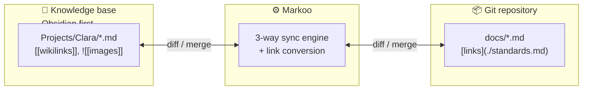
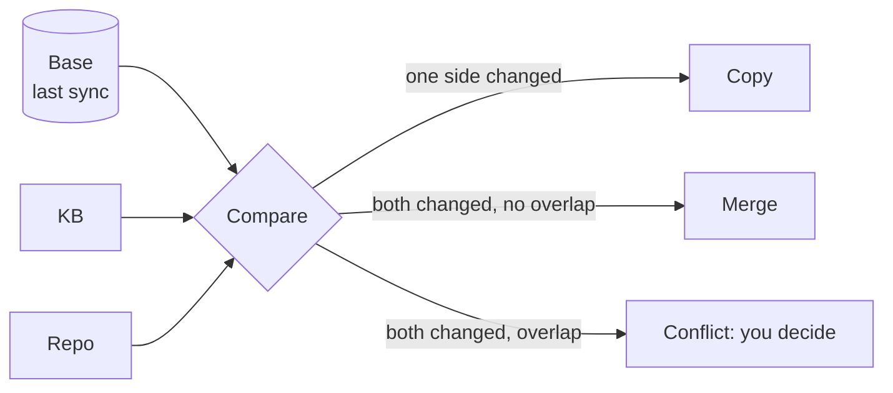

# Markoo

> 🇫🇷 [Version française](README.fr.md)

<p align="center">
  <picture>
    <source media="(prefers-color-scheme: dark)" srcset="assets/logo-mark-name-dark.svg">
    
  </picture>
</p>

**Keep your knowledge base and your project docs in sync.**

Markoo is a smart two-way connector between a **knowledge base** and a **local Git repository**. Write a note in your knowledge base and it lands in your repo's `docs/` with working Markdown links; pull a teammate's change to `docs/` and your knowledge base is updated.

Knowledge base tools are supported through **adapters**. **Obsidian is the first one implemented**; Logseq, Foam, Dendron and plain Markdown folders are designed to follow. When both sides changed, Markoo merges them like Git does, and only asks you when there is a real conflict.

> [!WARNING]
> **Design phase.** Markoo is not usable yet: this repository currently contains the design documentation only. See the [roadmap](documentation/en/07-roadmap.md).



## Features (planned)

- **Any knowledge base, through adapters**: Obsidian first, others later. Each adapter converts its tool's Markdown dialect to standard Markdown and back.
- **Three sync directions per pair**: KB → repo, repo → KB, or both ways.
- **3-way merge**: changes on both sides are merged line by line against the last synced version. You only decide on real conflicts.
- **No data loss**: dry-run before anything is written, atomic writes, backups and a trash folder. Markoo never commits or pushes for you.
- **Obsidian ↔ GitHub conversion** (first adapter): `[[wikilinks]]` become standard Markdown links, attachments are copied to `assets/`, callouts become GitHub alerts, and Obsidian-only frontmatter is filtered — all reversibly.
- **Rename detection**: a moved or renamed note is moved on the other side too, and links pointing to it are updated.
- **Many triggers**: time interval, Git hooks (`post-merge`…), local HTTP API, MCP server for Claude and other AI agents, CLI.
- **Desktop app**: menu bar status, pair setup wizard, side-by-side conflict view.
- **Cross-platform**: macOS first, then Linux and Windows.

## How it works

For every file, Markoo compares three versions: the knowledge base, the repo, and the **base** — the content at the last successful sync. The base tells which side changed, so Markoo can copy, merge or flag a conflict without guessing.



Details: [sync algorithm](documentation/en/03-sync-algorithm.md).

## Planned usage

The commands below describe the target interface; none of them exist yet.

```bash
markoo pair add clara --kb ~/Obsidian/Knowledge/Projects/Clara --kb-type obsidian --repo ~/code/clara/docs --direction both
```

```bash
markoo status
```

```bash
markoo sync --dry-run
```

```bash
markoo hook install --pair clara
```

Configuration lives in a single `markoo.toml`, editable by hand or from the app. See [configuration](documentation/en/06-configuration.md).

## Tech stack

Rust (Cargo workspace) · Tauri 2 · SQLite · axum · MCP (`rmcp`)

```
crates/markoo-core     sync engine (all the logic)
crates/markoo-cli      `markoo` command
crates/markoo-daemon   scheduler + HTTP API + MCP host
crates/markoo-mcp      MCP tools
app/                   Tauri desktop app
```

## Documentation

The design documentation is available in English and French: [documentation index](documentation/INDEX.md).

| | |
|---|---|
| [Vision and scope](documentation/en/01-vision-and-scope.md) | [Architecture](documentation/en/02-architecture.md) |
| [Sync algorithm](documentation/en/03-sync-algorithm.md) | [Transformations](documentation/en/04-transformations.md) |
| [Triggers](documentation/en/05-triggers.md) | [Configuration](documentation/en/06-configuration.md) |
| [Roadmap](documentation/en/07-roadmap.md) | [Configuration UI](documentation/en/08-configuration-ui.md) |
| [Knowledge bases](documentation/en/09-knowledge-bases.md) | |

## Contributing

Contributions are welcome once the first milestones land. Before contributing:

- read [AGENTS.md](AGENTS.md): it lists the project's invariants and conventions (they apply to humans too);
- documentation is bilingual: any change in `documentation/en/` must be mirrored in `documentation/fr/` in the same commit, and vice versa.

## License

To be decided.
