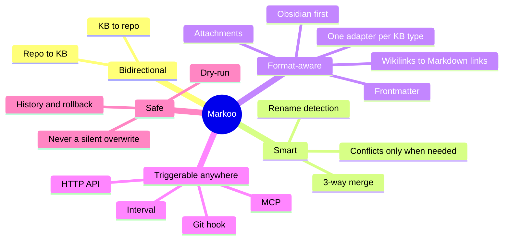
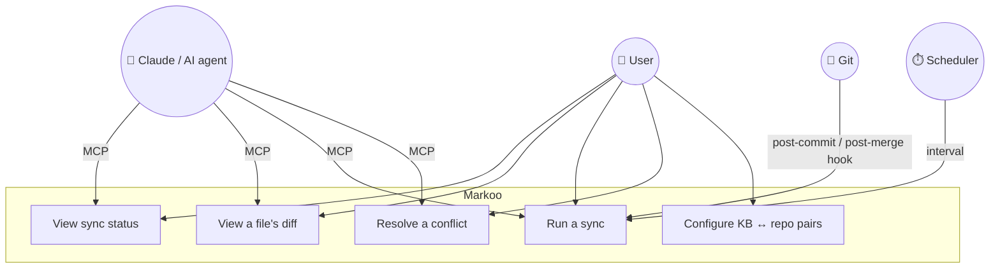

# 1. Vision and scope

> 🇫🇷 [Version française](../fr/01-vision-et-perimetre.md)

## The problem

A project's documentation lives in two places:

- in a **knowledge base** (KB) — Obsidian, Logseq, Foam, a plain Markdown folder… — where you think, take notes, and connect ideas;
- in the project's **Git repository** (`docs/`, `README.md`, ADRs…), where it is versioned and shared with the team.

The two drift apart quickly: a note updated in the KB never makes it to the repo, and a PR changes `docs/` without the knowledge base knowing. Manual copy-pasting breaks links (Obsidian's `[[wikilinks]]`, for example, are unreadable on GitHub) and overwrites changes made on the other side.

On top of that, each KB tool has its own Markdown dialect (links, embeds, callouts, properties, folder layout): a sync tool tied to just one of them only serves part of the users.

## The vision

> Markoo is a two-way bridge between a knowledge base and a Git repository: each side keeps its own conventions, and the content stays the same.

Each KB type is handled by an **adapter** that detects the KB, knows its layout and converts its dialect to a shared canonical form (GitHub Flavored Markdown). **Obsidian is the first knowledge base implemented**; others will follow (see [Knowledge bases](09-knowledge-bases.md#adapter-model)).

## Goals

| # | Goal | Success criterion |
|---|------|-------------------|
| O1 | Sync pairs of Markdown folders (KB ↔ repo) in both directions | A change on one side shows up on the other after a sync |
| O2 | **Never** lose a change | Every concurrent change is merged or reported as a conflict |
| O3 | Keep links valid on each side | Links work in the KB (e.g. Obsidian) **and** in GitHub's rendering |
| O4 | Show differences clearly | Readable `status` and `diff`, merge view in the app |
| O5 | Fit into the existing workflow | Sync by interval, Git hook, API or MCP |
| O6 | Support several knowledge base types through adapters | Adding a KB type = implementing the `KbAdapter` trait, without touching the engine; in v1: `obsidian` (first KB implemented, reference adapter) and `markdown` (plain folder, no conversion) |

## Non-goals (for v1)

- Replacing Git: Markoo **does not commit or push** on the user's behalf (at most, it suggests a commit message).
- Syncing anything other than Markdown and its referenced attachments.
- Syncing across machines (Obsidian Sync, iCloud or Git already handle that).
- Editing Markdown: Markoo is not an editor.
- Supporting remote knowledge bases accessed through an API (Notion, Confluence, Outline…): v1 only handles KBs stored as local files (later exploration, see [Knowledge bases](09-knowledge-bases.md#supported-knowledge-base-types)).
- Being a plugin for a specific KB tool (e.g. an Obsidian plugin): possible later, see the [roadmap](07-roadmap.md).

## Actors and use cases

### Typical scenarios

The scenarios use Obsidian as the example KB; they apply to any supported KB type.

1. **I write an architecture note in my KB** (e.g. Obsidian) in `Projets/Clara/`. On the next sync, it appears in `clara/docs/` with standard Markdown links. I commit it whenever I want.
2. **A colleague edits `docs/api.md`** in a PR. After my `git pull`, the `post-merge` hook triggers Markoo: my KB note is updated, in the KB's dialect (e.g. Obsidian wikilinks).
3. **I edited the same note on both sides.** If the changes touch different lines, Markoo merges them. Otherwise, it shows a conflict in the app (or via MCP) and waits for my decision; no file is overwritten.
4. **I ask Claude** "sync Clara's docs and tell me what changed": Claude calls the MCP tools `sync_status` then `sync_run`.

## Constraints

- **Local first**: everything runs on the machine; the API only listens on `127.0.0.1`.
- **Cross-platform**: macOS first, then Linux and Windows (Tauri and Rust make this possible).
- **Tolerant of concurrent edits**: the KB tool (e.g. Obsidian) may write during a sync; writes are atomic (temporary file, then rename).
- **Lossless conversion**: an adapter only converts what round-trips exactly; a construct it cannot reproduce is left untouched.
- **Performance**: a 10,000-note KB must be scanned in under a second when nothing has changed (comparison by `mtime` + size, hashing only when needed).
