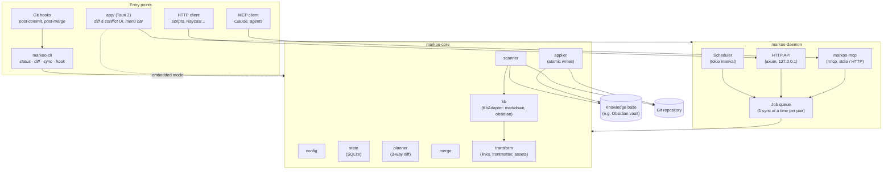
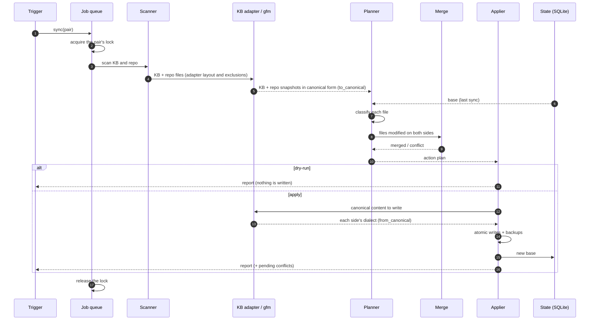

# 2. Architecture

> 🇫🇷 [Version française](../fr/02-architecture.md)

## Overview

Markoo is a **Cargo workspace**. All the sync logic lives in a library, `markoo-core`, which depends on no interface. The entry points (CLI, daemon, API, MCP, Tauri app) are thin layers that call it.

The engine knows no specific knowledge base tool: each KB type is handled by an **adapter** (`kb` module, `KbAdapter` trait) that detects the KB, describes its layout and converts its Markdown dialect to the canonical form (GitHub Flavored Markdown). Obsidian is the first KB implemented. See [Knowledge bases](09-knowledge-bases.md#adapter-model).



## Repository layout

```
markoo/
├── Cargo.toml              # workspace
├── crates/
│   ├── markoo-core/        # library: sync engine
│   ├── markoo-cli/         # `markoo` binary
│   ├── markoo-daemon/      # scheduler + HTTP API + MCP host
│   └── markoo-mcp/         # MCP tool definitions
├── app/                    # Tauri 2 (src-tauri/ + web front end)
├── documentation/          # this folder
└── tests/fixtures/         # test KBs and repos (one set per adapter)
```

## The crates

### `markoo-core`

| Module | Role | Planned dependencies |
|--------|------|----------------------|
| `paths` | Computes `<config>` and `<data>` per OS (see [Configuration](06-configuration.md#paths-per-operating-system)) | `directories` |
| `config` | Reads, validates and **edits** `markoo.toml` while preserving comments | `serde`, `toml`, `toml_edit` |
| `scanner` | Walks one side, filters by patterns, computes fingerprints | `walkdir`, `globset`, `blake3` |
| `state` | Stores the **base** (state at the last sync) | `rusqlite` |
| `kb` | `KbAdapter` trait and KB adapters: detection, layout (notes, attachments, exclusions), dialect (`to_canonical` / `from_canonical`), name resolution. In v1: `markdown` (identity) and `obsidian` (reference adapter). See [Knowledge bases](09-knowledge-bases.md#adapter-model) | `pulldown-cmark`, `unicode-normalization`, `serde_json` |
| `transform` | Applies the generic options (links, file names, frontmatter, attachments) between the canonical form and the repo's `gfm` dialect (KB ↔ repo) | `pulldown-cmark`, `serde_yaml` |
| `planner` | Compares KB / repo / base in canonical form, produces an action **plan** | — |
| `merge` | Line-by-line 3-way merge | `diffy` or `similar` |
| `applier` | Executes the plan: atomic writes, log, backups | `tempfile` |
| `service` | What the remote interfaces (HTTP API, MCP) ask for, as JSON views, so that both apply the same checks | `serde_json` |
| `events` | Emits events (progress, conflicts) to the interfaces | `tokio::sync::broadcast` |

The repo side has a dialect too: **`gfm`** (GitHub Flavored Markdown) in v1, selectable per pair later (`gitlab`, `mkdocs`, `docusaurus` are post-v1 ideas). Comparison and merging always happen in canonical form; each side is read with its `to_canonical` and written back with its `from_canonical`.

Target public API (tentative):

```rust
let engine = Engine::open(Paths::resolve()?)?;
let plan = engine.plan(PairId::all())?;         // changes nothing
println!("{}", plan.summary());                  // equivalent to `markoo status`
let report = engine.apply(&plan, ApplyOptions { dry_run: false })?;
for c in report.conflicts() { /* … */ }
engine.resolve(&pair, &path, Resolution::Content(text))?;
```

### `markoo-cli`

The `markoo` binary (`clap`):

| Command | Effect |
|---------|--------|
| `markoo init` | Interactively creates `markoo.toml` (KB type auto-detected) and prepares the state folder |
| `markoo status` | Lists modified, added, deleted and conflicting files |
| `markoo diff [file]` | Shows the colored diff |
| `markoo sync [--dry-run] [--pair <name>]` | Plans, then applies |
| `markoo conflicts` / `markoo resolve <file>` | Lists and resolves conflicts and divergences, identified by their file path |
| `markoo hook install\|uninstall` | Manages Git hooks |
| `markoo pair add\|list\|show\|set\|remove` | Manages pairs (direction, folders, filters…); creation: `markoo pair add <name> --kb <folder> [--kb-type obsidian\|markdown] --repo <folder>` (`--kb-type` auto-detected if omitted); see [Configuration UI](08-configuration-ui.md) |
| `markoo paths` | Shows the configuration and state paths in use |
| `markoo daemon [install\|uninstall]` | Starts the daemon (scheduler + API + MCP), or manages its `launchd` service on macOS |
| `markoo token rotate` | Replaces the API token |
| `markoo mcp` | MCP server over stdio (for Claude Desktop / Claude Code) |

#### Banner

`markoo --version` and `markoo init` display a banner in figlet's `standard` font, stored in [`assets/cli-banner.txt`](../../assets/cli-banner.txt):

```text
  __ __                         _
 / / \ \   _ __ ___   __ _ _ __| | _____   ___
/ /   \ \ | '_ ` _ \ / _` | '__| |/ / _ \ / _ \
\ \   / / | | | | | | (_| | |  |   < (_) | (_) |
 \_\ /_/  |_| |_| |_|\__,_|_|  |_|\_\___/ \___/
```

When the terminal supports color, `<` is printed in pink (`#F0418E`) and `>` in green (`#22A55A`), the logo's colors. Otherwise (`NO_COLOR` set, output not a terminal), the banner is printed as plain text.

### `markoo-daemon`

A long-running process, embedded in the Tauri app or run on its own (`launchd` on macOS). It guarantees **only one sync at a time per pair** through a job queue and one lock per pair (`<data>/locks/<pair>.lock`), whatever the trigger. The engine takes this lock itself, so a CLI command running alongside the daemon is covered too.

### `markoo-mcp`

Declares the MCP tools and wires them to the engine through `service`. The daemon hosts it over HTTP, and `markoo mcp` over stdio. See [Triggers](05-triggers.md#4-mcp-server).

### `app/` — Tauri 2

- **Menu bar**: status (✅ up to date, 🔄 syncing, ⚠️ conflicts), "Sync now".
- **Main window**: list of pairs, pending changes, history.
- **Conflict view**: three columns (KB · base · repo) and an editable result.
- **Configuration**: pair creation wizard, direction choice (→ · ⇄ · ←), filters with preview, transformations, triggers. Details in [Configuration UI](08-configuration-ui.md).
- The front end talks to the Rust core through **Tauri commands** and receives events via `emit`.

## Sync flow



## Design principles

1. **The core does no network I/O**: it handles files and returns data structures. The interfaces take care of the rest.
2. **Plan before acting**: every sync first produces a serializable `Plan`. Dry-run, the UI and MCP display it as is.
3. **Idempotence**: re-running a sync with no changes produces no writes.
4. **No data loss**: every overwritten file is backed up to `<data>/backups/` (configurable rotation).
5. **Testability**: the file system goes through a trait (`Fs`) so the engine can be tested in memory.
6. **Extensibility through adapters**: adding a KB type means implementing `KbAdapter` (with its golden and round-trip tests), without changing the planner, merge or applier. Entries go through an abstraction so that an API-backed adapter (remote KB) stays possible after v1.
