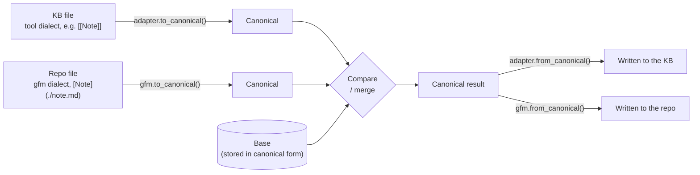
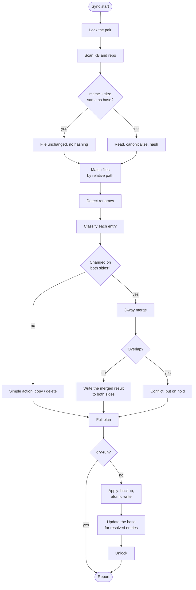
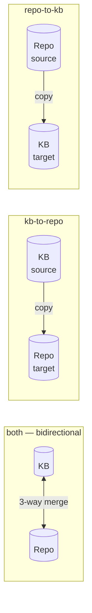
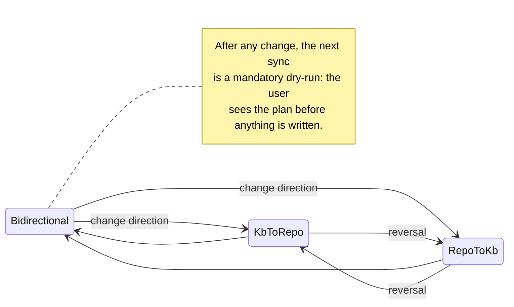
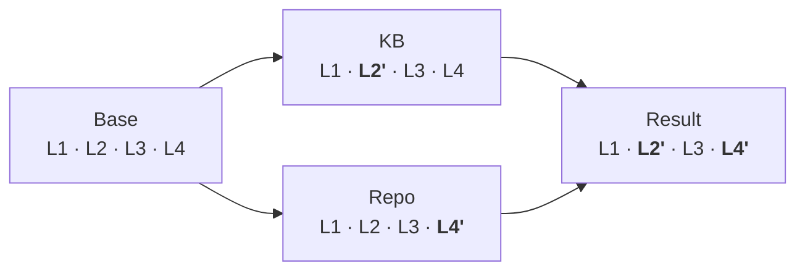
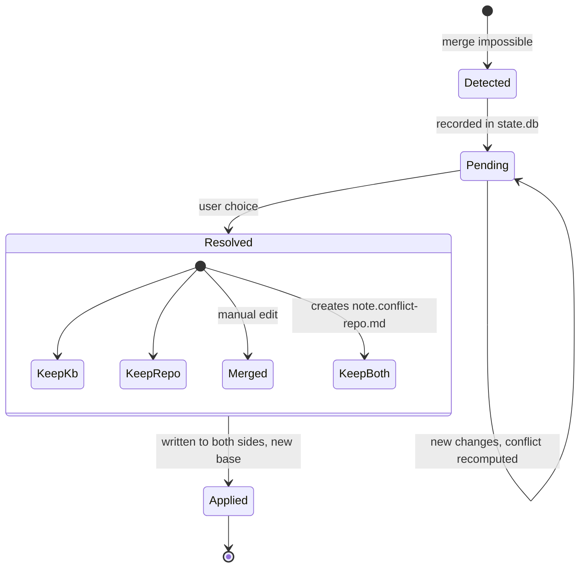
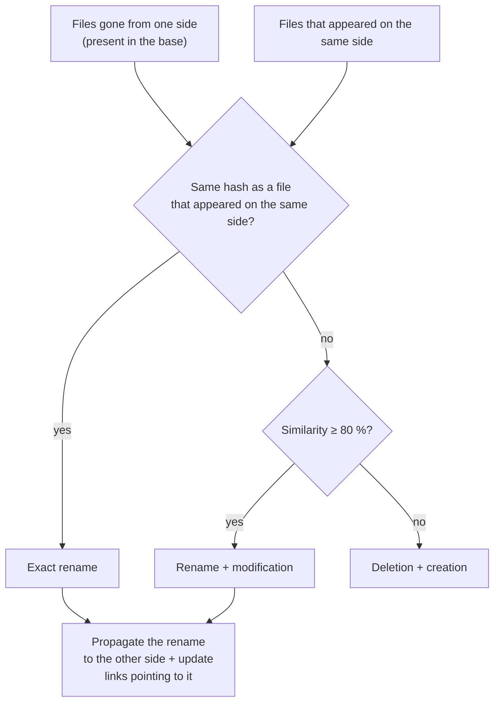

# 3. Sync algorithm

> 🇫🇷 [Version française](../fr/03-algorithme-de-synchronisation.md)

Markoo relies on **three-way synchronization** (*3-way*), the same principle as `git merge`: for each file, it compares the current state of the **knowledge base** (KB), the current state of the **repo**, and the **base**, i.e. the common state at the last successful sync.

This document first describes **bidirectional** mode, the most complete one; one-way modes are covered in [Sync direction](#sync-direction).

Without a base, there is no way to know who changed what: if `A.md` differs between the KB and the repo, did the KB change, the repo, or both? The base answers that question.

## Canonical form

The two sides don't use the same syntax: the knowledge base (KB) uses its tool's dialect (e.g. `[[Note]]` wikilinks in Obsidian), the repo uses GitHub Markdown. To compare and merge, Markoo brings everything back to a **canonical form**: **standard GitHub Flavored Markdown with relative links**, plus invisible `<!--markoo:…-->` comments carrying what GFM cannot represent (a link to a note outside the pair, the original callout type…).

Each side has its own **dialect**: the KB file goes through the `to_canonical()` of the **adapter** for its KB type (see [Knowledge bases](09-knowledge-bases.md#adapter-model)), the repo file through the `gfm` dialect. The base is stored in canonical form.

A hard requirement: the conversion must be **lossless**, for every adapter as well as for `gfm`: `to_canonical(from_canonical(x)) == x` for any canonical text, and `from_canonical(to_canonical(y)) == y` for any KB file. A construct that can't round-trip is left untouched. This is checked by property tests; see [Transformations](04-transformations.md).

## Steps

## Classification

Notation: `K` = knowledge base (KB), `R` = repo, `B` = base. "=" means an identical canonical hash, "∅" means the file is absent.

| # | Base | KB | Repo | Situation | Action |
|---|------|-------|------|-----------|--------|
| 1 | ∅ | ∅ | ∅ | — | nothing |
| 2 | ∅ | present | ∅ | created in the KB | copy K → R |
| 3 | ∅ | ∅ | present | created in the repo | copy R → K |
| 4 | ∅ | present | present, K = R | created on both sides, identical | record the base |
| 5 | ∅ | present | present, K ≠ R | created on both sides, different | 2-way merge (empty base) → often a **conflict** |
| 6 | B | = B | = B | unchanged | nothing |
| 7 | B | ≠ B | = B | changed in the KB | copy K → R |
| 8 | B | = B | ≠ B | changed in the repo | copy R → K |
| 9 | B | ≠ B | ≠ B, K = R | same change on both sides | update the base |
| 10 | B | ≠ B | ≠ B, K ≠ R | changed on both sides | **3-way merge** |
| 11 | B | ∅ | = B | deleted in the KB | delete in R |
| 12 | B | = B | ∅ | deleted in the repo | delete in K |
| 13 | B | ∅ | ∅ | deleted on both sides | forget the base |
| 14 | B | ∅ | ≠ B | deleted in K, changed in R | delete / modify **conflict** |
| 15 | B | ≠ B | ∅ | changed in K, deleted in R | delete / modify **conflict** |

> Deletions go to the **trash** (`<data>/trash/`); Markoo never deletes anything permanently.

## Sync direction

Each pair has a **direction**, chosen in the [configuration UI](08-configuration-ui.md) or in `markoo.toml` (key `direction`).

| Mode | Value | Diagram | Typical use |
|------|-------|---------|-------------|
| Bidirectional | `both` | KB ↔ repo | I write on both sides (default) |
| KB → repo | `kb-to-repo` | KB → repo | The KB (e.g. Obsidian) is the source of truth, the repo publishes |
| Repo → KB | `repo-to-kb` | repo → KB | The repo is the source of truth, the KB is for reading |

In one-way mode, we talk about the **source** and the **target**. Markoo never modifies the source.

### What about changes made in the target?

This is the real question for a one-way mode: someone can still edit the target (a colleague changes `docs/` while the KB is the source of truth). The `target_changes` option decides:

| Value | Behavior |
|-------|----------|
| `protect` (default) | Markoo **never overwrites** a change in the target. The file is flagged as **diverged** and left as is until the user decides. |
| `overwrite` | **Strict mirror**: the target is reset to match the source exactly. Overwritten content goes to `<data>/backups/` or `<data>/trash/`; it is never lost. |

A **divergence** is resolved like a conflict (app, CLI, API, MCP), with three choices: *restore the source*, *keep the target* (the file is excluded from subsequent syncs until further notice), or *push back to the source*, which is a one-off exception to the chosen direction and requires explicit confirmation.

### Classification by direction

The situations from the [classification table](#classification), seen from a one-way `S → T` mode:

| Situation | `both` | `S → T` + `protect` | `S → T` + `overwrite` |
|-----------|--------|---------------------|-----------------------|
| Created in S | copy to T | copy to T | copy to T |
| Created in T only | copy to S | ignored, flagged "not in source" | moved to trash |
| Changed in S | copy to T | copy to T | copy to T |
| Changed in T only | copy to S | **divergence** | restored from S |
| Changed on both sides | 3-way merge | **divergence** | overwritten by S |
| Deleted in S | delete in T | delete in T (divergence if T was changed) | delete in T |
| Deleted in T | delete in S | **divergence** | recreated from S |

The base is updated with the source's state after each copy. A divergence does not update the base: the file stays flagged until it is resolved.

### Changing direction

The direction of an existing pair can change at any time; the base is kept.

Switching from `both` to a one-way mode while conflicts are pending is refused until those conflicts are resolved, so that Markoo never decides on the user's behalf.

## 3-way merge

We compute the `B → K` diff and the `B → R` diff, line by line. Non-overlapping blocks (*hunks*) are both applied. When two hunks touch the same base lines:

- if they produce the same text, it is kept once;
- otherwise, that hunk is a **conflict**.

### Planned refinements

- **Frontmatter merged by key** rather than by line: `tags` changed on one side and `status` on the other do not cause a conflict. See [Transformations](04-transformations.md#4-frontmatter).
- Optional **paragraph granularity**, for prose where line breaks vary.
- **Normalization** before comparison: line endings (`\r\n` → `\n`), trailing whitespace and final newline. This avoids spurious changes.

## Conflicts

A conflicted file **is not written anywhere** until the user decides. The other files in the pair sync normally.

Conflicts can be resolved from:

- the **Tauri app** (three-column view);
- the **CLI** (`markoo resolve <id> --keep kb|repo|both` or `--edit` in `$EDITOR`);
- the **API** (`POST /conflicts/{id}/resolve`);
- **MCP** (`resolve_conflict`), which lets Claude propose a merge.

## Renames and moves

Without detection, a rename looks like "deletion + creation", which loses the base history and can cause needless conflicts.

## Atomicity and robustness

- **Atomic writes**: write to `file.md.markoo-tmp`, `fsync`, then `rename`.
- **Check right before writing**: if the target file changed since the scan (the KB tool, e.g. Obsidian, just saved it), the action is cancelled and rescheduled for the next sync.
- **Journal**: each apply writes `<data>/journal/<timestamp>.json`. An interrupted sync is resumed or rolled back on the next startup.
- **Backups**: overwritten content is copied to `<data>/backups/` before writing.
- **Exclusions**: each adapter's own exclusions (e.g. `.obsidian/` and `.trash/` for Obsidian; see [Knowledge bases](09-knowledge-bases.md#supported-knowledge-base-types)), plus `.git/`, `node_modules/` and `*.markoo-tmp` temporary files, are always ignored.
