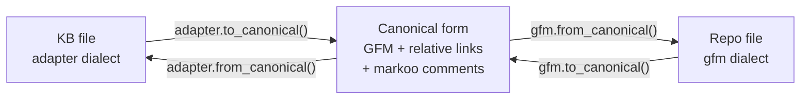
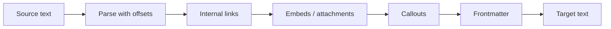
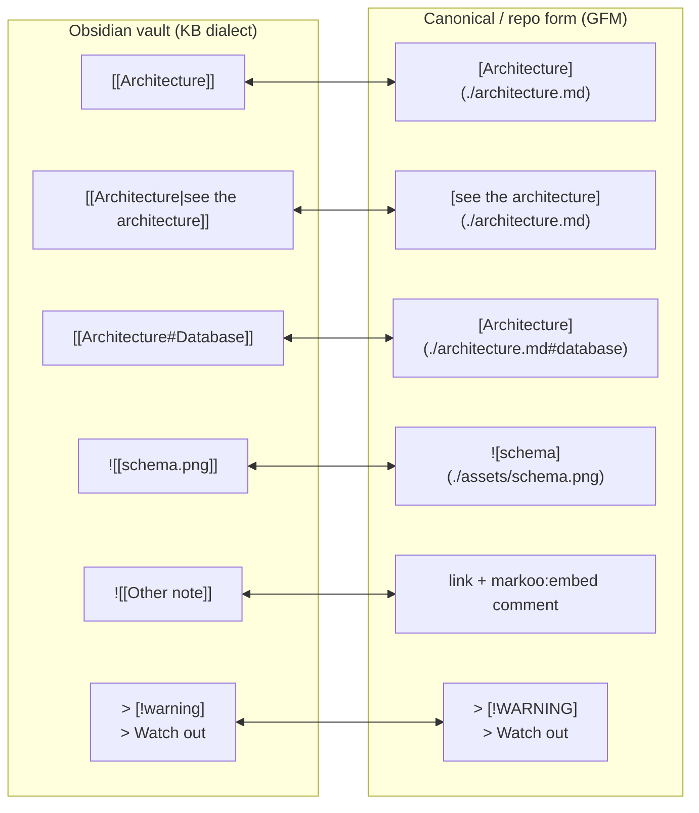
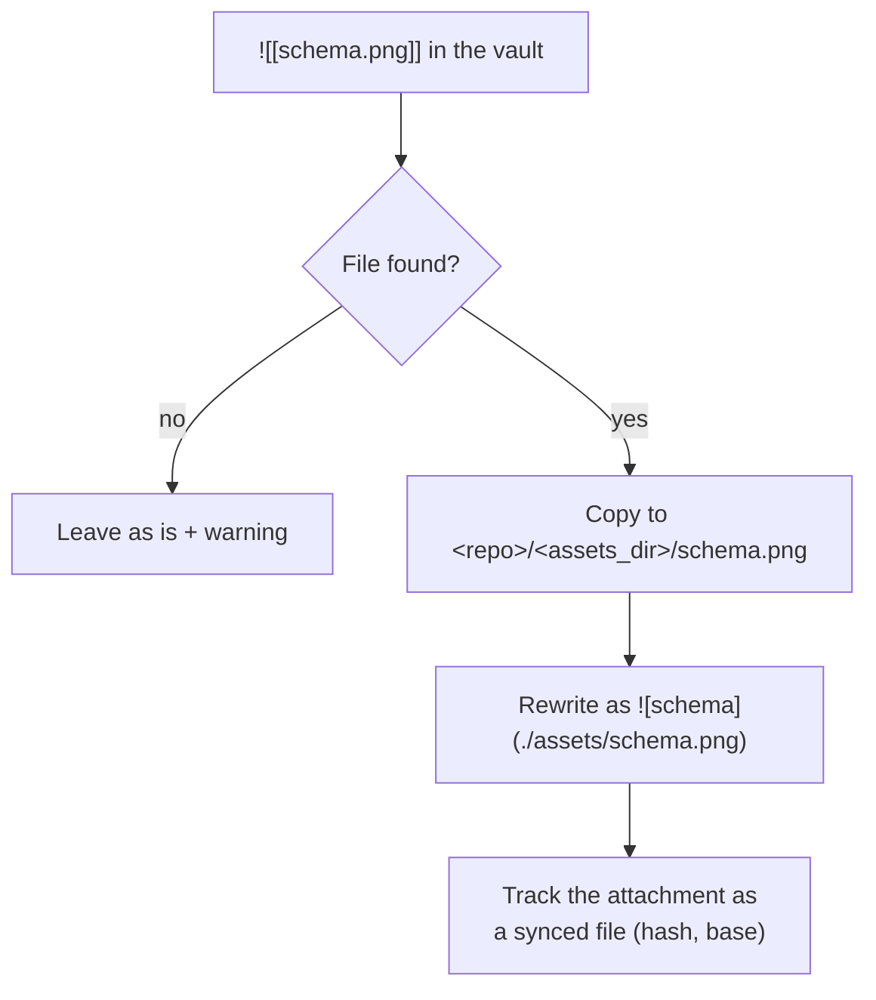
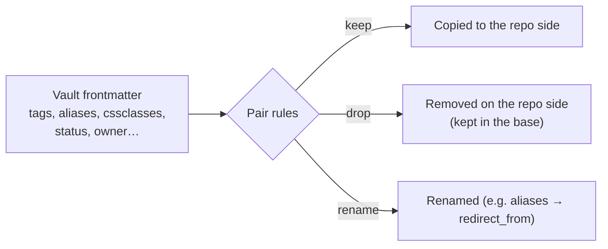

# 4. KB ↔ repo transformations

> 🇫🇷 [Version française](../fr/04-transformations.md)

A knowledge base (KB) and GitHub don't interpret Markdown the same way. Markoo converts content on the fly so that each side stays **native**: links work in the KB tool (e.g. Obsidian) **and** on GitHub.

This document first describes the **generic pipeline**, shared by all KB types, then the detailed rules of the **Obsidian adapter**, the first one implemented (sections 1 to 6).

## Principle: a reversible pipeline

Each side of a pair has a **dialect**: the adapter for the KB type (`kb_type`) on the KB side, `gfm` on the repo side. A dialect is a pair of functions, `to_canonical` / `from_canonical`, converting to and from the **canonical form**: **standard GitHub Flavored Markdown with relative links**, plus invisible `<!--markoo:…-->` comments for what GFM cannot represent. Comparison, merging and the base all use the canonical form (see [Sync algorithm](03-sync-algorithm.md#canonical-form)).



These functions operate on the **Markdown tree** (`pulldown-cmark` with source positions) and only rewrite the relevant spans. The rest of the file is preserved **byte for byte**, and the content of code blocks is never modified. Each adapter chains its own conversion steps; for Obsidian:



**Golden rule**, for every adapter as well as for `gfm`: a KB file comes back byte for byte, `from_canonical(to_canonical(y)) == y`, and what `from_canonical` produces is stable, `to_canonical(from_canonical(x)) == x` for the canonical text Markoo produces. Text written by hand on the repo side may be normalized once (for example `> [!note]` becomes `> [!NOTE]`), then it no longer changes. When a construct can't be converted cleanly, Markoo **leaves it as is** rather than lose information.

**One rule covers all conversions.** Each construct has a canonical rendering, and each rendering has a *default* Obsidian form. When the original is that default form, the canonical text is the rendering alone, so the repo stays clean: `[[Note]]` ↔ `[Note](./note.md)`. Otherwise the original is kept next to it, in an invisible comment: `[Note](./adr/note.md)<!--markoo:[[adr/Note]]-->`. On the way back, a comment is honored only if the text before it is still the rendering of what it contains; if someone edited that text on the repo side, the edit wins and the comment is dropped. These comments stay in the repo files: GitHub does not display them.

**Generic** options are set in `[pair.transform]` (`links`, `filenames`, `assets_dir`, `frontmatter`, `strip_comments`); **adapter-specific** options go in `[pair.kb_options]` (see [Configuration](06-configuration.md)).

## Obsidian adapter rules

Sections 1 to 6 describe the rules of the **Obsidian adapter** (`kb_type = "obsidian"`), the first one implemented and the reference adapter. Other adapters (Logseq, Foam, Dendron…) implement the same pipeline with their own rules: link syntax, name resolution, properties, exclusions. See [Knowledge bases](09-knowledge-bases.md#obsidian-adapter). The `markdown` adapter is the identity: it applies none of these rules.



## 1. Internal links (wikilinks)

### Resolution

A wikilink `[[Target]]` refers to a note by its **name**, not its path. Markoo builds a `name → path` index of the vault, just like Obsidian does:

1. Exact path match (`[[folder/Target]]`).
2. Otherwise, a unique file name in the vault.
3. Otherwise, the one closest to the current file; a warning is emitted if it is ambiguous.

| Case | Repo side |
|------|-----------|
| Target **inside the synced pair** | Relative link `./subfolder/target.md` |
| Target **outside the pair** (elsewhere in the vault) | Plain text + restore comment (see below) |
| Target **not found** | Left as is, warning in the report |

### Information that can't be represented

Some details have no equivalent in GFM (a link to a note outside the scope, an alias identical to the title…). Markoo keeps them in the canonical form as an **invisible HTML comment** so it can restore the exact form on the way back:

```markdown
See the [storage decision](./adr/002-storage.md) and March 12 Meeting<!--markoo:[[March 12 Meeting]]-->.
```

### Anchors

- `[[Note#Section title]]` ↔ `[Note](./note.md#section-title)`, with a slug computed the same way GitHub does.
- `[[Note#^block-id]]` (block reference) doesn't exist on GitHub: the link points to the note and the identifier is kept in a comment.

## 2. Attachments and embeds



- **Referenced** images, PDFs and other files are synced; unreferenced attachments are ignored.
- The destination folder on the repo side is configurable (`assets_dir`, `assets/` at the pair root by default).
- On the vault side, a new image added in the repo is copied to the attachment folder configured in Obsidian (read from `.obsidian/app.json`), or next to the note otherwise.
- `![[image.png|300]]` (size) becomes ``.
- `![[Other note]]` (note transclusion): a link, with the original kept in a comment. The `inline_embeds = true` option (in `[pair.kb_options]`), which would insert the content between two markers, is not implemented yet.
- Attachments are **copied, never deleted**: removing a reference leaves the file in place on both sides. An attachment changed on both sides is reported and left alone.

## 3. Callouts

GitHub supports a subset of callouts, called *alerts*: `NOTE`, `TIP`, `IMPORTANT`, `WARNING`, `CAUTION`.

| Obsidian | GitHub |
|----------|--------|
| `> [!note]`, `> [!info]` | `> [!NOTE]` |
| `> [!tip]`, `> [!hint]` | `> [!TIP]` |
| `> [!important]` | `> [!IMPORTANT]` |
| `> [!warning]`, `> [!attention]` | `> [!WARNING]` |
| `> [!danger]`, `> [!caution]`, `> [!error]` | `> [!CAUTION]` |
| others (`[!example]`, `[!quote]`…), custom title, foldable `[!note]-` | kept as is (GitHub renders them as a blockquote) |

The original type (`info` → `NOTE`) is kept in a `markoo` comment, and therefore in the base, so the vault form can be restored exactly. The mapping table can be adjusted in `[pair.kb_options]` (key `callouts`).

## 4. Frontmatter



- By default, Obsidian-specific keys (`cssclasses`, `aliases`, `publish`) are **removed** on the repo side, and the others are kept. This default list is adapter-specific and is set in `[pair.kb_options]` (`frontmatter_drop`).
- A key removed on the repo side is **restored** on the vault side on the way back: it never disappears.
- Frontmatter is currently merged line by line, like the rest of the file. Merging **key by key**, and the sets of values for lists (`tags`), is planned.
- Generic option `frontmatter = "drop"` (in `[pair.transform]`) for a repo that doesn't want any frontmatter at all.

## 5. File names

Obsidian accepts spaces, accents and capitals (`Café Meeting Notes.md`); many repos prefer `cafe-meeting-notes.md`.

| Mode (`filenames`, generic `[pair.transform]` option) | Behavior |
|--------------------|----------|
| `preserve` (default) | Same name on both sides |
| `kebab` (not implemented yet) | `Café Meeting Notes.md` ↔ `cafe-meeting-notes.md`; the mapping is stored in the base |

In `kebab` mode, the original title is kept (first `#` heading or the frontmatter `title` key), so the right name can be recreated on the vault side.

## 6. What is **not** transformed

- The content of code blocks and inline code.
- Dataview blocks, queries and plugin-specific Markdown: copied as is.
- Obsidian comments `%% … %%`: kept (the `strip_comments` option removes them on the repo side, reversibly).
- External links (`https://…`).

## Tests

Each adapter has its own tests:

- **Golden tests**: `input.md` / `expected.md` file pairs in `tests/fixtures/transform/<kb_type>/` (e.g. `obsidian/`).
- **Property tests** (`proptest`): lossless round trip both ways, `to_canonical(from_canonical(x)) == x` and `from_canonical(to_canonical(y)) == y`, for every adapter and for `gfm`.
- **Real-world corpus**: round-trip test on an anonymized KB (e.g. an Obsidian vault), with no differences expected.
