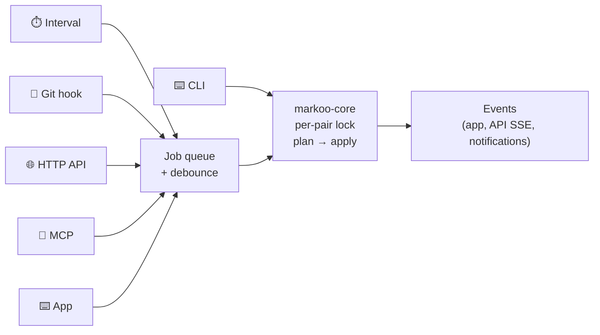
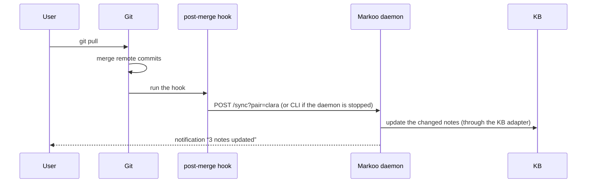
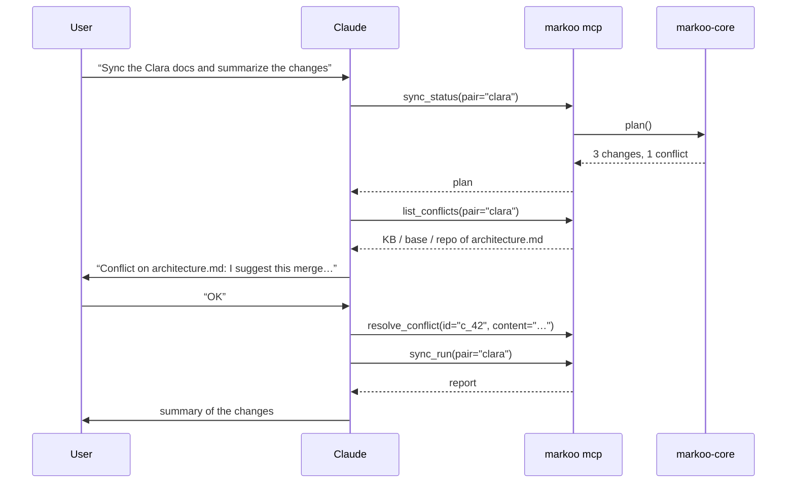

# 5. Triggers

> 🇫🇷 [Version française](../fr/05-declencheurs.md)

A sync can be started in four ways, plus the manual CLI. Interval, hook, API and MCP go through the daemon's **single job queue**. The manual CLI runs the engine directly. Every one of them needs the **pair's lock**, so two simultaneous triggers on the same pair never run two syncs in parallel: a sync that finds the lock taken stops with a `busy` error, without writing anything.



**Debounce**: requests received while a sync is running are merged into a single extra sync, started once the current one finishes. A dry run is never merged into a real sync.

## 1. Time interval

```toml
[schedule]
interval = "5m"        # 30s, 5m, 1h… ; "off" to disable
on_startup = true      # sync when the daemon starts
pause_on_battery = false # not implemented yet: accepted and ignored, with a warning
```

- The `tokio` scheduler syncs every pair at each interval, except paused pairs and pairs failing validation.
- `markoo daemon` runs in the foreground. On macOS, `markoo daemon install` runs it as a `launchd` service for the current user, using the configuration and data folders in use at that moment; it refuses to install when that configuration is missing or invalid, since the daemon could not start. `markoo daemon uninstall` removes it.
- A data folder has only one daemon at a time (`<data>/daemon.lock`).
- `markoo.toml` is checked every few seconds. A pair whose settings changed, or a new one, is synced at once; changes to `[api]` need a restart. While the file is invalid, the daemon **suspends its syncs**: using the previous settings could write in a direction the user has just changed.
- The fast comparison (`mtime` + size) makes a no-op sync almost free, so short intervals are fine.
- **Planned**: a `watch` mode based on file system events (`notify`, FSEvents on macOS), with a debounce of a few seconds.

## 2. Git hooks

```bash
markoo hook install --pair clara
```

Installs hooks in the pair's repository that call Markoo:

| Hook | When | Purpose |
|------|------|---------|
| `post-merge` | after `git pull` / `git merge` | bring docs changed by the team into the KB |
| `post-checkout` | after switching branches | align the KB with the current branch (optional) |
| `post-commit` | after a local commit | usually nothing new to propagate; acts as a checkpoint |
| `pre-commit` | before a commit | **check** that no Markoo conflict remains (optional, blocking) |



- The hook **never fails** because of Markoo (except `pre-commit`, if enabled): errors are logged and Git carries on.
- Existing hooks are preserved: Markoo appends itself at the end, between two `# >>> markoo` / `# <<< markoo` markers. The `husky` and `lefthook` managers are detected, and a configuration snippet is suggested instead.
- Branches can be filtered (`hook_branches = ["main"]`) to sync only the main branch.

## 3. Local HTTP API

Served by `axum`, on `127.0.0.1` only (default port `4848`). Authentication uses a random token stored in `<data>/token` (`Authorization: Bearer …` header).

| Method | Route | Purpose |
|--------|-------|---------|
| `GET` | `/health` | daemon status |
| `GET` | `/pairs` | list of configured pairs |
| `GET` | `/pairs/{pair}/status` | current plan (nothing applied) |
| `GET` | `/pairs/{pair}/diff?path=…` | diff of one file, or of every file without `path` |
| `POST` | `/pairs/{pair}/sync` | start a sync (`{"dry_run": false}`) → `202` + job id |
| `GET` | `/jobs/{id}` | status and report of a job |
| `POST` | `/pairs` | create a pair |
| `GET` | `/pairs/{pair}/config` | pair configuration |
| `PATCH` | `/pairs/{pair}/config` | update the pair (direction, filters…); returns the plan preview |
| `DELETE` | `/pairs/{pair}` | delete the pair (files are left untouched) |
| `GET` | `/conflicts` | pending conflicts and divergences |
| `POST` | `/conflicts/{id}/resolve` | `{"keep": "kb" \| "repo" \| "both"}`, `{"content": "…"}` or `{"push_to_source": true}` |
| `GET` | `/events` | SSE stream: `job-started`, `job-finished`, `new-conflicts`, `config-reloaded`, `shutdown` |

Every route needs the token. Errors are `{"error": "…"}`, with `400` for an invalid request, `401` without a valid token, `404` for an unknown pair, job or conflict, and `409` when the state forbids it (pair busy or paused, conflicts pending, folder unavailable). Plans and job reports never contain file contents; only `/conflicts` does.

Sample job (`GET /jobs/{id}`):

```json
{
  "job": "j_12",
  "pair": "clara",
  "dry_run": false,
  "trigger": "api",
  "status": "done",
  "outcome": {
    "kb_type": "obsidian",
    "direction_changed": false,
    "summary": { "kb_to_repo": 2, "repo_to_kb": 1, "merged": 1, "conflicts": 1, "deleted": 0 },
    "conflicts": [{ "id": "c_5f2a91d03b7c44e8", "path": "architecture.md", "kind": "conflict" }],
    "report": { "written": [], "trashed": [], "pending": [], "not_in_source": [], "skipped": [], "attachment_conflicts": [] }
  },
  "error": null,
  "duration_ms": 184
}
```

## 4. MCP server

Markoo exposes a **Model Context Protocol** server (`rmcp` crate), usable from Claude Code, Claude Desktop or any MCP client.

- **stdio**: `markoo mcp` (the client spawns the process).
- **HTTP**: `http://127.0.0.1:4848/mcp` while the daemon is running.

```json
{
  "mcpServers": {
    "markoo": { "command": "markoo", "args": ["mcp"] }
  }
}
```

### Tools

| Tool | Parameters | Effect |
|------|-----------|--------|
| `list_pairs` | — | Configured pairs, KB type (e.g. `obsidian`) and status |
| `sync_status` | `pair?` | Current plan: what would be synced |
| `sync_diff` | `pair`, `path` | Unified diff of one file (KB ↔ repo, in canonical form) |
| `sync_run` | `pair?`, `dry_run?` | Starts a sync, returns the report |
| `list_conflicts` | `pair?` | Pending conflicts, with all three versions |
| `resolve_conflict` | `id`, `keep?` \| `content?` | Resolves a conflict or a divergence |
| `get_pair_config` | `pair` | Pair configuration (KB type, direction, filters…) |
| `update_pair_config` | `pair`, `changes` | Updates the pair; **disabled** unless `mcp.allow_config_write = true` |

### Resources

- `markoo://pairs/{pair}/status`: current status.
- `markoo://conflicts/{id}`: KB, base and repo versions of a conflict.



> **Safeguard**: the tools that write (`sync_run`, `resolve_conflict`) are annotated as *destructive* in MCP, which lets the client ask the user for confirmation.

## Shared security

- Listens on `127.0.0.1` only, never on `0.0.0.0`.
- Regenerable API token (`markoo token rotate`), applied without restarting the daemon. The `token` file can only be read by its owner.
- Incoming paths (API, MCP) are normalized and **confined** to the pair: no reads or writes outside the configured folders (protection against `../`).
