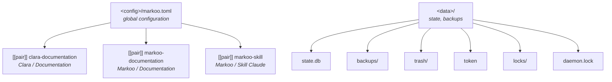
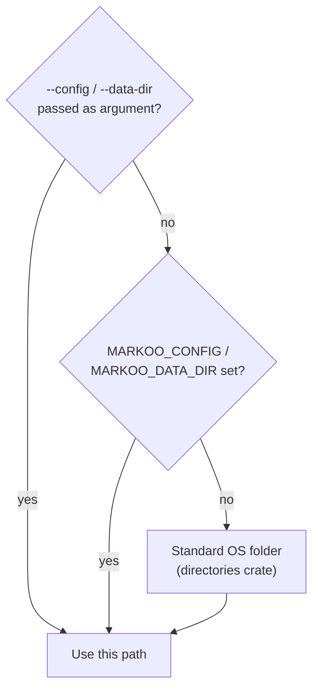
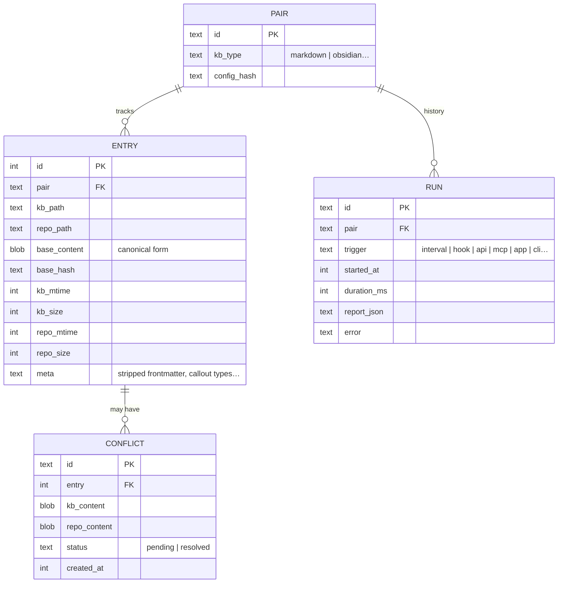

# 6. Configuration

> 🇫🇷 [Version française](../fr/06-configuration.md)

## Locations

Markoo keeps two things **outside the knowledge base (KB) and outside the repo**, so that neither the KB tool (e.g. Obsidian) nor Git gets cluttered:

- the **configuration** (`<config>`): the `markoo.toml` file, which the user may edit;
- the **state** (`<data>`): the database, with the history, backups, the trash and the API token, managed by Markoo alone.



### Paths per operating system

Each OS has its own convention; Markoo follows it instead of forcing a Unix path.

| OS | `<config>` | `<data>` | Convention |
|----|------------|----------|------------|
| **Linux** | `~/.config/markoo/` | `~/.local/share/markoo/` | XDG (honors `$XDG_CONFIG_HOME` and `$XDG_DATA_HOME`) |
| **macOS** | `~/Library/Application Support/dev.markoo.markoo/` | `~/Library/Application Support/dev.markoo.markoo/` | Apple: a single folder per application |
| **Windows** | `%APPDATA%\markoo\markoo\config\` | `%LOCALAPPDATA%\markoo\markoo\data\` | Known Folders |

On Windows, state goes in `%LOCALAPPDATA%` (local) rather than `%APPDATA%` (roaming): `state.db` holds machine-specific paths, and a SQLite database must not be copied from one machine to another by a roaming profile.

The `markoo paths` command prints the paths actually in use.

### Resolution



### Implementation rules

- **No hard-coded paths.** The `markoo-core::paths` module is the only one that computes `<config>` and `<data>`, using `directories::ProjectDirs::from("dev", "markoo", "markoo")`.
- **A single source of truth for the CLI and the app.** The Tauri app does **not** use `app.path().app_data_dir()` for Markoo's files: on Linux and Windows, Tauri would return a different folder than the CLI, and each would end up with its own database (conflicts invisible from the other side). The app calls `markoo-core::paths` just like the CLI.
- The Tauri `identifier` is `dev.markoo.markoo`, so that Tauri's own folders (WebView cache, window preferences) sit alongside on macOS.
- Tests pass a temporary `<data>` through `MARKOO_DATA_DIR`, never touching the real folder.

## Full example

> This file can be edited by hand or through the [configuration UI](08-configuration-ui.md); both stay in sync and comments are preserved.

```toml
# <config>/markoo.toml

[general]
log_level = "info"
backups_keep = 20          # number of backups kept per file
language = "en"            # en | fr: language of the configuration UI

[schedule]
interval = "5m"
on_startup = true

[api]
enabled = true
port = 4848

[mcp]
http = true                # also expose /mcp on the API
allow_config_write = false # may an agent change the configuration?

# ---------------------------------------------------------------
[[pair]]
id      = "clara-documentation" # stable, written when the pair is created; never changes
name    = "Documentation"  # free text, can be renamed at any time
project = "Clara"          # pairs sharing a project are shown together
kb      = "~/Obsidian/Knowledge/Projets/Clara"
kb_type = "obsidian"       # markdown | obsidian; logseq | foam | dendron after v1. Detected if omitted
repo    = "~/Projets/lerebours/clara/docs"

include = ["**/*.md"]
exclude = ["brouillons/**", "**/_*.md"]

conflict  = "ask"          # ask | prefer-kb | prefer-repo | markers
direction = "both"         # both | kb-to-repo | repo-to-kb
target_changes = "protect" # protect | overwrite (one-way modes)
paused = false

[pair.transform]                # generic options, valid for any KB type
links          = "markdown"     # markdown | keep
filenames      = "preserve"     # preserve | kebab
assets_dir     = "assets"
frontmatter    = "filter"       # keep | filter | drop
strip_comments = false

[pair.kb_options]               # adapter-specific options (here: obsidian)
callouts       = "github"       # github | keep
inline_embeds  = false
frontmatter_drop = ["cssclasses", "aliases", "publish"]

[pair.hooks]
install  = ["post-merge"]
branches = ["main"]

# ---------------------------------------------------------------
[[pair]]
id      = "markoo-documentation"
name    = "Documentation"        # same name as in Clara: names are unique within a project only
project = "Markoo"
kb      = "~/Obsidian/Knowledge/Projets/Markoo/Documentation"   # kb_type omitted: detected (.obsidian/ present)
repo    = "~/Projets/opensource/markoo/documentation"
direction = "repo-to-kb"        # the repo is the reference, the KB only reads
target_changes = "protect"      # an edit in the KB is reported, never overwritten

[[pair]]
id      = "markoo-skill"
name    = "Skill Claude"
project = "Markoo"              # second pair of the same project
kb      = "~/Obsidian/Knowledge/Projets/Markoo/Skill"
repo    = "~/Projets/opensource/markoo/skill"
```

## Pair option reference

| Key | Type | Default | Description |
|-----|------|---------|-------------|
| `id` | text | the `name` | Stable identifier, unique across all pairs: lowercase letters, digits and hyphens. Written by Markoo when it creates the pair, then never changed; see [Id and name](#id-and-name) |
| `name` | text | **required** | Name shown in the app and the CLI: free text, 1 to 64 characters, unique within the project. Can be changed at any time |
| `project` | text | none | Project the pair belongs to; pairs sharing a project are grouped. Required when a pair is added by Markoo, see [Projects](#projects) |
| `kb` | path | **required** | Folder on the knowledge base (KB) side |
| `kb_type` | enum | detected | KB type: `markdown`, `obsidian` in v1 (see [Supported knowledge base types](09-knowledge-bases.md#supported-knowledge-base-types)); detected by the adapters if omitted |
| `repo` | path | **required** | Folder on the Git repository side |
| `include` | list of globs | `["**/*.md"]` | Tracked files |
| `exclude` | list of globs | `[]` | Ignored files, on top of the built-in exclusions |
| `conflict` | enum | `ask` | Strategy when changes overlap |
| `direction` | enum | `both` | Direction: `both`, `kb-to-repo`, `repo-to-kb` (see [Sync direction](03-sync-algorithm.md#sync-direction)) |
| `target_changes` | enum | `protect` | One-way modes: `protect` (divergence reported) or `overwrite` (strict mirror) |
| `paused` | boolean | `false` | Suspends the pair for all triggers |
| `transform.*` | — | see above | Generic options, see [Transformations](04-transformations.md) |
| `kb_options.*` | — | adapter-dependent | Adapter-specific options (e.g. Obsidian: callouts, embeds, frontmatter filtering), see [Obsidian adapter](09-knowledge-bases.md#obsidian-adapter) |
| `hooks.install` | list | `["post-merge"]` | Hooks set up by `markoo hook install`: `post-merge`, `post-checkout`, `post-commit`, `pre-commit`. Nothing is installed until that command runs, see [Triggers](05-triggers.md#2-git-hooks) |
| `hooks.branches` | list | `[]` | Branches the hooks act on; empty means all of them |

### Projects

A **project** groups the pairs that belong together, for example the documentation and the skill of the same software. It is the `project` key of each of its pairs:

```toml
[[pair]]
id      = "markoo-documentation"
name    = "Documentation"
project = "Markoo"
kb      = "~/Obsidian/Knowledge/Projets/Markoo/Documentation"
repo    = "~/Projets/opensource/markoo/documentation"

[[pair]]
id      = "markoo-skill"
name    = "Skill Claude"
project = "Markoo"
kb      = "~/Obsidian/Knowledge/Projets/Markoo/Skill"
repo    = "~/Projets/opensource/markoo/skill"
```

- The name is free text, from 1 to 64 characters, on one line, without spaces at either end and without `/`: `"Markoo"`, `"Web site"`.
- The project is named when its first pair is created; the next pairs pick it or name a new one. `markoo pair add`, the app and the API refuse a new pair without a project.
- The spelling already in use wins, regardless of case: a pair added to `markoo` joins the existing `Markoo` project instead of starting a second one.
- In a file written by hand, the key is optional, so files from before projects keep loading. Pairs without a project are listed apart, after the projects. Give them one with `markoo pair set <pair> project <name>`, which also moves a pair to another project.
- A project has no settings of its own: it exists as long as one of its pairs names it.
- Two projects can each have a pair with the same name, for example `Documentation`: the pairs are told apart by their id, see below.

### Id and name

A pair has an **id** for Markoo and a **name** for you:

| | `id` | `name` |
|---|------|--------|
| Use | Key of everything Markoo keeps about the pair: state, history, pending conflicts, locks, `backups/` and `trash/` folders, Git hooks | Shown in the app, in `markoo pair list` and in messages |
| Form | Lowercase letters, digits and hyphens: `markoo-documentation` | Free text, 1 to 64 characters on one line, without spaces at either end and without `/`: `"Documentation technique"`, `"Skill Claude (prod)"` |
| Unique | Across all pairs | Within its project, regardless of case |
| Changes | Never | At any time |

- Markoo writes the `id` when it creates the pair, from the project and the name: `Markoo` and `Documentation` give `markoo-documentation`. Accents are dropped, other characters become hyphens, and a number is added if the id is taken (`markoo-documentation-2`). When the project and the name give the same text, the id is that text alone: `Clara` and `clara` give `clara`.
- The id is not recomputed afterwards: renaming the pair or moving it to another project keeps it.
- Rename a pair with `markoo pair set <pair> name "Documentation technique"`, or in the **General** tab of the app. Its history, pending conflicts and Git hooks stay with it.
- The id cannot be changed: `markoo pair set <pair> id …` is refused. Editing it by hand in `markoo.toml` makes Markoo see a new pair, without history, and leaves the installed hooks calling the old id.
- In a file written by hand, `id` is optional: without it, the id is the name, so files written before ids existed keep their state and hooks. Such a name must then follow the id form. Renaming such a pair first writes its current name as its `id`.

### Designate a pair

The CLI, the API and MCP accept a pair in three forms, tried in this order:

1. its **id**: `markoo-documentation`;
2. **`Project/Name`**, regardless of case: `Markoo/Documentation`, `"markoo/skill claude"`;
3. its **name** alone, regardless of case, when no other project has a pair with that name: `"Skill Claude"`.

A name shared by several projects is refused and the candidates are listed:

```text
"Documentation" matches several pairs: Clara/Documentation, Markoo/Documentation; use project/name or the id
```

**Use the id in scripts, hooks and agent configurations**: it is the only form that never changes. In a URL, encode the other forms: `/pairs/Markoo%2FSkill%20Claude/status`. JSON outputs (`--json`, API, MCP) give the id in their `"pair"` fields; the pair listings of the API and MCP also give `name`, `project` and `label` (`Project/Name`).

### Conflict strategies

| Value | Behavior when changes overlap |
|-------|-------------------------------|
| `ask` | Conflict put on hold, resolved by the user (default) |
| `prefer-kb` | The KB version wins **for conflicting blocks only** |
| `prefer-repo` | The repo version wins for conflicting blocks only |
| `markers` | Writes `<<<<<<<` / `=======` / `>>>>>>>` markers on both sides |

### Load-time validation

- `kb` and `repo` exist and are folders.
- Two pairs must not overlap (same file tracked by two pairs): explicit error. The `kb` and `repo` folders of a pair must not overlap either.
- `id`, when present, has only lowercase letters, digits and hyphens, and no other pair uses it; without `id`, the name must follow that form: explicit error otherwise.
- `name` has 1 to 64 characters on one line, without spaces at either end and without `/`, and no other pair of the same project has it, regardless of case: explicit error otherwise.
- `project`, when present, has 1 to 64 characters on one line, without spaces at either end and without `/`: explicit error otherwise.
- Unknown keys in a `[[pair]]` table are refused, so that a typo such as `directon` cannot silently change the direction.
- `target_changes = "overwrite"` with `direction = "both"`: warning, the option has no effect.
- `repo` is inside a Git repository: only a warning if it is not, which remains allowed.
- `kb` is recognized by the adapter for its type: if `kb_type` is omitted, each adapter tries detection and the first one that recognizes the folder wins (`markdown` as a last resort); if `kb_type` is set and detection fails, explicit error.
- Obsidian: `kb` is inside an Obsidian vault (a `.obsidian/` exists in a parent folder): required to read the attachments folder.
- `kb_options` only contains keys known to the chosen adapter: an unknown key gives a warning.

## State database (`state.db`)


