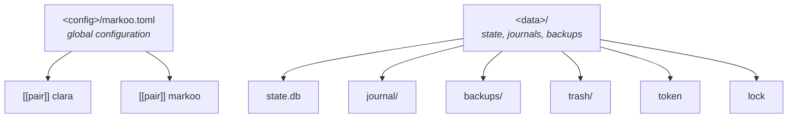
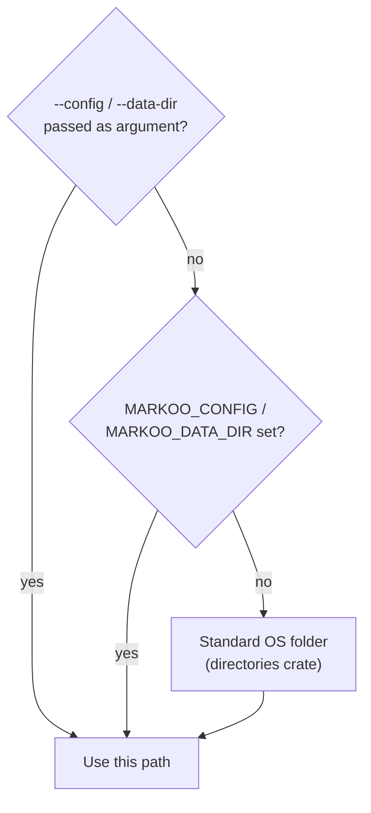
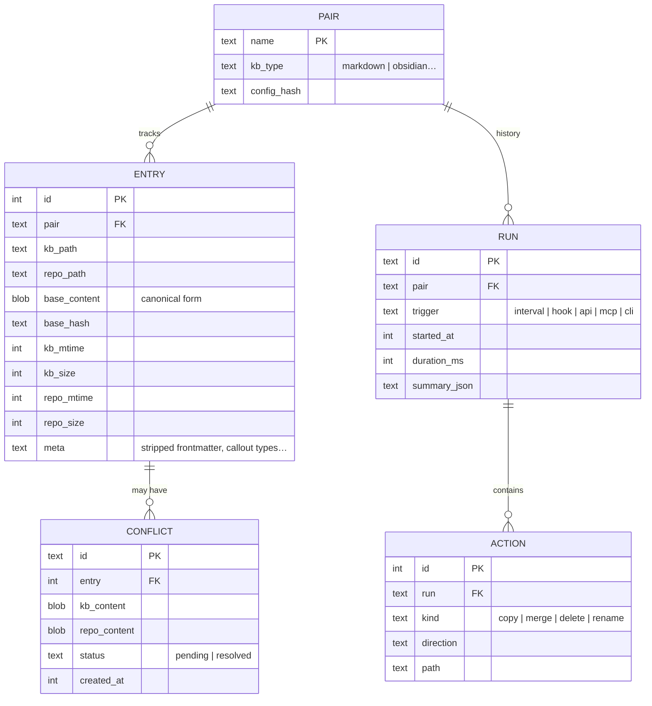

# 6. Configuration

> 🇫🇷 [Version française](../fr/06-configuration.md)

## Locations

Markoo keeps two things **outside the knowledge base (KB) and outside the repo**, so that neither the KB tool (e.g. Obsidian) nor Git gets cluttered:

- the **configuration** (`<config>`): the `markoo.toml` file, which the user may edit;
- the **state** (`<data>`): the database, the journal, backups, the trash and the API token, managed by Markoo alone.



### Paths per operating system

Each OS has its own convention; Markoo follows it instead of forcing a Unix path.

| OS | `<config>` | `<data>` | Convention |
|----|------------|----------|------------|
| **Linux** | `~/.config/markoo/` | `~/.local/share/markoo/` | XDG (honors `$XDG_CONFIG_HOME` and `$XDG_DATA_HOME`) |
| **macOS** | `~/Library/Application Support/dev.markoo.markoo/` | `~/Library/Application Support/dev.markoo.markoo/` | Apple: a single folder per application |
| **Windows** | `%APPDATA%\markoo\markoo\config\` | `%LOCALAPPDATA%\markoo\markoo\data\` | Known Folders |

On Windows, state goes in `%LOCALAPPDATA%` (local) rather than `%APPDATA%` (roaming): `state.db` holds machine-specific paths, and a SQLite database must not be copied from one machine to another by a roaming profile.

The `markoo paths` command prints the paths actually in use.

### Resolution



### Implementation rules

- **No hard-coded paths.** The `markoo-core::paths` module is the only one that computes `<config>` and `<data>`, using `directories::ProjectDirs::from("dev", "markoo", "markoo")`.
- **A single source of truth for the CLI and the app.** The Tauri app does **not** use `app.path().app_data_dir()` for Markoo's files: on Linux and Windows, Tauri would return a different folder than the CLI, and each would end up with its own database (conflicts invisible from the other side). The app calls `markoo-core::paths` just like the CLI.
- The Tauri `identifier` is `dev.markoo.markoo`, so that Tauri's own folders (WebView cache, window preferences) sit alongside on macOS.
- Tests pass a temporary `<data>` through `MARKOO_DATA_DIR`, never touching the real folder.

## Full example

> This file can be edited by hand or through the [configuration UI](08-configuration-ui.md); both stay in sync and comments are preserved.

```toml
# <config>/markoo.toml

[general]
log_level = "info"
backups_keep = 20          # number of backups kept per file

[schedule]
interval = "5m"
on_startup = true

[api]
enabled = true
port = 4848

[mcp]
http = true                # also expose /mcp on the API
allow_config_write = false # may an agent change the configuration?

# ---------------------------------------------------------------
[[pair]]
name    = "clara"
kb      = "~/Obsidian/Knowledge/Projets/Clara"
kb_type = "obsidian"       # markdown | obsidian; logseq | foam | dendron after v1. Detected if omitted
repo    = "~/Projets/lerebours/clara/docs"

include = ["**/*.md"]
exclude = ["brouillons/**", "**/_*.md"]

conflict  = "ask"          # ask | prefer-kb | prefer-repo | markers
direction = "both"         # both | kb-to-repo | repo-to-kb
target_changes = "protect" # protect | overwrite (one-way modes)
paused = false

[pair.transform]                # generic options, valid for any KB type
links          = "markdown"     # markdown | keep
filenames      = "preserve"     # preserve | kebab
assets_dir     = "assets"
frontmatter    = "filter"       # keep | filter | drop
strip_comments = false

[pair.kb_options]               # adapter-specific options (here: obsidian)
callouts       = "github"       # github | keep
inline_embeds  = false
frontmatter_drop = ["cssclasses", "aliases", "publish"]

[pair.hooks]
install  = ["post-merge"]
branches = ["main"]

# ---------------------------------------------------------------
[[pair]]
name  = "markoo"
kb    = "~/Obsidian/Knowledge/Projets/Markoo"   # kb_type omitted: detected (.obsidian/ present)
repo  = "~/Projets/opensource/markoo/documentation"
direction = "repo-to-kb"        # the repo is the reference, the KB only reads
target_changes = "protect"      # an edit in the KB is reported, never overwritten
```

## Pair option reference

| Key | Type | Default | Description |
|-----|------|---------|-------------|
| `name` | text | **required** | Unique identifier (CLI, API, MCP) |
| `kb` | path | **required** | Folder on the knowledge base (KB) side |
| `kb_type` | enum | detected | KB type: `markdown`, `obsidian` in v1 (see [Supported knowledge base types](09-knowledge-bases.md#supported-knowledge-base-types)); detected by the adapters if omitted |
| `repo` | path | **required** | Folder on the Git repository side |
| `include` | list of globs | `["**/*.md"]` | Tracked files |
| `exclude` | list of globs | `[]` | Ignored files, on top of the built-in exclusions |
| `conflict` | enum | `ask` | Strategy when changes overlap |
| `direction` | enum | `both` | Direction: `both`, `kb-to-repo`, `repo-to-kb` (see [Sync direction](03-sync-algorithm.md#sync-direction)) |
| `target_changes` | enum | `protect` | One-way modes: `protect` (divergence reported) or `overwrite` (strict mirror) |
| `paused` | boolean | `false` | Suspends the pair for all triggers |
| `transform.*` | — | see above | Generic options, see [Transformations](04-transformations.md) |
| `kb_options.*` | — | adapter-dependent | Adapter-specific options (e.g. Obsidian: callouts, embeds, frontmatter filtering), see [Obsidian adapter](09-knowledge-bases.md#obsidian-adapter) |
| `hooks.*` | — | no hooks | See [Triggers](05-triggers.md#2-git-hooks) |

### Conflict strategies

| Value | Behavior when changes overlap |
|-------|-------------------------------|
| `ask` | Conflict put on hold, resolved by the user (default) |
| `prefer-kb` | The KB version wins **for conflicting blocks only** |
| `prefer-repo` | The repo version wins for conflicting blocks only |
| `markers` | Writes `<<<<<<<` / `=======` / `>>>>>>>` markers on both sides |

### Load-time validation

- `kb` and `repo` exist and are folders.
- Two pairs must not overlap (same file tracked by two pairs): explicit error.
- `target_changes = "overwrite"` with `direction = "both"`: warning, the option has no effect.
- `repo` is inside a Git repository: only a warning if it is not, which remains allowed.
- `kb` is recognized by the adapter for its type: if `kb_type` is omitted, each adapter tries detection and the first one that recognizes the folder wins (`markdown` as a last resort); if `kb_type` is set and detection fails, explicit error.
- Obsidian: `kb` is inside an Obsidian vault (a `.obsidian/` exists in a parent folder): required to read the attachments folder.
- `kb_options` only contains keys known to the chosen adapter: an unknown key gives a warning.

## State database (`state.db`)


