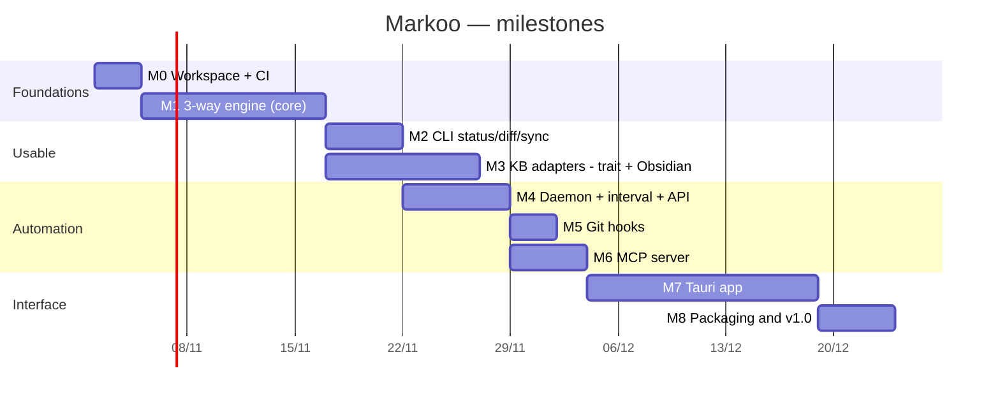

# 7. Roadmap

> 🇫🇷 [Version française](../fr/07-feuille-de-route.md)

> Durations are rough and mostly serve to order the work.

## Milestones

### M0 — Foundations
- Cargo workspace (`markoo-core`, `markoo-cli`), `rustfmt`, `clippy`.
- GitHub Actions CI: build and tests on macOS and Linux.
- Test fixtures: a mini-KB (plain Markdown folder, then a mini Obsidian vault) and a mini-repo.

**Done when**: `cargo test` passes in CI.

### M1 — Sync engine
- `scanner`, `state` (SQLite), `planner` (the 15 cases of the [classification](03-sync-algorithm.md#classification)), `merge` (3-way), `applier` (atomic, backups, trash).
- All three directions (`both`, `kb-to-repo`, `repo-to-kb`) with `protect` / `overwrite` and divergences.
- `markdown` adapter (identity, no link conversion yet): only a baseline for testing the engine, not a product target.
- Detection of exact renames.

**Done when**: every row of the classification table has a test, and replaying a sync produces no writes.

### M2 — CLI
- `init`, `status`, `diff`, `sync [--dry-run]`, `conflicts`, `resolve`.
- `pair add|list|show|set|remove`, with an interactive wizard.
- Colored output and `--json` for scripts.

**Done when**: Markoo is usable day to day on a real pair (KB ↔ `clara/docs`).

### M3 — KB adapters: trait + Obsidian (first KB)
- `KbAdapter` trait in `markoo-core::kb`: detection, file layout, dialect (`to_canonical` / `from_canonical`), name resolution (see [Adapter model](09-knowledge-bases.md#adapter-model)).
- `obsidian` adapter, **the first supported knowledge base**: wikilinks ↔ Markdown links, anchors, attachments, callouts, frontmatter; detection via `.obsidian/` and `obsidian.json`.
- `gfm` dialect on the repo side; canonical form = GFM with relative links.
- Golden tests and round-trip property tests, for each adapter.

**Done when**: a round trip of a real Obsidian vault produces no difference and links work on GitHub.

### M4 — Daemon, interval, API
- `markoo daemon`: job queue, lock, debounce, scheduler.
- HTTP API (`axum`), token, SSE stream.
- `launchd` service on macOS.

**Status**: done, and tried on a real `launchd`: `markoo daemon install` and `uninstall` work, a failed start is retried and the service stays up with a configuration. Starting at login has not been tried. Progress events are limited to the start and end of jobs: the engine does not report progress during a sync.

### M5 — Git hooks
- `markoo hook install|uninstall`, coexistence with existing hooks, husky and lefthook.

**Status**: done. Real hooks are tested on macOS and Linux only; on Windows, installing is tested, not hooks being run by Git. husky and lefthook are recognized from their files, without trying the suggested snippets in those tools.

### M6 — MCP server
- Tools and resources described in [Triggers](05-triggers.md#4-mcp-server), over stdio and HTTP.
- Testing with Claude Code.

**Status**: done, tried with Claude Code over stdio and HTTP on a sample pair. Other MCP clients have not been tried.

### M7 — Tauri app
- Menu bar, list of pairs, pending changes, history.
- Three-column conflict view with an editor.
- [Configuration UI](08-configuration-ui.md): creation wizard, direction choice, filters with preview, transformations, triggers.

**Status**: done on macOS, except that the screens were mostly checked with sample data. Not done: rollback from the history, per-pair intervals, the Linux and Windows builds of the app.

### M8 — v1.0
- Signed binaries (notarized on macOS), Homebrew formula, user documentation.

**Status**: in progress, starting with `1.0.0-rc.1`. Done: release workflow (command line for macOS, Linux and Windows, app for macOS, with the command included), user guide, changelog. Not done: signing and notarization, which the workflow applies once the Apple secrets exist; the Homebrew formula, postponed.

## After v1

- `watch` mode (file system events) alongside the interval.
- Paragraph-level merging and advanced semantic merging of frontmatter.
- Suggested commit message / branch and PR creation on the repo side.
- `logseq`, `foam` and `dendron` adapters (see [Supported knowledge base types](09-knowledge-bases.md#supported-knowledge-base-types)).
- Repo-side dialects beyond `gfm`: GitLab, MkDocs, Docusaurus.
- Exploration of remote KBs (Notion, Confluence, Outline…) through an adapter backed by an API instead of the file system.
- Obsidian plugin showing Markoo status in the sidebar (built on the API).
- LLM-assisted conflict resolution (via MCP or the Claude API).

## Identified risks

| Risk | Impact | Mitigation |
|------|--------|------------|
| Non-reversible link conversion | Spurious changes, sync loops | Property tests, `markoo:` comments for information that cannot be represented |
| Writing while Obsidian is saving | Lost keystrokes | Check right before writing, atomic writes |
| Corrupted or lost database | Everything looks “created on both sides” | Case 4 of the classification (identical content = no conflict), backup of `state.db` |
| Ambiguous wikilink resolution | Link to the wrong note | Same algorithm as the KB tool (e.g. Obsidian), warnings |
| Dialect differences between KB tools (e.g. Logseq outliner format) | Partial or lossy conversion | Adapters only convert what round-trips; unsupported constructs pass through unchanged |
| Large KBs | Slowness | `mtime` + size comparison before hashing, parallel scan (`rayon`) |
