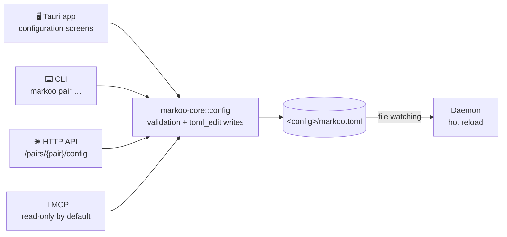
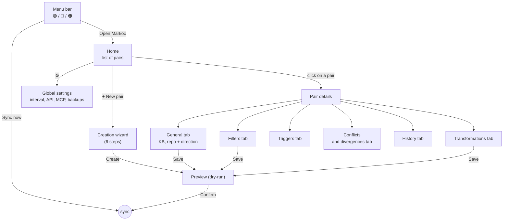
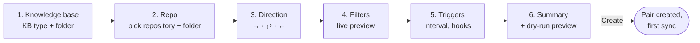
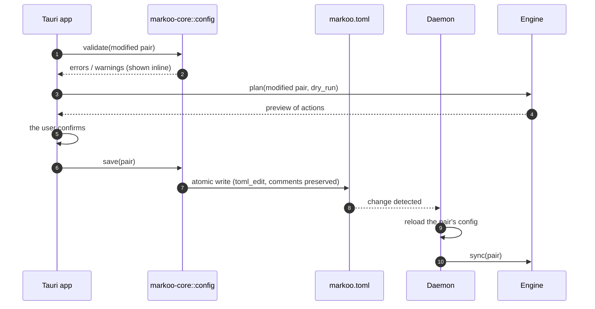

# 8. Configuration UI

> 🇫🇷 [Version française](../fr/08-interface-de-configuration.md)

Markoo must be configurable **without editing a file by hand**: creating a pair, picking the **knowledge base (KB)** and its type, the repo folder, the **sync direction**, filters, transformations and triggers.

> **Status**: this page describes the target. What exists today is listed in the [roadmap](07-roadmap.md#m7--tauri-app). The pair page adds a **Changes** tab, which lists the plan. For now, the interval is global only, frontmatter keys are typed as a list, and options that are not implemented are not shown (file names, `strip_comments`, `inline_embeds`). Hooks run the `markoo` command, which has to be installed.

## Principles

1. **`markoo.toml` remains the source of truth.** The UI only edits that file. It uses `toml_edit`, which **preserves the user's comments and formatting**. A change made by hand in the file shows up in the UI, and vice versa.
2. **A single validation logic**, in `markoo-core::config`. The app, the CLI and the API show the same errors.
3. **Preview before applying.** Any change that affects what will be synced (folders, KB type, direction, filters) is followed by a **preview** (dry-run) before the first sync.
4. **Defaults are safe**: bidirectional, `protect` for one-way modes, `ask` for conflicts.

## Access points



| Access | Read | Write |
|--------|------|-------|
| Tauri app | ✅ | ✅ |
| CLI | ✅ `markoo pair list` / `show` | ✅ `markoo pair add` / `edit` / `set` / `remove` |
| HTTP API | ✅ `GET /pairs/{pair}/config` | ✅ `POST /pairs`, `PATCH /pairs/{pair}/config`, `DELETE /pairs/{pair}` |
| MCP | ✅ `get_pair_config` | ❌ by default; can be enabled with `mcp.allow_config_write = true` (`update_pair_config` tool) |

Configuration writes by an AI agent are disabled by default: changing a direction or a folder can cause massive writes on the next sync.

## App navigation



## Screens

### Home: list of pairs

```text
┌─ Markoo ──────────────────────────────────────────────────── ⚙️ ─┐
│                                                                  │
│  Pairs                                         [ + New ]         │
│                                                                  │
│  ● clara      Obsidian  Projets/Clara  ⇄  clara/docs             │
│               ✅ Up to date · 2 min ago · every 5 min            │
│                                                                  │
│  ● markoo     Obsidian  Projets/Markoo  ←  markoo/documentation  │
│               ⚠️ 1 divergence · 1 h ago · post-merge hook        │
│                                                                  │
│  ○ notes-api  Markdown  ~/notes/api  →  api/docs       (paused)  │
│                                                                  │
└──────────────────────────────────────────────────────────────────┘
```

Each pair shows the **type of its KB** (icon or label: Obsidian, Markdown…), then the KB folder and the repo folder. The arrow between the two folders always shows the direction: `⇄` bidirectional, `→` KB to repo, `←` repo to KB.

### General tab: KB, repo and direction

```text
┌─ clara › General ────────────────────────────────────────────────┐
│                                                                  │
│  Name           [ clara                     ]                    │
│                                                                  │
│  KB type        [ Obsidian (detected)   ▾ ]                      │
│  KB             [ ~/Obsidian/Knowledge/Projets/Clara ] [Browse]  │
│                 ✓ Obsidian vault “Knowledge” detected            │
│  Repo           [ ~/Projets/lerebours/clara/docs     ] [Browse]  │
│                 ✓ Git repository, branch main                    │
│                                                                  │
│  Sync direction                                                  │
│  ┌──────────────────┐ ┌──────────────────┐ ┌──────────────────┐  │
│  │   KB  →  Repo    │ │   KB  ⇄  Repo    │ │   KB  ←  Repo    │  │
│  │                  │ │   ◉ selected     │ │                  │  │
│  │ The KB is the    │ │ Writing on       │ │ The repo is the  │  │
│  │ reference        │ │ both sides       │ │ reference        │  │
│  └──────────────────┘ └──────────────────┘ └──────────────────┘  │
│                                                                  │
│  If the target is changed (one-way modes)                        │
│   ◉ Protect: report a divergence, overwrite nothing              │
│   ○ Overwrite: strict mirror of the source (with backup)         │
│                                                                  │
│  Conflicts (bidirectional mode)                                  │
│   [ Ask me                                       ▾ ]             │
│                                                                  │
│                              [ Cancel ]  [ Save and preview ]    │
└──────────────────────────────────────────────────────────────────┘
```

- The **KB type** is detected from the chosen folder (see [Knowledge bases](09-knowledge-bases.md#supported-knowledge-base-types)); it can be forced from the list. The message under the KB field comes from the adapter: Obsidian vault recognized, plain Markdown folder…
- The options shown depend on the direction: “If the target is changed” only appears for a one-way mode, and “Conflicts” only for bidirectional mode.
- The **Save and preview** button opens the preview (dry-run) instead of saving directly when the change affects folders, KB type, direction or filters.

### Filters tab

```text
┌─ clara › Filters ────────────────────────────────────────────────┐
│  Include    [ **/*.md                                  ] [+]     │
│  Exclude    [ brouillons/**                            ] [−]     │
│             [ **/_*.md                                 ] [−]     │
│                                                                  │
│  Live preview: 42 files tracked · 7 excluded                     │
│   ✓ architecture.md                                              │
│   ✓ adr/001-stack.md                                             │
│   ✗ brouillons/idees.md               (excluded: brouillons/**)  │
└──────────────────────────────────────────────────────────────────┘
```

The preview is recomputed on every keystroke; it uses the same scanner as the sync, so there are no surprises.

### Transformations tab

Toggles and lists for the [Transformations](04-transformations.md) options, in two groups:

- **Generic options** (`[pair.transform]`): link conversion, attachments folder, frontmatter (checkboxes per key found in the notes), file names (`preserve` / `kebab`, with a sample rename).
- **Adapter options** (`[pair.kb_options]`): they depend on the KB type. For Obsidian: wikilinks, callouts, embeds, frontmatter keys dropped by default (see [Obsidian adapter](09-knowledge-bases.md#obsidian-adapter)). The `markdown` adapter has none.

A **before / after** panel shows the effect on a real note from the pair.

### Triggers tab

| Setting | Control |
|---------|---------|
| Interval | Global or per-pair value (`off`, `30s`, `5m`, `1h`…) |
| Git hooks | `post-merge`, `post-checkout`, `pre-commit` checkboxes; **Install / Uninstall** button; branches covered |
| API / MCP | Read-only: shows the URL and the command to copy |
| Pause | “Suspend this pair” toggle |

## Creation wizard



- **Step 1**: first the **KB type** is chosen (auto-detected when possible), then the folder. Known KBs are suggested by the adapter: the Obsidian one reads the app's `obsidian.json` file (`~/Library/Application Support/obsidian/` on macOS, `~/.config/obsidian/` on Linux, `%APPDATA%\obsidian\` on Windows); other adapters may suggest nothing and just offer a folder picker. A folder can always be picked by hand.
- **Step 2**: the picker checks that the folder is inside a Git repository and shows the current branch.
- **Step 3**: the three direction cards, with bidirectional mode preselected.
- **Step 6, first sync of a new pair**: if both folders already contain files, the preview highlights files present on both sides with different content (case 5 of the [classification](03-sync-algorithm.md#classification)) so the user can deal with them before starting. It also counts the files going to each side, and warns about those going to the KB that Git does not track in the repo: they may have nothing to do with the repository.

## Saving a change



### Live validation

The [load-time validation](06-configuration.md#load-time-validation) rules apply while typing, plus:

- pair name unique and URL-safe (`[a-z0-9-]+`);
- switching from `both` to a one-way direction is **refused** while conflicts are still pending (see [Changing direction](03-sync-algorithm.md#changing-direction));
- choosing `overwrite`: explicit warning, with the number of target files that would be modified or moved to the trash.

## Equivalent CLI

Everything the UI does can be done from the command line:

```bash
markoo pair add clara --kb ~/Obsidian/Knowledge/Projets/Clara --kb-type obsidian --repo ~/Projets/lerebours/clara/docs --direction both
```

```bash
markoo pair set clara direction kb-to-repo --target-changes protect
```

```bash
markoo pair list
```

`--kb-type` is optional: without it, the type is detected from the folder. Without arguments, `markoo pair add` runs the same wizard interactively in the terminal.
