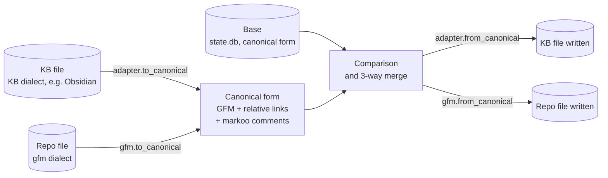
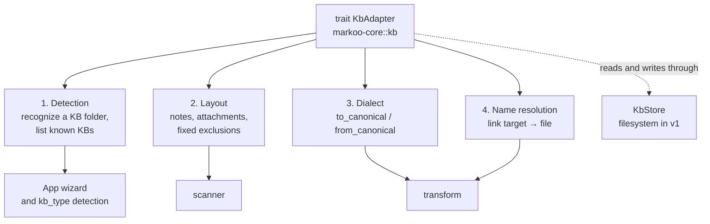
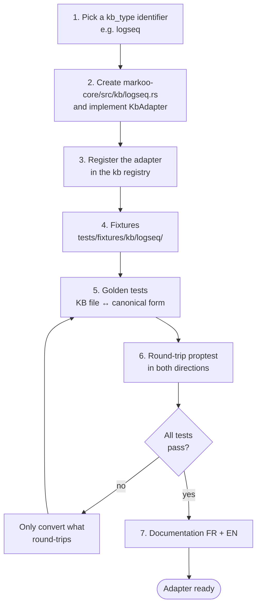

# 9. Knowledge bases

> 🇫🇷 [Version française](../fr/09-bases-de-connaissance.md)

Markoo syncs Markdown between a **knowledge base (KB)** and a **local Git repository**. Obsidian is only **one** of the possible KB types: each type is handled by an **adapter** that recognizes the KB, knows its layout and converts its Markdown dialect to a common form.

**Obsidian is the first knowledge base implemented** (reference adapter, milestone M3). The `markdown` adapter, which converts nothing, is the engine's baseline for milestone M1 tests and a fallback; it is not a product target.

> [!NOTE]
> In French, "base" always means the **merge ancestor** (state at the last sync), so "base de connaissance" is never shortened to "base". In both languages, "KB" or the full term is used.

## Adapter model

Each side of a pair speaks a **dialect**: the KB's (Obsidian wikilinks and callouts, Logseq `key:: value` properties…) and the repo's, `gfm` (GitHub Flavored Markdown). Both are converted to a single **canonical form**; Markoo compares, merges and stores the base on that form.



### Canonical form

The canonical form is **standard GitHub Flavored Markdown with relative links**, plus invisible HTML comments `<!--markoo:…-->` carrying what GFM cannot represent (target of a wikilink outside the pair, original callout type, block reference…).

**Invariant**: for every adapter, the round trip is lossless in both directions.

- `to_canonical(from_canonical(x)) == x` for any canonical text `x`;
- `from_canonical(to_canonical(y)) == y` for any KB file `y`.

A construct that cannot round-trip is **not converted**: it passes through unchanged on both sides. The conversions are detailed in [Transformations](04-transformations.md).

### Adapter responsibilities



| Responsibility | Role | Obsidian example |
|----------------|------|------------------|
| **Detection** | Recognize a KB folder; suggest the KBs known to the tool | `.obsidian/` folder; vaults listed in `obsidian.json` |
| **Layout** | Say which files are notes, which are attachments, where new attachments go, what is always excluded | Excludes `.obsidian/` and `.trash/`; attachments folder read from `.obsidian/app.json` |
| **Dialect** | Convert links, embeds, callouts, properties and comments to and from the canonical form | `[[Note]]` ↔ `[Note](./note.md)` |
| **Name resolution** | Find the file a link target points to | By note name, shortest path |

### The `KbAdapter` trait

Indicative sketch; exact signatures will be settled in milestone M3.

```rust
/// Implemented by each knowledge base type (module markoo-core::kb).
pub trait KbAdapter: Send + Sync {
    /// Identifier used in the `kb_type` key (e.g. "obsidian").
    fn id(&self) -> &'static str;

    // 1. Detection
    /// Is the folder (or one of its parents) a KB of this type?
    fn detect(&self, folder: &Path) -> Option<Detection>;
    /// KBs known to the tool, suggested by the wizard (may be empty).
    fn known_kbs(&self) -> Vec<KnownKb>;

    // 2. Layout
    fn layout(&self, root: &Path, opts: &KbOptions) -> Result<Layout>;

    // 3. Dialect
    fn to_canonical(&self, text: &str, ctx: &ConvertCtx) -> Result<String>;
    fn from_canonical(&self, text: &str, ctx: &ConvertCtx) -> Result<String>;

    // 4. Name resolution
    fn resolve(&self, target: &str, from: &EntryPath, index: &NameIndex) -> Resolution;
}

pub struct Layout {
    pub notes: GlobSet,              // e.g. **/*.md
    pub attachments: GlobSet,        // images, PDFs…
    pub attachments_dir: PathBuf,    // where new attachments go
    pub excluded: GlobSet,           // fixed exclusions, on top of the pair's filters
}

/// Access to the KB's entries: filesystem in v1,
/// a remote API would remain possible later.
pub trait KbStore: Send + Sync {
    fn list(&self) -> Result<Vec<Entry>>;
    fn read(&self, path: &EntryPath) -> Result<Vec<u8>>;
    fn write(&self, path: &EntryPath, bytes: &[u8]) -> Result<()>;
}
```

### Repo dialect

The repo side has a dialect too, **`gfm`** in v1: relative Markdown links, GitHub *alerts* (`> [!NOTE]`), YAML frontmatter. Since the canonical form is already GFM, `gfm` only strips or restores the `markoo` comments and applies the generic `[pair.transform]` options (file names, attachments folder, frontmatter filtering). Other repo dialects (`gitlab`, `mkdocs`, `docusaurus`) could be chosen per pair after v1.

## Supported knowledge base types

| `kb_type` | KB | Status | Notes |
|-----------|----|--------|-------|
| `markdown` | Plain Markdown folder | v1 | Identity dialect, no conversion. Fallback for any unknown tool. |
| `obsidian` | Obsidian | v1 (reference adapter) | Wikilinks, embeds, callouts, frontmatter, attachments folder read from `.obsidian/app.json`. |
| `logseq` | Logseq (file-based graphs) | after v1 | Outliner format (bullets `- `), `[[page]]` links, `key:: value` properties, `pages/` + `journals/`, namespaces. |
| `foam` | Foam (VS Code) | after v1 | Wikilinks + link reference definitions at the end of the file. |
| `dendron` | Dendron | after v1 | Dot-hierarchy file names `a.b.c.md`, `id` key in the frontmatter. |
| Remote KBs (Notion, Confluence, Outline…) | | exploration, not planned | Would need an adapter backed by an API instead of the filesystem. |

If `kb_type` is missing from the configuration, Markoo calls each adapter's `detect()`, from most specific to most general, and keeps the first one that recognizes the folder; otherwise it uses `markdown`. The detected type is written to `markoo.toml` when the pair is created so that the behavior does not change afterwards.

## Markdown adapter

The `markdown` adapter: a folder of `.md` files with no particular tool.

- **Detection**: recognizes any folder; it is the fallback when no other adapter applies. It suggests no known KBs.
- **Layout**: `*.md` files are notes; files referenced by a note are attachments, stored next to the note or in `assets_dir`.
- **Dialect**: identity. The content is already in canonical form.
- **Name resolution**: relative paths only.

Its role is primarily technical: the milestone M1 engine (scanner, state, planner, merge) is tested with it, without any conversion, before the Obsidian adapter arrives.

## Obsidian adapter

The `obsidian` adapter, **the first knowledge base implemented** and the reference for the next ones. An Obsidian KB is called a **vault**.

### Detection

- A folder is a vault if it contains `.obsidian/`, or if one of its parents does (a pair may cover only a subfolder of the vault).
- Known vaults are read from the app's `obsidian.json` file, which the wizard suggests in step 1:

| System | Location of `obsidian.json` |
|--------|-----------------------------|
| macOS | `~/Library/Application Support/obsidian/` |
| Linux | `~/.config/obsidian/` |
| Windows | `%APPDATA%\obsidian\` |

### Layout

- **Notes**: `*.md` files. `.canvas` files are not converted.
- **Fixed exclusions**: `.obsidian/` and `.trash/`, whatever the pair's filters.
- **Attachments**: a new attachment coming from the repo is stored in the folder configured in Obsidian (`attachmentFolderPath` key of `.obsidian/app.json`), or next to the note otherwise.
- **New link format**: the `useMarkdownLinks` and `newLinkFormat` settings in `.obsidian/app.json` decide the form produced by `from_canonical` (wikilink or Markdown link, shortest or relative path).

### Dialect

| Obsidian construct | Canonical form |
|--------------------|----------------|
| `[[Note]]`, `[[Note\|alias]]`, `[[Note#Heading]]` | Relative Markdown link, GitHub-style anchor |
| `![[image.png]]`, `![[image.png\|300]]` | `` or `` |
| `![[Other note]]` | Link + `markoo:embed` comment |
| `> [!info]` and other callouts | GitHub *alert* (`> [!NOTE]`); original type in a comment |
| Properties (YAML frontmatter) | YAML frontmatter, filtered according to the options |
| `%% comment %%`, `^block-id` | Kept as is |

The detailed rules (anchors, attachments, callouts, frontmatter, file names) are in [Transformations](04-transformations.md).

### Name resolution

Same as Obsidian: exact path match, otherwise a unique note name in the vault, otherwise the file closest to the current note (shortest path), with a warning when ambiguous. The `name → path` index covers **the whole vault**, not just the pair, to tell a target outside the pair from a missing target.

### Options

Obsidian-specific options live in `[pair.kb_options]`:

```toml
[pair.kb_options]                  # kb_type = "obsidian"
callouts         = "github"        # github | keep
inline_embeds    = false           # true: insert the content of embedded notes
frontmatter_drop = ["cssclasses", "aliases", "publish"]
```

## Logseq adapter (after v1)

**File-based** Logseq graphs (not the database version). Layout: `pages/`, `journals/`, attachments in `assets/`, `logseq/` and `logseq/.recycle/` excluded; detection through `logseq/config.edn`. Dialect: `[[page]]` links, `key:: value` properties, `a/b` namespaces. The bullet structure (`- `) is **kept as is**: turning it into prose would lose information.

## Foam adapter (after v1)

Foam workspaces in VS Code. Wikilinks, plus the **link reference definitions** Foam adds at the end of files (`[note]: note.md "Note"`): they are already standard Markdown, so the adapter just strips or restores them reversibly.

## Dendron adapter (after v1)

**Dot** hierarchy in file names (`projet.clara.archi.md`), detection through `dendron.yml`, stable identifier in the frontmatter `id` key. Name resolution follows the hierarchy; the `filenames` option decides whether `a.b.c.md` becomes `a/b/c.md` on the repo side.

## Remote knowledge bases (exploration)

Notion, Confluence, Outline… do not store their pages in files. An adapter backed by an API would be needed. The `KbAdapter` trait reads and writes entries through the `KbStore` abstraction so that this stays possible one day, but v1 only handles **file-based** KBs and nothing is planned.

## Adding an adapter



1. **Implement the** `KbAdapter` **trait** in `markoo-core::kb`, with its four responsibilities, and add it to the adapter registry (detection order).
2. **Fixtures**: a small, realistic KB in `tests/fixtures/kb/<kb_type>/`, with the tool's own constructs and a few edge cases.
3. **Golden tests**: `input.md` / `canonical.md` pairs for `to_canonical`, and the reverse for `from_canonical`.
4. **Property test** (`proptest`): `from_canonical(to_canonical(y)) == y` on KB files and `to_canonical(from_canonical(x)) == x` on canonical text. Any construct that fails is left as is rather than converted.
5. **Documentation in French and English**: a section in this document, a row in the [supported types](#supported-knowledge-base-types) table, the `[pair.kb_options]` options in [Configuration](06-configuration.md) and new terms in the [glossary](glossary.md).
