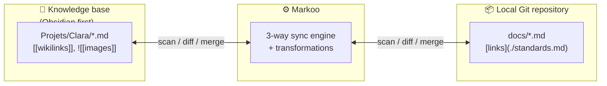

# Markoo — Documentation

> 🇫🇷 [Version française](../fr/README.md)

  <picture>
    <source media="(prefers-color-scheme: dark)" srcset="../../assets/logo-mark-name-dark.svg">
    
  </picture>

**Markoo** is a smart sync connector between a **knowledge base** (KB) and one or more locally cloned **Git repositories**. Each knowledge base type is handled by an adapter; **Obsidian** is the first one implemented. It keeps Markdown documentation consistent on both sides: the knowledge base stays up to date with the project, and the project benefits from what is written in the knowledge base.

## Contents

| # | Document | Content |
|---|----------|---------|
| 1 | [Vision and scope](01-vision-and-scope.md) | Problem, goals, non-goals, use cases |
| 2 | [Architecture](02-architecture.md) | Rust workspace, crates, Tauri app, data flow |
| 3 | [Sync algorithm](03-sync-algorithm.md) | Change detection, sync direction, 3-way merge, conflicts, renames |
| 4 | [Transformations](04-transformations.md) | Conversion pipeline; Obsidian adapter rules: links, attachments, frontmatter, file names |
| 5 | [Triggers](05-triggers.md) | Interval, Git hooks, HTTP API, MCP server |
| 6 | [Configuration](06-configuration.md) | `markoo.toml` format, per-OS locations (`<config>`, `<data>`) |
| 7 | [Roadmap](07-roadmap.md) | Milestones and exit criteria |
| 8 | [Configuration UI](08-configuration-ui.md) | Screens, wizard, direction choice, configuration CLI and API |
| 9 | [Knowledge bases](09-knowledge-bases.md) | Adapter model, supported types (Obsidian first), adding an adapter |
| 10 | [User guide](10-user-guide.md) | Install, first pair, daily use, recovering files |
| — | [Glossary](glossary.md) | Project vocabulary |

## Decisions already made

| Topic | Decision |
|-------|----------|
| Language | Rust (Cargo workspace) |
| Knowledge bases | Several types through adapters; **Obsidian** is the first implemented |
| Interface | **Tauri 2** desktop application + CLI |
| Direction | Per pair: KB → repo, repo → KB, or bidirectional (default) |
| Conflicts | Automatic 3-way merge; the user only decides real conflicts |
| Links | Conversion of the KB dialect (e.g. Obsidian `[[wikilinks]]`) ↔ standard Markdown links |
| Triggers | Time interval, Git hook, local HTTP API, MCP server |
| Storage | Outside the knowledge base and the repo, in each OS's standard folders (Linux, macOS, Windows) |
