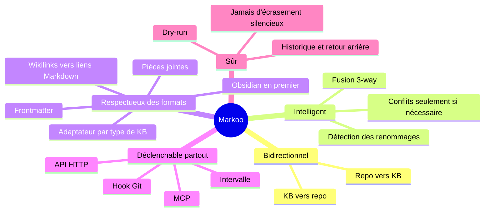
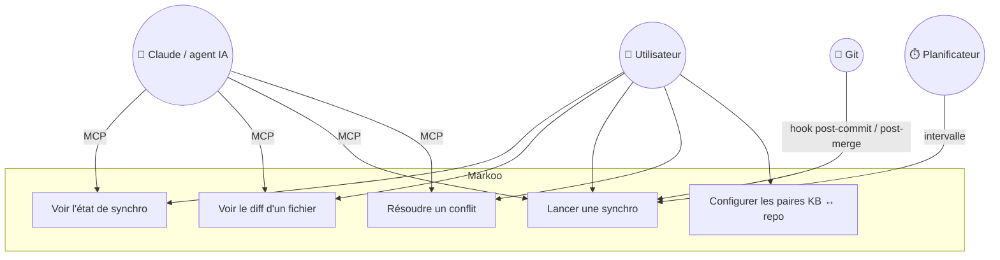

# 1. Vision et périmètre

> 🇬🇧 [English version](../en/01-vision-and-scope.md)

## Le problème

La documentation d'un projet vit à deux endroits :

- dans une **base de connaissance** (KB) — Obsidian, Logseq, Foam, un simple dossier Markdown… —, où on réfléchit, prend des notes, relie les idées entre elles ;
- dans le **dépôt Git** du projet (`docs/`, `README.md`, ADR…), où elle est versionnée et partagée avec l'équipe.

Les deux divergent vite : une note mise à jour dans la KB n'est jamais reportée dans le repo, une PR modifie `docs/` sans que la base de connaissance le sache. Les copier-coller manuels cassent les liens (les `[[wikilinks]]` d'Obsidian, par exemple, sont illisibles sur GitHub) et écrasent les modifications de l'autre côté.

Chaque outil de KB a en plus son propre dialecte Markdown (liens, intégrations, callouts, propriétés, organisation des dossiers) : un outil de synchro lié à un seul d'entre eux ne sert qu'à une partie des utilisateurs.

## La vision

> Markoo est un pont bidirectionnel entre une base de connaissance et un dépôt Git : chaque côté garde ses conventions, et le contenu reste identique.

Chaque type de KB est pris en charge par un **adaptateur** qui sait détecter la KB, connaît son organisation et convertit son dialecte vers une forme canonique commune (GitHub Flavored Markdown). **Obsidian est la première base de connaissance implémentée** ; d'autres suivront (voir [Bases de connaissance](09-bases-de-connaissance.md#modèle-dadaptateur)).

## Objectifs

| # | Objectif | Mesure de réussite |
|---|----------|--------------------|
| O1 | Synchroniser des paires de dossiers Markdown (KB ↔ repo) dans les deux sens | Une modification d'un côté apparaît de l'autre après une synchro |
| O2 | Ne **jamais** perdre une modification | Toute modification concurrente est fusionnée ou signalée comme conflit |
| O3 | Rendre les liens valides de chaque côté | Les liens fonctionnent dans la KB (par ex. Obsidian) **et** dans le rendu GitHub |
| O4 | Montrer clairement les différences | `status` et `diff` lisibles, vue de fusion dans l'app |
| O5 | S'intégrer au flux de travail existant | Synchro par intervalle, hook Git, API ou MCP |
| O6 | Prendre en charge plusieurs types de bases de connaissance via des adaptateurs | Ajouter un type de KB = implémenter le trait `KbAdapter`, sans toucher au moteur ; en v1 : `obsidian` (première KB implémentée, adaptateur de référence) et `markdown` (dossier simple, sans conversion) |

## Non-objectifs (pour la v1)

- Remplacer Git : Markoo **ne commit pas et ne push pas** à la place de l'utilisateur (au mieux, il propose un message de commit).
- Synchroniser autre chose que du Markdown et ses pièces jointes référencées.
- Synchroniser entre plusieurs machines (Obsidian Sync, iCloud ou Git s'en chargent déjà).
- Éditer le Markdown : Markoo n'est pas un éditeur.
- Prendre en charge les bases de connaissance distantes accessibles par API (Notion, Confluence, Outline…) : la v1 ne gère que des KB sous forme de fichiers locaux (exploration ultérieure, voir [Bases de connaissance](09-bases-de-connaissance.md#types-de-bases-de-connaissance-pris-en-charge)).
- Être un plugin d'un outil de KB particulier (par ex. un plugin Obsidian) : envisageable plus tard, voir la [feuille de route](07-feuille-de-route.md).

## Acteurs et cas d'usage

### Scénarios types

Les scénarios prennent Obsidian comme exemple de KB ; ils s'appliquent à tout type de KB pris en charge.

1. **Je rédige dans ma KB** (par ex. Obsidian) une note d'architecture dans `Projets/Clara/`. À la synchro suivante, elle apparaît dans `clara/docs/`, avec des liens Markdown standards. Je la commit quand je veux.
2. **Un collègue modifie `docs/api.md`** dans une PR. Après mon `git pull`, le hook `post-merge` déclenche Markoo : ma note dans la KB est mise à jour, dans le dialecte de la KB (par ex. wikilinks Obsidian).
3. **J'ai modifié la même note des deux côtés.** Si les changements touchent des lignes différentes, Markoo fusionne. Sinon, il affiche un conflit dans l'app (ou via MCP) et attend ma décision ; aucun fichier n'est écrasé.
4. **Je demande à Claude** « synchronise la doc de Clara et dis-moi ce qui a changé » : Claude appelle les outils MCP `sync_status` puis `sync_run`.

## Contraintes

- **Local d'abord** : tout tourne sur la machine, l'API n'écoute que sur `127.0.0.1`.
- **Multi-plateforme** : macOS en priorité, Linux et Windows ensuite (Tauri et Rust le permettent).
- **Tolérant aux éditions concurrentes** : l'outil de KB (par ex. Obsidian) peut écrire pendant une synchro ; les écritures sont atomiques (fichier temporaire puis renommage).
- **Sans perte à la conversion** : un adaptateur ne convertit que ce qui fait l'aller-retour à l'identique ; une construction qu'il ne sait pas reproduire est laissée telle quelle.
- **Performance** : une KB de 10 000 notes doit être scannée en moins d'une seconde quand rien n'a changé (comparaison par `mtime` + taille, hash seulement si nécessaire).
