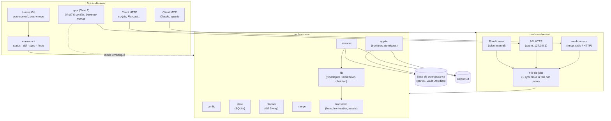
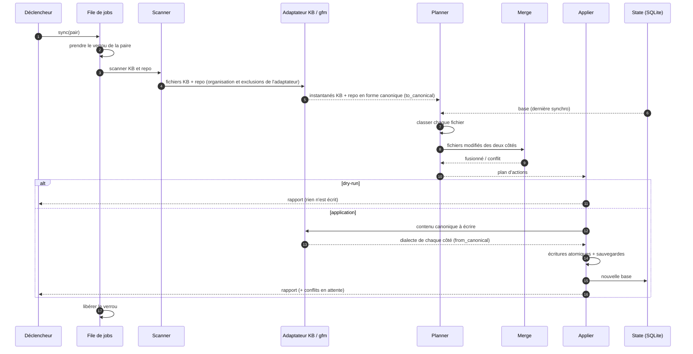

# 2. Architecture

> 🇬🇧 [English version](../en/02-architecture.md)

## Vue d'ensemble

Markoo est un **workspace Cargo**. Toute la logique de synchronisation vit dans une bibliothèque, `markoo-core`, qui ne dépend d'aucune interface. Les points d'entrée (CLI, daemon, API, MCP, app Tauri) sont de fines couches qui l'appellent.

Le moteur ne connaît aucun outil de base de connaissance en particulier : chaque type de KB est pris en charge par un **adaptateur** (module `kb`, trait `KbAdapter`) qui détecte la KB, décrit son organisation et convertit son dialecte Markdown vers la forme canonique (GitHub Flavored Markdown). Obsidian est la première KB implémentée. Voir [Bases de connaissance](09-bases-de-connaissance.md#modèle-dadaptateur).



## Organisation du dépôt

```
markoo/
├── Cargo.toml              # workspace
├── crates/
│   ├── markoo-core/        # bibliothèque : moteur de synchro
│   ├── markoo-cli/         # binaire `markoo`
│   ├── markoo-daemon/      # planificateur + API HTTP + hôte MCP
│   └── markoo-mcp/         # définition des outils MCP
├── app/                    # Tauri 2 (src-tauri/ + front web)
├── documentation/          # ce dossier
└── tests/fixtures/         # KB et repos de test (un jeu par adaptateur)
```

## Les crates

### `markoo-core`

| Module | Rôle | Dépendances envisagées |
|--------|------|------------------------|
| `paths` | Calcule `<config>` et `<data>` selon l'OS (voir [Configuration](06-configuration.md#chemins-par-système)) | `directories` |
| `config` | Lit, valide et **modifie** `markoo.toml` en conservant les commentaires | `serde`, `toml`, `toml_edit` |
| `scanner` | Parcourt un côté, filtre par motifs, calcule les empreintes | `walkdir`, `globset`, `blake3` |
| `state` | Stocke la **base** (état à la dernière synchro) | `rusqlite` |
| `kb` | Trait `KbAdapter` et adaptateurs de KB : détection, organisation (notes, pièces jointes, exclusions), dialecte (`to_canonical` / `from_canonical`), résolution des noms. En v1 : `markdown` (identité) et `obsidian` (adaptateur de référence). Voir [Bases de connaissance](09-bases-de-connaissance.md#modèle-dadaptateur) | `pulldown-cmark`, `unicode-normalization`, `serde_json` |
| `transform` | Applique les options génériques (liens, noms de fichiers, frontmatter, pièces jointes) entre forme canonique et dialecte `gfm` du repo (KB ↔ repo) | `pulldown-cmark`, `serde_yaml` |
| `planner` | Compare KB / repo / base en forme canonique, produit un **plan** d'actions | — |
| `merge` | Fusion 3-way ligne à ligne | `diffy` ou `similar` |
| `applier` | Exécute le plan : écritures atomiques, journal, sauvegardes | `tempfile` |
| `service` | Ce que demandent les interfaces distantes (API HTTP, MCP), sous forme de vues JSON, pour qu'elles appliquent les mêmes contrôles | `serde_json` |
| `events` | Émet des événements (progression, conflits) vers les interfaces | `tokio::sync::broadcast` |

Le côté repo a lui aussi un dialecte : **`gfm`** (GitHub Flavored Markdown) en v1, choisissable par paire plus tard (`gitlab`, `mkdocs`, `docusaurus` sont des idées post-v1). La comparaison et la fusion se font toujours en forme canonique ; chaque côté est relu avec son `to_canonical` et réécrit avec son `from_canonical`.

API publique visée (indicative) :

```rust
let engine = Engine::open(Paths::resolve()?)?;
let plan = engine.plan(PairId::all())?;         // ne modifie rien
println!("{}", plan.summary());                  // équivalent de `markoo status`
let report = engine.apply(&plan, ApplyOptions { dry_run: false })?;
for c in report.conflicts() { /* … */ }
engine.resolve(&pair, &path, Resolution::Content(text))?;
```

### `markoo-cli`

Binaire `markoo` (`clap`) :

| Commande | Effet |
|----------|-------|
| `markoo init` | Crée `markoo.toml` de façon interactive (type de KB détecté automatiquement) et prépare le dossier d'état |
| `markoo status` | Liste les fichiers modifiés, ajoutés, supprimés, en conflit |
| `markoo diff [fichier]` | Affiche le diff coloré |
| `markoo sync [--dry-run] [--pair <nom>]` | Planifie puis applique |
| `markoo conflicts` / `markoo resolve <fichier>` | Liste et résout les conflits et divergences, identifiés par le chemin du fichier |
| `markoo hook install\|uninstall` | Gère les hooks Git |
| `markoo pair add\|list\|show\|set\|remove` | Gère les paires (sens, dossiers, filtres…) ; création : `markoo pair add <nom> --kb <dossier> [--kb-type obsidian\|markdown] --repo <dossier>` (`--kb-type` détecté si omis) ; voir [Interface de configuration](08-interface-de-configuration.md) |
| `markoo paths` | Affiche les chemins de configuration et d'état utilisés |
| `markoo daemon [install\|uninstall]` | Lance le daemon (planificateur + API + MCP), ou gère son service `launchd` sur macOS |
| `markoo token rotate` | Remplace le jeton de l'API |
| `markoo mcp` | Serveur MCP en stdio (pour Claude Desktop / Claude Code) |

#### Bannière

`markoo --version` et `markoo init` affichent une bannière dans la police `standard` de figlet, stockée dans [`assets/cli-banner.txt`](../../assets/cli-banner.txt) :

```text
  __ __                         _
 / / \ \   _ __ ___   __ _ _ __| | _____   ___
/ /   \ \ | '_ ` _ \ / _` | '__| |/ / _ \ / _ \
\ \   / / | | | | | | (_| | |  |   < (_) | (_) |
 \_\ /_/  |_| |_| |_|\__,_|_|  |_|\_\___/ \___/
```

Si le terminal gère les couleurs, `<` est affiché en rose (`#F0418E`) et `>` en vert (`#22A55A`), les couleurs du logo. Sinon (`NO_COLOR` défini, sortie qui n'est pas un terminal), la bannière est affichée en texte brut.

### `markoo-daemon`

Processus longue durée, embarqué dans l'app Tauri ou lancé seul (`launchd` sur macOS). Il garantit **une seule synchro à la fois par paire** grâce à une file de jobs et un verrou par paire (`<data>/locks/<paire>.lock`), quel que soit le déclencheur. Le moteur prend lui-même ce verrou : une commande CLI lancée à côté du daemon est donc couverte aussi.

### `markoo-mcp`

Déclare les outils MCP et les relie au moteur via `service`. Le daemon l'héberge en HTTP, et `markoo mcp` en stdio. Voir [Déclencheurs](05-declencheurs.md#4-serveur-mcp).

### `app/` — Tauri 2

- **Barre de menus** : état (✅ à jour, 🔄 en cours, ⚠️ conflits), « Synchroniser maintenant ».
- **Fenêtre principale** : liste des paires, des changements en attente, historique.
- **Vue de conflit** : trois colonnes (KB · base · repo) et résultat éditable.
- **Configuration** : assistant de création de paire, choix du sens (→ · ⇄ · ←), filtres avec aperçu, transformations, déclencheurs. Détail dans [Interface de configuration](08-interface-de-configuration.md).
- Le front communique avec le cœur Rust via les **commandes Tauri** et reçoit les événements via `emit`.

## Flux d'une synchronisation



## Principes de conception

1. **Le cœur ne fait pas d'entrées/sorties réseau** : il manipule des fichiers et renvoie des structures. Les interfaces se chargent du reste.
2. **Planifier avant d'agir** : toute synchro produit d'abord un `Plan` sérialisable. Le dry-run, l'UI et MCP l'affichent tel quel.
3. **Idempotence** : relancer une synchro sans changement ne produit aucune écriture.
4. **Aucune perte de données** : chaque fichier écrasé est sauvegardé dans `<data>/backups/` (rotation configurable).
5. **Testabilité** : le système de fichiers passe par un trait (`Fs`) pour pouvoir tester le moteur en mémoire.
6. **Extensibilité par adaptateurs** : ajouter un type de KB revient à implémenter `KbAdapter` (avec ses tests golden et d'aller-retour), sans modifier le planner, la fusion ni l'applier. Les entrées passent par une abstraction pour qu'un adaptateur adossé à une API (KB distante) reste possible après la v1.
