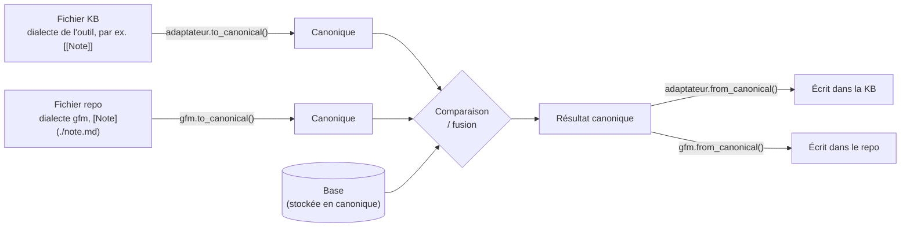
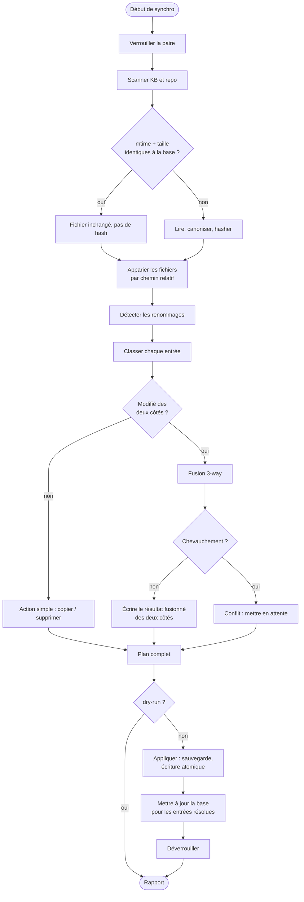
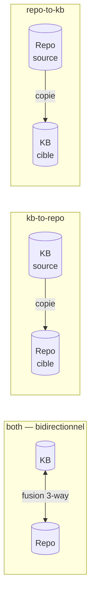
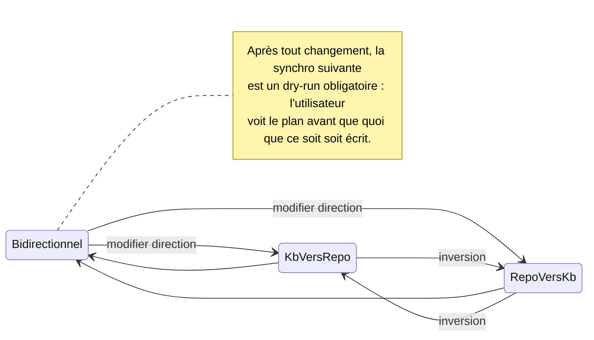
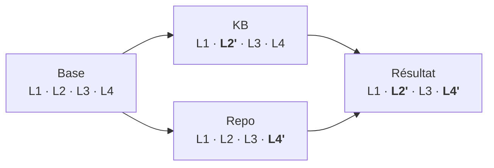
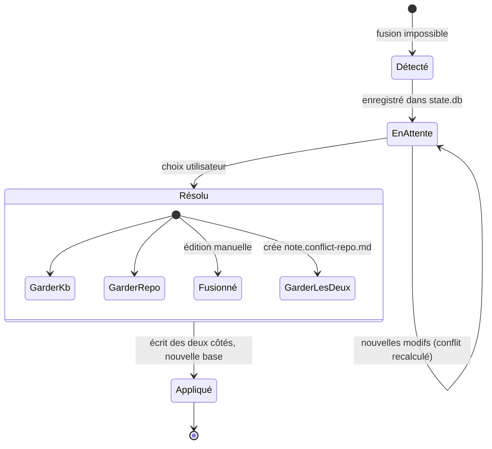
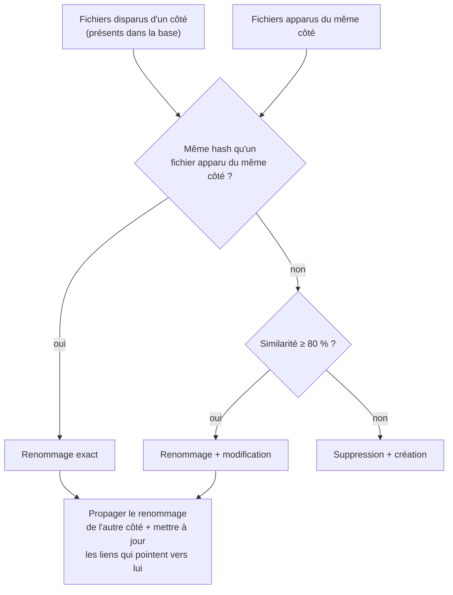

# 3. Algorithme de synchronisation

> 🇬🇧 [English version](../en/03-sync-algorithm.md)

Markoo s'appuie sur une **synchronisation à trois points** (*3-way*), le même principe que `git merge` : pour chaque fichier, on compare l'état actuel de la **base de connaissance** (KB), l'état actuel du **repo** et la **base**, c'est-à-dire l'état commun lors de la dernière synchro réussie.

Ce document décrit d'abord le mode **bidirectionnel**, le plus complet ; les modes à sens unique sont détaillés dans [Sens de synchronisation](#sens-de-synchronisation).

Sans base, impossible de savoir qui a modifié quoi : si `A.md` diffère entre la KB et le repo, est-ce la KB qui a changé, le repo, ou les deux ? La base répond à cette question.

## Forme canonique

Les deux côtés n'ont pas la même syntaxe : la base de connaissance (KB) utilise le dialecte de son outil (par ex. wikilinks `[[Note]]` dans Obsidian), le repo du Markdown GitHub. Pour comparer et fusionner, Markoo ramène tout à une **forme canonique** : du **GitHub Flavored Markdown standard avec des liens relatifs**, complété par des commentaires invisibles `<!--markoo:…-->` qui portent ce que GFM ne sait pas représenter (lien vers une note hors paire, type de callout d'origine…).

Chaque côté a son **dialecte** : le fichier KB passe par le `to_canonical()` de l'**adaptateur** de son type de KB (voir [Bases de connaissance](09-bases-de-connaissance.md#modèle-dadaptateur)), le fichier repo par le dialecte `gfm`. La base est stockée en forme canonique.

Condition indispensable : la conversion doit être **sans perte**, pour chaque adaptateur comme pour `gfm` : `to_canonical(from_canonical(x)) == x` pour tout texte canonique, et `from_canonical(to_canonical(y)) == y` pour tout fichier de la KB. Une construction qui ne fait pas l'aller-retour est laissée telle quelle. C'est vérifié par des tests de propriété ; voir [Transformations](04-transformations.md).

## Étapes

## Classification

Notations : `K` = base de connaissance (KB), `R` = repo, `B` = base. « = » signifie un hash canonique identique, « ∅ » que le fichier est absent.

| # | Base | KB | Repo | Situation | Action |
|---|------|-------|------|-----------|--------|
| 1 | ∅ | ∅ | ∅ | — | rien |
| 2 | ∅ | présent | ∅ | créé dans la KB | copier K → R |
| 3 | ∅ | ∅ | présent | créé dans le repo | copier R → K |
| 4 | ∅ | présent | présent, K = R | créé des deux côtés, identique | enregistrer la base |
| 5 | ∅ | présent | présent, K ≠ R | créé des deux côtés, différent | fusion 2-way (base vide) → souvent **conflit** |
| 6 | B | = B | = B | inchangé | rien |
| 7 | B | ≠ B | = B | modifié dans la KB | copier K → R |
| 8 | B | = B | ≠ B | modifié dans le repo | copier R → K |
| 9 | B | ≠ B | ≠ B, K = R | même modification des deux côtés | mettre à jour la base |
| 10 | B | ≠ B | ≠ B, K ≠ R | modifié des deux côtés | **fusion 3-way** |
| 11 | B | ∅ | = B | supprimé dans la KB | supprimer dans R |
| 12 | B | = B | ∅ | supprimé dans le repo | supprimer dans K |
| 13 | B | ∅ | ∅ | supprimé des deux côtés | oublier la base |
| 14 | B | ∅ | ≠ B | supprimé dans K, modifié dans R | **conflit** suppression / modification |
| 15 | B | ≠ B | ∅ | modifié dans K, supprimé dans R | **conflit** suppression / modification |

> Les suppressions sont **mises à la corbeille** (`<data>/trash/`), jamais supprimées définitivement par Markoo.

## Sens de synchronisation

Chaque paire a un **sens**, choisi dans l'[interface de configuration](08-interface-de-configuration.md) ou dans `markoo.toml` (clé `direction`).

| Mode | Valeur | Schéma | Usage typique |
|------|--------|--------|---------------|
| Bidirectionnel | `both` | KB ↔ repo | Je rédige des deux côtés (défaut) |
| KB → repo | `kb-to-repo` | KB → repo | La KB (par ex. Obsidian) fait référence, le repo publie |
| Repo → KB | `repo-to-kb` | repo → KB | Le repo fait référence, la KB consulte |

En mode unidirectionnel, on parle de **source** et de **cible**. La source n'est jamais modifiée par Markoo.

### Que faire des modifications faites dans la cible ?

C'est la vraie question d'un mode unidirectionnel : quelqu'un peut quand même éditer la cible (un collègue modifie `docs/` alors que la KB fait référence). L'option `target_changes` décide :

| Valeur | Comportement |
|--------|--------------|
| `protect` (défaut) | Markoo **n'écrase jamais** une modification de la cible. Le fichier est marqué **divergent** et laissé tel quel jusqu'à ce que l'utilisateur tranche. |
| `overwrite` | **Miroir strict** : la cible est remise à l'identique de la source. Le contenu écrasé part dans `<data>/backups/` ou `<data>/trash/`, il n'est jamais perdu. |

Une **divergence** se résout comme un conflit (app, CLI, API, MCP), avec trois choix : *rétablir la source*, *garder la cible* (le fichier est exclu des synchros suivantes jusqu'à nouvel ordre) ou *reporter dans la source*, ce qui est une exception ponctuelle au sens choisi et demande une confirmation explicite.

### Classification selon le sens

Reprise des situations du [tableau de classification](#classification), du point de vue d'un mode unidirectionnel `S → C` :

| Situation | `both` | `S → C` + `protect` | `S → C` + `overwrite` |
|-----------|--------|---------------------|-----------------------|
| Créé dans S | copier vers C | copier vers C | copier vers C |
| Créé dans C seulement | copier vers S | ignoré, signalé « hors source » | mis à la corbeille |
| Modifié dans S | copier vers C | copier vers C | copier vers C |
| Modifié dans C seulement | copier vers S | **divergence** | rétabli depuis S |
| Modifié des deux côtés | fusion 3-way | **divergence** | écrasé par S |
| Supprimé dans S | supprimer dans C | supprimer dans C (divergence si C a été modifié) | supprimer dans C |
| Supprimé dans C | supprimer dans S | **divergence** | recréé depuis S |

La base est mise à jour avec l'état de la source après chaque copie. Une divergence ne met pas la base à jour : le fichier restera signalé tant qu'il n'est pas résolu.

### Changer de sens

Le sens d'une paire existante peut changer à tout moment ; la base est conservée.

Passer de `both` à un mode unidirectionnel avec des conflits en attente est refusé tant que ces conflits ne sont pas résolus, pour ne pas trancher à la place de l'utilisateur.

## Fusion 3-way

On calcule le diff `B → K` et le diff `B → R`, ligne par ligne. Les blocs (*hunks*) qui ne se chevauchent pas sont appliqués tous les deux. Quand deux blocs touchent les mêmes lignes de la base :

- s'ils produisent le même texte, on le garde une fois ;
- sinon, c'est un **conflit** sur ce bloc.

### Raffinements prévus

- **Frontmatter fusionné par clé** plutôt que par ligne : `tags` modifiés d'un côté et `status` de l'autre ne créent pas de conflit. Voir [Transformations](04-transformations.md#4-frontmatter).
- **Granularité par paragraphe** en option, pour la prose où les retours à la ligne varient.
- **Normalisation** avant comparaison : fins de ligne (`\r\n` → `\n`), espaces en fin de ligne et ligne finale. On évite ainsi les faux changements.

## Conflits

Un fichier en conflit **n'est écrit nulle part** tant que l'utilisateur n'a pas tranché. Les autres fichiers de la paire sont synchronisés normalement.

Les conflits sont résolus depuis :

- l'**app Tauri** (vue en trois colonnes) ;
- la **CLI** (`markoo resolve <id> --keep kb|repo|both` ou `--edit` dans `$EDITOR`) ;
- l'**API** (`POST /conflicts/{id}/resolve`) ;
- **MCP** (`resolve_conflict`), ce qui permet à Claude de proposer une fusion.

## Renommages et déplacements

Sans détection, un renommage ressemble à « suppression + création », ce qui perd l'historique de la base et peut créer des conflits inutiles.

## Atomicité et robustesse

- **Écriture atomique** : écrire dans `fichier.md.markoo-tmp`, `fsync`, puis `rename`.
- **Vérification juste avant d'écrire** : si le fichier cible a changé depuis le scan (l'outil de la KB, par ex. Obsidian, vient de l'enregistrer), l'action est annulée et sera replanifiée à la synchro suivante.
- **Journal** : chaque application écrit `<data>/journal/<horodatage>.json`. Une synchro interrompue est reprise ou annulée au démarrage suivant.
- **Sauvegardes** : le contenu écrasé est copié dans `<data>/backups/` avant l'écriture.
- **Exclusions** : les exclusions propres à chaque adaptateur (par ex. `.obsidian/` et `.trash/` pour Obsidian ; voir [Bases de connaissance](09-bases-de-connaissance.md#types-de-bases-de-connaissance-pris-en-charge)), ainsi que `.git/`, `node_modules/` et les fichiers temporaires `*.markoo-tmp`, sont toujours ignorés.
