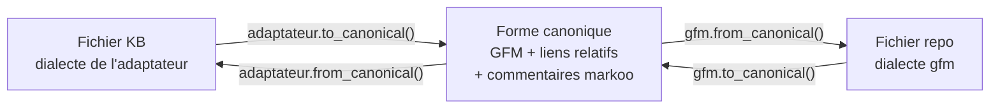
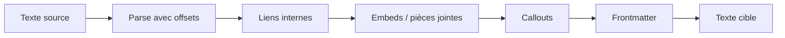
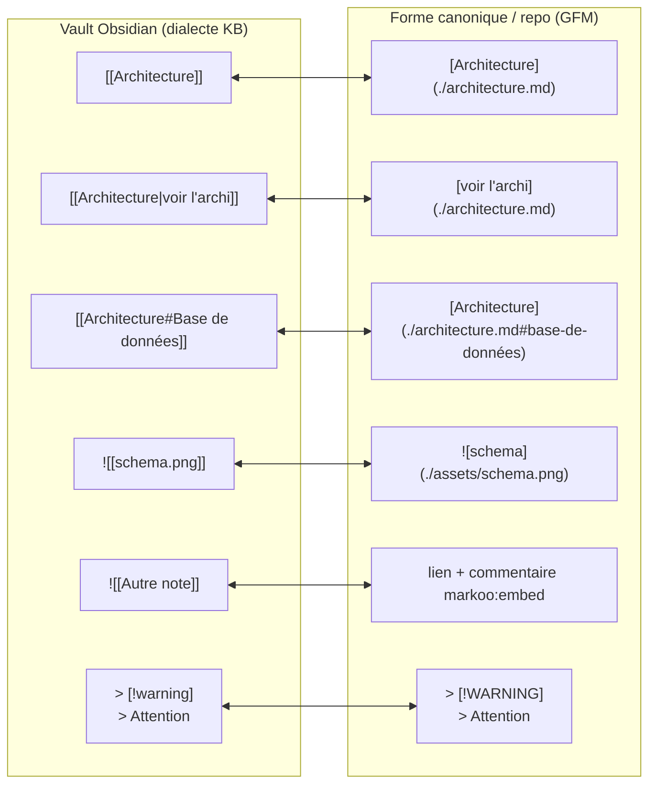
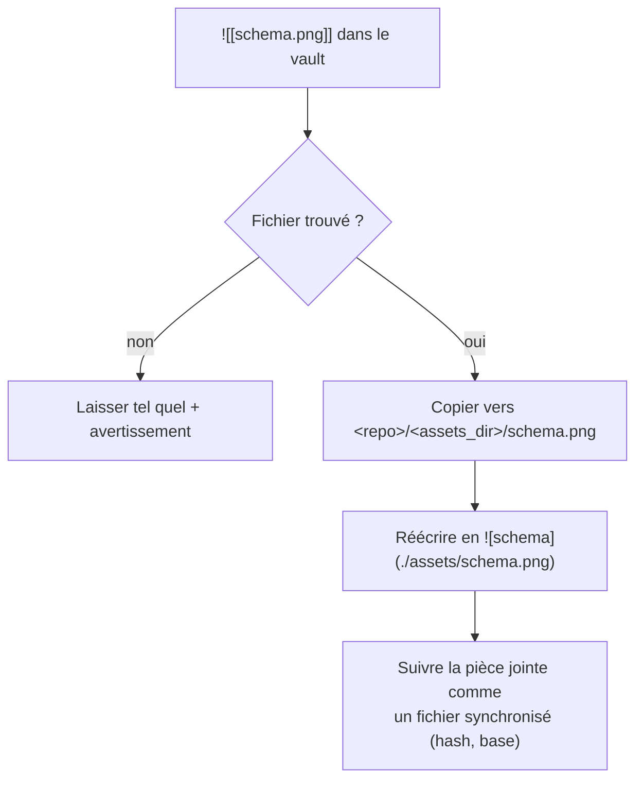
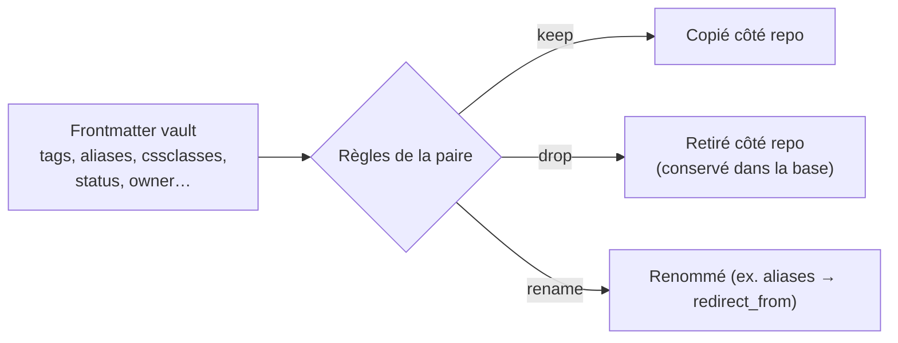

# 4. Transformations KB ↔ repo

> 🇬🇧 [English version](../en/04-transformations.md)

Une base de connaissance (KB) et GitHub n'interprètent pas le Markdown de la même façon. Markoo convertit le contenu au passage pour que chaque côté reste **natif** : les liens fonctionnent dans l'outil de la KB (par ex. Obsidian) **et** sur GitHub.

Ce document décrit d'abord le **pipeline générique**, commun à tous les types de KB, puis les règles détaillées de l'**adaptateur Obsidian**, le premier implémenté (sections 1 à 6).

## Principe : un pipeline réversible

Chaque côté d'une paire a un **dialecte** : celui de l'adaptateur du type de KB (`kb_type`) côté KB, `gfm` côté repo. Un dialecte est une paire de fonctions `to_canonical` / `from_canonical` qui convertit vers et depuis la **forme canonique** : du **GitHub Flavored Markdown standard avec des liens relatifs**, plus des commentaires invisibles `<!--markoo:…-->` pour ce que GFM ne sait pas représenter. La comparaison, la fusion et la base se font en forme canonique (voir [Algorithme de synchronisation](03-algorithme-de-synchronisation.md#forme-canonique)).



Les fonctions agissent sur l'**arbre Markdown** (`pulldown-cmark` avec positions de source) et ne réécrivent que les portions concernées. Le reste du fichier est conservé **à l'octet près**, et le contenu des blocs de code n'est jamais modifié. Chaque adaptateur enchaîne ses étapes de conversion ; pour Obsidian :



**Règle d'or**, pour chaque adaptateur comme pour `gfm` : un fichier de la KB revient à l'octet près, `from_canonical(to_canonical(y)) == y`, et ce que produit `from_canonical` est stable, `to_canonical(from_canonical(x)) == x` pour le texte canonique produit par Markoo. Un texte écrit à la main côté repo peut être normalisé une fois (par exemple `> [!note]` devient `> [!NOTE]`), puis il ne change plus. Quand une construction ne peut pas être convertie proprement, Markoo la **laisse telle quelle** plutôt que de perdre de l'information.

**Une seule règle couvre toutes les conversions.** Chaque construction a un rendu canonique, et chaque rendu a une forme Obsidian *par défaut*. Quand l'original est cette forme par défaut, le texte canonique est le rendu seul, et le repo reste propre : `[[Note]]` ↔ `[Note](./note.md)`. Sinon, l'original est conservé à côté, dans un commentaire invisible : `[Note](./adr/note.md)<!--markoo:[[adr/Note]]-->`. Au retour, un commentaire n'est suivi que si le texte qui le précède est toujours le rendu de ce qu'il contient ; si quelqu'un a modifié ce texte côté repo, sa modification l'emporte et le commentaire disparaît. Ces commentaires restent dans les fichiers du repo : GitHub ne les affiche pas.

Les options **génériques** se règlent dans `[pair.transform]` (`links`, `filenames`, `assets_dir`, `frontmatter`, `strip_comments`) ; les options **propres à un adaptateur** dans `[pair.kb_options]` (voir [Configuration](06-configuration.md)).

## Règles de l'adaptateur Obsidian

Les sections 1 à 6 décrivent les règles de l'**adaptateur Obsidian** (`kb_type = "obsidian"`), le premier implémenté et l'adaptateur de référence. Les autres adaptateurs (Logseq, Foam, Dendron…) implémentent le même pipeline avec leurs propres règles : syntaxe des liens, résolution des noms, propriétés, exclusions. Voir [Bases de connaissance](09-bases-de-connaissance.md#adaptateur-obsidian). L'adaptateur `markdown` est l'identité : il n'applique aucune de ces règles.



## 1. Liens internes (wikilinks)

### Résolution

Un wikilink `[[Cible]]` désigne une note par son **nom**, pas par son chemin. Markoo construit un index `nom → chemin` du vault, comme le fait Obsidian :

1. Correspondance exacte du chemin (`[[dossier/Cible]]`).
2. Sinon, nom de fichier unique dans le vault.
3. Sinon, le plus proche du fichier courant ; un avertissement est émis en cas d'ambiguïté.

| Cas | Côté repo |
|-----|-----------|
| Cible **dans la paire synchronisée** | Lien relatif `./sous-dossier/cible.md` |
| Cible **hors de la paire** (ailleurs dans le vault) | Texte simple + commentaire de restauration (voir plus bas) |
| Cible **introuvable** | Laissé tel quel, avertissement dans le rapport |

Un chemin commençant par `./` ou `../` se résout depuis la note courante. Les noms se comparent sans tenir compte de la casse ni de l'encodage des accents, qui dépend du système ayant créé le fichier. Un wikilink sans `!` vers une pièce jointe, quand aucune note ne porte ce nom, pointe vers le dossier des pièces jointes et le fichier y est copié. Si deux pièces jointes portent le même nom, il reste tel quel, avec un avertissement qui le précise : le dossier des pièces jointes est à plat.

Un **lien Markdown** écrit dans le vault se lit ainsi : un fichier à côté de la note a la priorité, comme sur GitHub ; sinon le chemin est cherché depuis la racine du vault, la forme qu'Obsidian écrit avec `newLinkFormat = "absolute"`. Les chemins commençant par `./` ou `../` ne sont jamais cherchés depuis la racine. Un lien vers une note écrit depuis la racine suit le tableau ci-dessus, et sa forme d'origine est gardée dans un commentaire. Un lien vers une pièce jointe, image ou non, pointe vers le dossier des pièces jointes et le fichier y est copié, sauf si deux pièces jointes portent le même nom : le lien reste alors tel quel.

### Information non représentable

Certains détails n'ont pas d'équivalent en GFM (lien vers une note hors périmètre, alias identique au titre…). Markoo les conserve dans la forme canonique sous forme de **commentaire HTML invisible** pour pouvoir restaurer la forme exacte au retour :

```markdown
Voir la [décision de stockage](./adr/002-stockage.md) et Réunion du 12 mars<!--markoo:[[Réunion du 12 mars]]-->.
```

### Ancres

- `[[Note#Titre de section]]` ↔ `[Note](./note.md#titre-de-section)`, avec un slug calculé comme celui de GitHub.
- `[[Note#^bloc-id]]` (référence de bloc) n'existe pas sur GitHub : le lien pointe vers la note et l'identifiant est conservé dans un commentaire.

## 2. Pièces jointes et embeds



- Les images, PDF et autres fichiers **référencés** sont synchronisés ; les pièces jointes non référencées sont ignorées.
- Le dossier de destination côté repo est configurable (`assets_dir`, par défaut `assets/` à la racine de la paire).
- Côté vault, une nouvelle image ajoutée dans le repo est copiée dans le dossier de pièces jointes configuré dans Obsidian (lu depuis `.obsidian/app.json`), ou à défaut à côté de la note.
- `![[image.png|300]]` (taille) devient ``.
- `![[Autre note]]` (transclusion de note) : un lien, avec l'original conservé dans un commentaire. L'option `inline_embeds = true` (dans `[pair.kb_options]`), qui insérerait le contenu entre deux marqueurs, n'est pas encore implémentée.
- Les pièces jointes sont **copiées, jamais supprimées** : retirer une référence laisse le fichier en place des deux côtés. Une pièce jointe modifiée des deux côtés est signalée et laissée telle quelle.

## 3. Callouts

GitHub prend en charge un sous-ensemble des callouts sous le nom d'*alerts* : `NOTE`, `TIP`, `IMPORTANT`, `WARNING`, `CAUTION`.

| Obsidian | GitHub |
|----------|--------|
| `> [!note]`, `> [!info]` | `> [!NOTE]` |
| `> [!tip]`, `> [!hint]` | `> [!TIP]` |
| `> [!important]` | `> [!IMPORTANT]` |
| `> [!warning]`, `> [!attention]` | `> [!WARNING]` |
| `> [!danger]`, `> [!caution]`, `> [!error]` | `> [!CAUTION]` |
| autres (`[!example]`, `[!quote]`…), titre personnalisé, repliable `[!note]-` | conservés tels quels (GitHub les affiche comme une citation) |

Le type d'origine (`info` → `NOTE`) est conservé dans un commentaire `markoo`, donc dans la base, pour restituer exactement la forme du vault. La table de correspondance peut être ajustée dans `[pair.kb_options]` (clé `callouts`).

## 4. Frontmatter



- Par défaut, les clés propres à Obsidian (`cssclasses`, `aliases`, `publish`) sont **retirées** côté repo, et les autres sont conservées. Cette liste par défaut est propre à l'adaptateur et se règle dans `[pair.kb_options]` (`frontmatter_drop`).
- Une clé retirée côté repo est **restituée** côté vault au retour : elle ne disparaît jamais.
- Le frontmatter est pour l'instant fusionné ligne par ligne, comme le reste du fichier. La fusion **clé par clé**, et par ensemble de valeurs pour les listes (`tags`), est prévue.
- Option générique `frontmatter = "drop"` (dans `[pair.transform]`) pour un repo qui n'en veut pas du tout.

## 5. Noms de fichiers

Obsidian accepte espaces, accents et majuscules (`Décision Stockage.md`) ; beaucoup de repos préfèrent `decision-stockage.md`.

| Mode (`filenames`, option générique de `[pair.transform]`) | Comportement |
|--------------------|--------------|
| `preserve` (défaut) | Même nom des deux côtés |
| `kebab` (pas encore implémenté) | `Décision Stockage.md` ↔ `decision-stockage.md` ; la correspondance est mémorisée dans la base |

En mode `kebab`, le titre d'origine est conservé (premier titre `#` ou clé `title` du frontmatter), ce qui permet de recréer le bon nom côté vault.

## 6. Ce qui n'est **pas** transformé

- Le contenu des blocs de code et du code en ligne.
- Les blocs Dataview, les requêtes et le Markdown spécifique à des plugins : copiés tels quels.
- Les commentaires Obsidian `%% … %%` : conservés (option `strip_comments` pour les retirer côté repo, de façon réversible).
- Les liens externes (`https://…`).

## Tests

Chaque adaptateur a ses propres tests :

- **Golden tests** : paires de fichiers `entrée.md` / `attendu.md` dans `tests/fixtures/transform/<kb_type>/` (par ex. `obsidian/`).
- **Tests de propriété** (`proptest`) : aller-retour sans perte dans les deux sens, `to_canonical(from_canonical(x)) == x` et `from_canonical(to_canonical(y)) == y`, pour chaque adaptateur et pour `gfm`.
- **Corpus réel** : test d'aller-retour sur une KB anonymisée (par ex. un vault Obsidian), sans aucune différence attendue.
