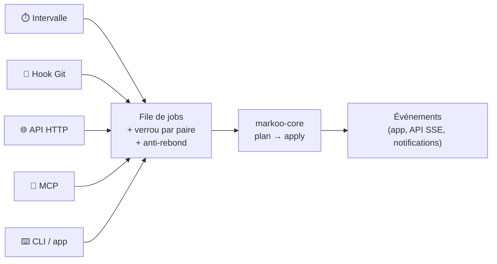
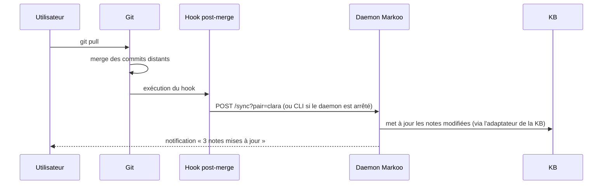
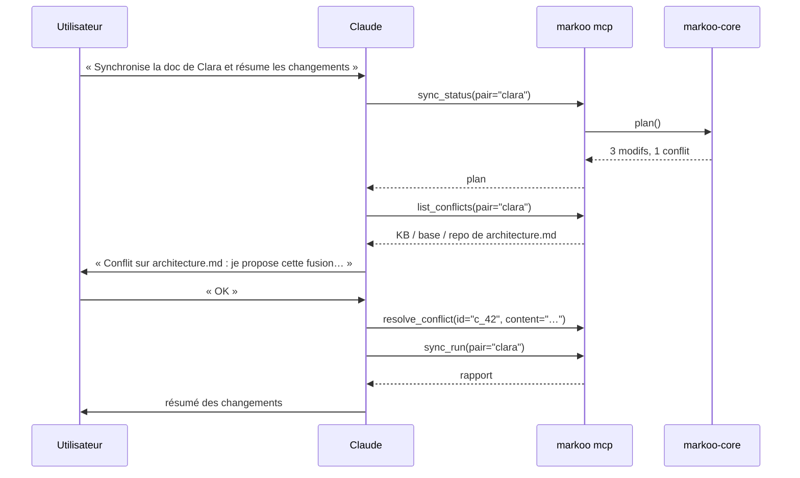

# 5. Déclencheurs

> 🇬🇧 [English version](../en/05-triggers.md)

Une synchronisation peut être lancée de quatre façons, plus la CLI manuelle. Toutes passent par la **même file de jobs** du daemon : deux déclencheurs simultanés sur la même paire ne lancent jamais deux synchros en parallèle.



**Anti-rebond** : les demandes reçues pendant une synchro en cours sont fusionnées en une seule synchro supplémentaire, lancée à la fin.

## 1. Intervalle de temps

```toml
[schedule]
interval = "5m"        # 30s, 5m, 1h… ; "off" pour désactiver
on_startup = true      # synchro au lancement du daemon
pause_on_battery = false
```

- Le planificateur `tokio` lance une synchro de chaque paire à chaque intervalle.
- La comparaison rapide (`mtime` + taille) rend une synchro « à vide » quasi gratuite, ce qui autorise des intervalles courts.
- **Évolution prévue** : un mode `watch` basé sur les événements du système de fichiers (`notify`, FSEvents sur macOS), avec un anti-rebond de quelques secondes.

## 2. Hooks Git

```bash
markoo hook install --pair clara
```

Installe, dans le dépôt de la paire, des hooks qui appellent Markoo :

| Hook | Moment | Intérêt |
|------|--------|---------|
| `post-merge` | après `git pull` / `git merge` | récupérer dans la KB la doc modifiée par l'équipe |
| `post-checkout` | après un changement de branche | aligner la KB sur la branche courante (optionnel) |
| `post-commit` | après un commit local | rien de nouveau à propager en général, sert de point de contrôle |
| `pre-commit` | avant un commit | **vérifier** qu'il ne reste pas de conflit Markoo (optionnel, bloquant) |



- Le hook **n'échoue jamais** à cause de Markoo (sauf `pre-commit`, si activé) : une erreur est journalisée et Git continue.
- Les hooks existants sont respectés : Markoo s'ajoute à la fin, entre deux marqueurs `# >>> markoo` / `# <<< markoo`. Les gestionnaires `husky` et `lefthook` sont détectés et un extrait de configuration est proposé à la place.
- Les branches peuvent être filtrées (`hook_branches = ["main"]`) pour ne synchroniser que la branche principale.

## 3. API HTTP locale

Servie par `axum`, uniquement sur `127.0.0.1` (port par défaut `4848`). L'authentification se fait par un jeton aléatoire stocké dans `<data>/token` (en-tête `Authorization: Bearer …`).

| Méthode | Route | Rôle |
|---------|-------|------|
| `GET` | `/health` | état du daemon |
| `GET` | `/pairs` | liste des paires configurées |
| `GET` | `/pairs/{pair}/status` | plan courant (sans rien appliquer) |
| `GET` | `/pairs/{pair}/diff?path=…` | diff d'un fichier |
| `POST` | `/pairs/{pair}/sync` | lance une synchro (`{"dry_run": false}`) → `202` + id du job |
| `GET` | `/jobs/{id}` | état et rapport d'un job |
| `POST` | `/pairs` | crée une paire |
| `GET` | `/pairs/{pair}/config` | configuration de la paire |
| `PATCH` | `/pairs/{pair}/config` | modifie la paire (sens, filtres…) ; renvoie l'aperçu du plan |
| `DELETE` | `/pairs/{pair}` | supprime la paire (les fichiers ne sont pas touchés) |
| `GET` | `/conflicts` | conflits et divergences en attente |
| `POST` | `/conflicts/{id}/resolve` | `{"keep": "kb" \| "repo" \| "both"}` ou `{"content": "…"}` |
| `GET` | `/events` | flux SSE : progression, fin de job, nouveaux conflits |

Exemple de rapport :

```json
{
  "job": "j_01JB…",
  "pair": "clara",
  "kb_type": "obsidian",
  "dry_run": false,
  "summary": { "kb_to_repo": 2, "repo_to_kb": 1, "merged": 1, "conflicts": 1, "deleted": 0 },
  "conflicts": [{ "id": "c_42", "path": "architecture.md", "hunks": 1 }],
  "duration_ms": 184
}
```

## 4. Serveur MCP

Markoo expose un serveur **Model Context Protocol** (crate `rmcp`), utilisable par Claude Code, Claude Desktop ou tout client MCP.

- **stdio** : `markoo mcp` (le client lance le processus).
- **HTTP** : `http://127.0.0.1:4848/mcp` quand le daemon tourne.

```json
{
  "mcpServers": {
    "markoo": { "command": "markoo", "args": ["mcp"] }
  }
}
```

### Outils

| Outil | Paramètres | Effet |
|-------|-----------|-------|
| `list_pairs` | — | Paires configurées, type de KB (par ex. `obsidian`) et état |
| `sync_status` | `pair?` | Plan courant : ce qui serait synchronisé |
| `sync_diff` | `pair`, `path` | Diff unifié d'un fichier (KB ↔ repo, en forme canonique) |
| `sync_run` | `pair?`, `dry_run?` | Lance une synchro, renvoie le rapport |
| `list_conflicts` | `pair?` | Conflits en attente, avec les trois versions |
| `resolve_conflict` | `id`, `keep?` \| `content?` | Résout un conflit ou une divergence |
| `get_pair_config` | `pair` | Configuration de la paire (type de KB, sens, filtres…) |
| `update_pair_config` | `pair`, `changes` | Modifie la paire ; **désactivé** sauf si `mcp.allow_config_write = true` |

### Ressources

- `markoo://pairs/{pair}/status` : état courant.
- `markoo://conflicts/{id}` : versions KB, base et repo d'un conflit.



> **Garde-fou** : les outils qui écrivent (`sync_run`, `resolve_conflict`) sont annotés comme *destructifs* dans MCP, ce qui permet au client de demander confirmation à l'utilisateur.

## Sécurité commune

- Écoute uniquement sur `127.0.0.1`, jamais sur `0.0.0.0`.
- Jeton d'API régénérable (`markoo token rotate`).
- Les chemins reçus (API, MCP) sont normalisés et **confinés** à la paire : aucune lecture ni écriture hors des dossiers configurés (protection contre `../`).
