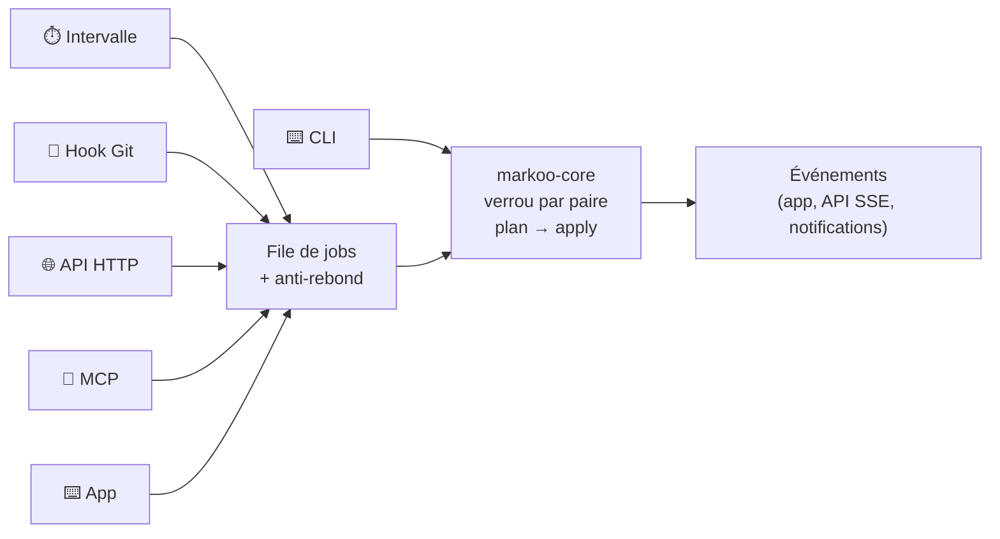
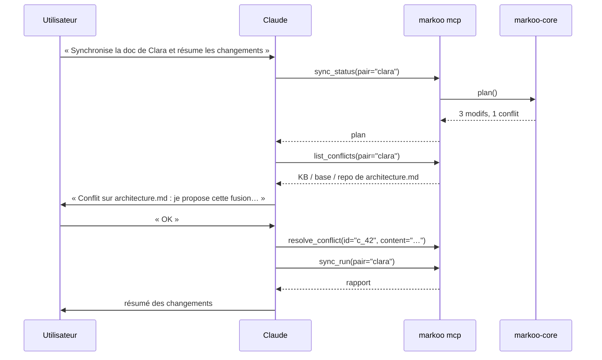

# 5. Déclencheurs

> 🇬🇧 [English version](../en/05-triggers.md)

Une synchronisation peut être lancée de quatre façons, plus la CLI manuelle. L'intervalle, le hook, l'API et MCP passent par la **même file de jobs** du daemon. La CLI manuelle appelle directement le moteur. Tous ont besoin du **verrou de la paire** : deux déclencheurs simultanés sur la même paire ne lancent donc jamais deux synchros en parallèle. Une synchro qui trouve le verrou pris s'arrête avec une erreur `busy`, sans rien écrire.



**Anti-rebond** : les demandes reçues pendant une synchro en cours sont fusionnées en une seule synchro supplémentaire, lancée à la fin. Un dry-run n'est jamais fusionné avec une vraie synchro.

## 1. Intervalle de temps

```toml
[schedule]
interval = "5m"        # 30s, 5m, 1h… ; "off" pour désactiver
on_startup = true      # synchro au lancement du daemon
pause_on_battery = false # pas encore implémenté : accepté et ignoré, avec un avertissement
```

- Le planificateur `tokio` lance une synchro de chaque paire à chaque intervalle, sauf les paires en pause et celles qui échouent à la validation.
- `markoo daemon` tourne au premier plan. Sur macOS, `markoo daemon install` le lance comme service `launchd` de l'utilisateur courant, avec les dossiers de configuration et de données utilisés à ce moment-là ; il refuse de l'installer si cette configuration est absente ou invalide, puisque le démon ne pourrait pas démarrer. `markoo daemon uninstall` le retire.
- Un dossier de données n'a qu'un seul daemon à la fois (`<data>/daemon.lock`).
- `markoo.toml` est vérifié toutes les quelques secondes. Une paire dont les réglages ont changé, ou une nouvelle paire, est synchronisée aussitôt ; les changements de `[api]` demandent un redémarrage. Tant que le fichier est invalide, le daemon **suspend ses synchros** : utiliser les anciens réglages pourrait écrire dans un sens que l'utilisateur vient de changer.
- La comparaison rapide (`mtime` + taille) rend une synchro « à vide » quasi gratuite, ce qui autorise des intervalles courts.
- **Évolution prévue** : un mode `watch` basé sur les événements du système de fichiers (`notify`, FSEvents sur macOS), avec un anti-rebond de quelques secondes.

## 2. Hooks Git

```bash
markoo hook install --pair clara
```

Installe, dans le dépôt de la paire, les hooks listés dans `[pair.hooks]`, par défaut `post-merge`, et retire les autres hooks de la paire. `markoo hook uninstall --pair clara` les retire. L'installation ne synchronise rien : les hooks agissent la prochaine fois que Git les lance, et `markoo sync --pair clara` synchronise tout de suite. Les hooks appellent Markoo :

| Hook | Moment | Intérêt |
|------|--------|---------|
| `post-merge` | après `git pull` / `git merge` | récupérer dans la KB la doc modifiée par l'équipe |
| `post-checkout` | après un changement de branche | aligner la KB sur la branche courante (optionnel) |
| `post-commit` | après un commit local | rien de nouveau à propager en général, sert de point de contrôle |
| `pre-commit` | avant un commit | **vérifier** qu'il ne reste pas de conflit Markoo (optionnel, bloquant) |


- Le hook **n'échoue jamais** à cause de Markoo et ne fait jamais attendre Git : il tourne en arrière-plan, et les erreurs sont journalisées dans `<data>/hooks.log`. `pre-commit` fait exception : il attend, et refuse le commit tant qu'un conflit est en attente (`git commit --no-verify` le contourne) ; une panne de Markoo lui-même laisse passer le commit.
- Les hooks existants sont respectés : Markoo s'ajoute à la fin, entre deux marqueurs `# >>> markoo clara` / `# <<< markoo clara` qui nomment la paire, après en avoir gardé une copie dans `<data>/backups/`. La désinstallation ne retire que ce bloc ; un hook resté vide part dans `<data>/trash/`.
- `markoo pair remove` laisse les hooks en place et nomme les fichiers qui appellent encore la paire : lancez `markoo hook uninstall` avant, car il ne connaît plus la paire ensuite.
- Markoo ne touche pas à un hook et affiche les lignes à ajouter à la main quand elles ne pourraient pas s'exécuter après lui ou que l'écriture l'abîmerait : pas un script shell, fin par `exit` ou `exec`, non exécutable (Git l'ignore), lien symbolique.
- Les gestionnaires `husky` et `lefthook`, ainsi que tout autre `core.hooksPath`, sont détectés et un extrait de configuration est proposé à la place : ces fichiers peuvent être versionnés ou partagés, donc l'extrait a besoin de `markoo` dans le `PATH` et ne fait rien sans lui.
- Les branches peuvent être filtrées (`branches = ["main"]` dans `[pair.hooks]`) pour ne synchroniser que la branche principale. Une paire en pause ne fait rien.
- Rien ne s'exécute pendant un rebase, un merge, un cherry-pick, un revert ou un bisect en cours : leurs états intermédiaires ne doivent pas arriver dans la KB. `post-checkout` n'agit que si le commit de la branche change.

## 3. API HTTP locale

Servie par `axum`, uniquement sur `127.0.0.1` (port par défaut `4848`). L'authentification se fait par un jeton aléatoire stocké dans `<data>/token` (en-tête `Authorization: Bearer …`).

| Méthode | Route | Rôle |
|---------|-------|------|
| `GET` | `/health` | état du daemon |
| `GET` | `/pairs` | liste des paires configurées |
| `GET` | `/pairs/{pair}/status` | plan courant (sans rien appliquer) |
| `GET` | `/pairs/{pair}/diff?path=…` | diff d'un fichier, ou de tous les fichiers sans `path` |
| `POST` | `/pairs/{pair}/sync` | lance une synchro (`{"dry_run": false}`) → `202` + id du job |
| `GET` | `/jobs/{id}` | état et rapport d'un job |
| `POST` | `/pairs` | crée une paire |
| `GET` | `/pairs/{pair}/config` | configuration de la paire |
| `PATCH` | `/pairs/{pair}/config` | modifie la paire (sens, filtres…) ; renvoie l'aperçu du plan |
| `DELETE` | `/pairs/{pair}` | supprime la paire (les fichiers ne sont pas touchés) |
| `GET` | `/conflicts` | conflits et divergences en attente |
| `POST` | `/conflicts/{id}/resolve` | `{"keep": "kb" \| "repo" \| "both"}`, `{"content": "…"}` ou `{"push_to_source": true}` |
| `GET` | `/events` | flux SSE : `job-started`, `job-finished`, `new-conflicts`, `config-reloaded`, `shutdown` |

Toutes les routes exigent le jeton. Les erreurs ont la forme `{"error": "…"}`, avec `400` pour une requête invalide, `401` sans jeton valide, `404` pour une paire, un job ou un conflit inconnu, et `409` quand l'état l'interdit (paire occupée ou en pause, conflits en attente, dossier indisponible). Les plans et les rapports de job ne contiennent jamais le contenu des fichiers ; seul `/conflicts` le renvoie.

Exemple de job (`GET /jobs/{id}`) :

```json
{
  "job": "j_12",
  "pair": "clara",
  "dry_run": false,
  "trigger": "api",
  "status": "done",
  "outcome": {
    "kb_type": "obsidian",
    "direction_changed": false,
    "summary": { "kb_to_repo": 2, "repo_to_kb": 1, "merged": 1, "conflicts": 1, "deleted": 0 },
    "conflicts": [{ "id": "c_5f2a91d03b7c44e8", "path": "architecture.md", "kind": "conflict" }],
    "report": { "written": [], "trashed": [], "pending": [], "not_in_source": [], "skipped": [], "attachment_conflicts": [] }
  },
  "error": null,
  "duration_ms": 184
}
```

## 4. Serveur MCP

Markoo expose un serveur **Model Context Protocol** (crate `rmcp`), utilisable par Claude Code, Claude Desktop ou tout client MCP.

- **stdio** : `markoo mcp` (le client lance le processus).
- **HTTP** : `http://127.0.0.1:4848/mcp` quand le daemon tourne.

```json
{
  "mcpServers": {
    "markoo": { "command": "markoo", "args": ["mcp"] }
  }
}
```

### Outils

| Outil | Paramètres | Effet |
|-------|-----------|-------|
| `list_pairs` | — | Paires configurées, type de KB (par ex. `obsidian`) et état |
| `sync_status` | `pair?` | Plan courant : ce qui serait synchronisé |
| `sync_diff` | `pair`, `path` | Diff unifié d'un fichier (KB ↔ repo, en forme canonique) |
| `sync_run` | `pair?`, `dry_run?` | Lance une synchro, renvoie le rapport |
| `list_conflicts` | `pair?` | Conflits en attente, avec les trois versions |
| `resolve_conflict` | `id`, `keep?` \| `content?` | Résout un conflit ou une divergence |
| `get_pair_config` | `pair` | Configuration de la paire (type de KB, sens, filtres…) |
| `update_pair_config` | `pair`, `changes` | Modifie la paire ; **désactivé** sauf si `mcp.allow_config_write = true` |

### Ressources

- `markoo://pairs/{pair}/status` : état courant.
- `markoo://conflicts/{id}` : versions KB, base et repo d'un conflit.



> **Garde-fou** : les outils qui écrivent (`sync_run`, `resolve_conflict`) sont annotés comme *destructifs* dans MCP, ce qui permet au client de demander confirmation à l'utilisateur.

## Sécurité commune

- Écoute uniquement sur `127.0.0.1`, jamais sur `0.0.0.0`.
- Jeton d'API régénérable (`markoo token rotate`), appliqué sans redémarrer le daemon. Le fichier `token` n'est lisible que par son propriétaire.
- Les chemins reçus (API, MCP) sont normalisés et **confinés** à la paire : aucune lecture ni écriture hors des dossiers configurés (protection contre `../`).
