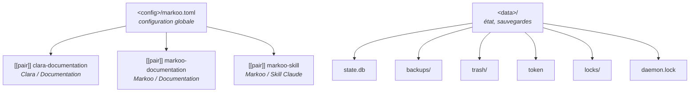
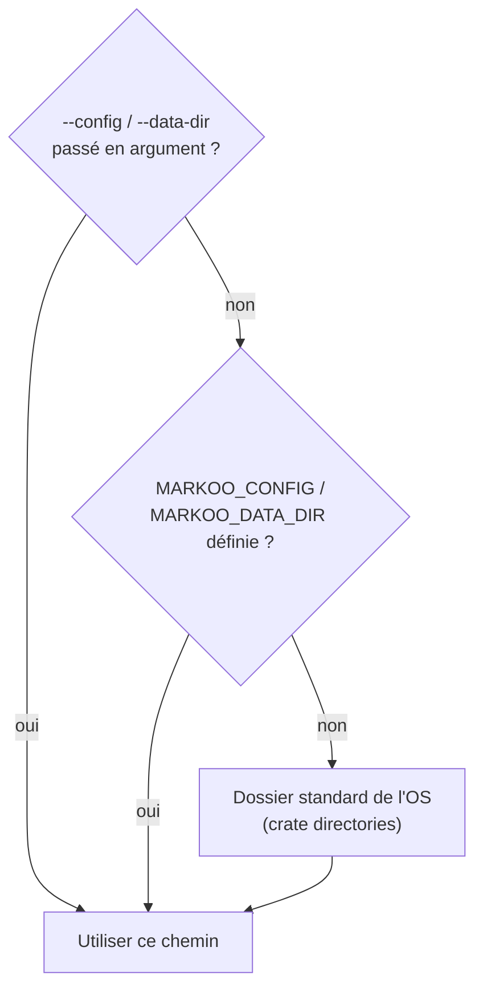
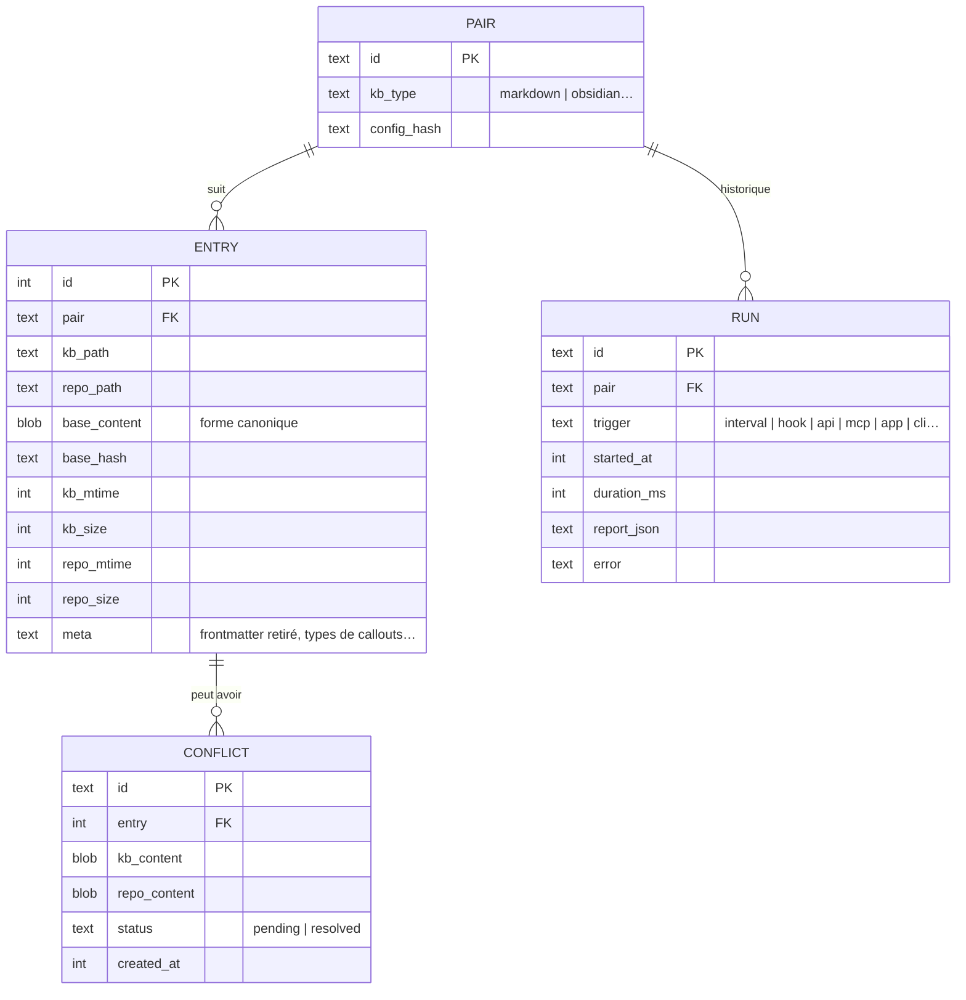

# 6. Configuration

> 🇬🇧 [English version](../en/06-configuration.md)

## Emplacements

Markoo range deux choses **hors de la base de connaissance (KB) et hors du repo**, pour ne polluer ni l'outil de KB (par ex. Obsidian) ni Git :

- la **configuration** (`<config>`) : le fichier `markoo.toml`, que l'utilisateur peut éditer ;
- l'**état** (`<data>`) : la base, avec l'historique, les sauvegardes, la corbeille et le jeton d'API, que seul Markoo gère.



### Chemins par système

Chaque OS a sa propre convention ; Markoo les respecte au lieu d'imposer un chemin Unix.

| OS | `<config>` | `<data>` | Convention |
|----|------------|----------|------------|
| **Linux** | `~/.config/markoo/` | `~/.local/share/markoo/` | XDG (respecte `$XDG_CONFIG_HOME` et `$XDG_DATA_HOME`) |
| **macOS** | `~/Library/Application Support/dev.markoo.markoo/` | `~/Library/Application Support/dev.markoo.markoo/` | Apple : un seul dossier par application |
| **Windows** | `%APPDATA%\markoo\markoo\config\` | `%LOCALAPPDATA%\markoo\markoo\data\` | Known Folders |

Sous Windows, l'état va dans `%LOCALAPPDATA%` (non itinérant) et non dans `%APPDATA%` (itinérant) : `state.db` contient des chemins propres à la machine, et une base SQLite ne doit pas être recopiée d'un poste à l'autre par un profil itinérant.

La commande `markoo paths` affiche les chemins effectivement utilisés.

### Résolution



### Règles d'implémentation

- **Aucun chemin écrit en dur.** Le module `markoo-core::paths` est le seul à calculer `<config>` et `<data>`, avec `directories::ProjectDirs::from("dev", "markoo", "markoo")`.
- **Une seule source de vérité pour la CLI et l'app.** L'app Tauri n'utilise **pas** `app.path().app_data_dir()` pour les fichiers de Markoo : sous Linux et Windows, Tauri donnerait un autre dossier que la CLI, et chacune aurait sa propre base (conflits invisibles de l'autre côté). L'app appelle `markoo-core::paths` comme la CLI.
- L'`identifier` Tauri vaut `dev.markoo.markoo`, pour que les dossiers propres à Tauri (cache WebView, préférences de fenêtre) restent à côté sous macOS.
- Les tests passent un `<data>` temporaire via `MARKOO_DATA_DIR`, sans jamais toucher au dossier réel.

## Exemple complet

> Ce fichier peut être édité à la main ou via l'[interface de configuration](08-interface-de-configuration.md) ; les deux restent synchronisés et les commentaires sont conservés.

```toml
# <config>/markoo.toml

[general]
log_level = "info"
backups_keep = 20          # nombre de sauvegardes conservées par fichier
language = "en"            # en | fr : langue de l'interface de configuration

[schedule]
interval = "5m"
on_startup = true

[api]
enabled = true
port = 4848

[mcp]
http = true                # expose aussi /mcp sur l'API
allow_config_write = false # un agent peut-il modifier la configuration ?

# ---------------------------------------------------------------
[[pair]]
id      = "clara-documentation" # stable, écrit à la création de la paire ; ne change jamais
name    = "Documentation"  # texte libre, renommable à tout moment
project = "Clara"          # les paires d'un même projet sont affichées ensemble
kb      = "~/Obsidian/Knowledge/Projets/Clara"
kb_type = "obsidian"       # markdown | obsidian ; logseq | foam | dendron après la v1. Détecté si omis
repo    = "~/Projets/lerebours/clara/docs"

include = ["**/*.md"]
exclude = ["brouillons/**", "**/_*.md"]

conflict  = "ask"          # ask | prefer-kb | prefer-repo | markers
direction = "both"         # both | kb-to-repo | repo-to-kb
target_changes = "protect" # protect | overwrite (modes à sens unique)
paused = false

[pair.transform]                # options génériques, valables pour tout type de KB
links          = "markdown"     # markdown | keep
filenames      = "preserve"     # preserve | kebab
assets_dir     = "assets"
frontmatter    = "filter"       # keep | filter | drop
strip_comments = false

[pair.kb_options]               # options propres à l'adaptateur (ici : obsidian)
callouts       = "github"       # github | keep
inline_embeds  = false
frontmatter_drop = ["cssclasses", "aliases", "publish"]

[pair.hooks]
install  = ["post-merge"]
branches = ["main"]

# ---------------------------------------------------------------
[[pair]]
id      = "markoo-documentation"
name    = "Documentation"        # même nom que dans Clara : un nom n'est unique que dans son projet
project = "Markoo"
kb      = "~/Obsidian/Knowledge/Projets/Markoo/Documentation"   # kb_type omis : détecté (.obsidian/ présent)
repo    = "~/Projets/opensource/markoo/documentation"
direction = "repo-to-kb"        # le repo fait référence, la KB ne fait que lire
target_changes = "protect"      # une édition dans la KB est signalée, jamais écrasée

[[pair]]
id      = "markoo-skill"
name    = "Skill Claude"
project = "Markoo"              # deuxième paire du même projet
kb      = "~/Obsidian/Knowledge/Projets/Markoo/Skill"
repo    = "~/Projets/opensource/markoo/skill"
```

## Référence des options de paire

| Clé | Type | Défaut | Description |
|-----|------|--------|-------------|
| `id` | texte | le `name` | Identifiant stable, unique parmi toutes les paires : lettres minuscules, chiffres et tirets. Écrit par Markoo à la création de la paire, puis jamais modifié ; voir [Identifiant et nom](#identifiant-et-nom) |
| `name` | texte | **requis** | Nom affiché dans l'app et la CLI : texte libre, de 1 à 64 caractères, unique dans le projet. Modifiable à tout moment |
| `project` | texte | aucun | Projet de la paire ; les paires d'un même projet sont regroupées. Requis quand Markoo ajoute la paire, voir [Projets](#projets) |
| `kb` | chemin | **requis** | Dossier côté base de connaissance (KB) |
| `kb_type` | énum | détecté | Type de KB : `markdown`, `obsidian` en v1 (voir [Types de bases de connaissance pris en charge](09-bases-de-connaissance.md#types-de-bases-de-connaissance-pris-en-charge)) ; détecté par les adaptateurs si omis |
| `repo` | chemin | **requis** | Dossier côté dépôt Git |
| `include` | liste de globs | `["**/*.md"]` | Fichiers suivis |
| `exclude` | liste de globs | `[]` | Fichiers ignorés, en plus des exclusions fixes |
| `conflict` | énum | `ask` | Stratégie en cas de chevauchement |
| `direction` | énum | `both` | Sens : `both`, `kb-to-repo`, `repo-to-kb` (voir [Sens de synchronisation](03-algorithme-de-synchronisation.md#sens-de-synchronisation)) |
| `target_changes` | énum | `protect` | Modes à sens unique : `protect` (divergence signalée) ou `overwrite` (miroir strict) |
| `paused` | booléen | `false` | Suspend la paire pour tous les déclencheurs |
| `transform.*` | — | voir ci-dessus | Options génériques, voir [Transformations](04-transformations.md) |
| `kb_options.*` | — | selon l'adaptateur | Options propres à l'adaptateur (par ex. Obsidian : callouts, embeds, filtrage du frontmatter), voir [Adaptateur Obsidian](09-bases-de-connaissance.md#adaptateur-obsidian) |
| `hooks.install` | liste | `["post-merge"]` | Hooks mis en place par `markoo hook install` : `post-merge`, `post-checkout`, `post-commit`, `pre-commit`. Rien n'est installé tant que cette commande n'a pas été lancée, voir [Déclencheurs](05-declencheurs.md#2-hooks-git) |
| `hooks.branches` | liste | `[]` | Branches sur lesquelles les hooks agissent ; vide pour toutes |

### Projets

Un **projet** regroupe les paires qui vont ensemble, par exemple la documentation et le skill d'un même logiciel. C'est la clé `project` de chacune de ses paires :

```toml
[[pair]]
id      = "markoo-documentation"
name    = "Documentation"
project = "Markoo"
kb      = "~/Obsidian/Knowledge/Projets/Markoo/Documentation"
repo    = "~/Projets/opensource/markoo/documentation"

[[pair]]
id      = "markoo-skill"
name    = "Skill Claude"
project = "Markoo"
kb      = "~/Obsidian/Knowledge/Projets/Markoo/Skill"
repo    = "~/Projets/opensource/markoo/skill"
```

- Le nom est un texte libre, de 1 à 64 caractères, sur une ligne, sans espace au début ni à la fin et sans `/` : `"Markoo"`, `"Site web"`.
- Le projet est nommé à la création de sa première paire ; les suivantes le choisissent ou en nomment un nouveau. `markoo pair add`, l'app et l'API refusent une nouvelle paire sans projet.
- L'orthographe déjà utilisée l'emporte, sans tenir compte de la casse : une paire ajoutée à `markoo` rejoint le projet `Markoo` existant au lieu d'en créer un second.
- Dans un fichier écrit à la main, la clé est facultative, pour que les fichiers d'avant les projets se chargent toujours. Les paires sans projet sont listées à part, après les projets. Donnez-leur-en un avec `markoo pair set <paire> project <nom>`, qui sert aussi à changer une paire de projet.
- Un projet n'a pas de réglages propres : il existe tant qu'une de ses paires le nomme.
- Deux projets peuvent avoir chacun une paire du même nom, par exemple `Documentation` : leurs identifiants les distinguent, voir ci-dessous.

### Identifiant et nom

Une paire a un **identifiant** pour Markoo et un **nom** pour vous :

| | `id` | `name` |
|---|------|--------|
| Rôle | Clé de tout ce que Markoo garde sur la paire : état, historique, conflits en attente, verrous, dossiers `backups/` et `trash/`, hooks Git | Affiché dans l'app, dans `markoo pair list` et dans les messages |
| Forme | Lettres minuscules, chiffres et tirets : `markoo-documentation` | Texte libre, de 1 à 64 caractères sur une ligne, sans espace au début ni à la fin et sans `/` : `"Documentation technique"`, `"Skill Claude (prod)"` |
| Unique | Parmi toutes les paires | Dans son projet, sans tenir compte de la casse |
| Change | Jamais | À tout moment |

- Markoo écrit l'`id` à la création de la paire, à partir du projet et du nom : `Markoo` et `Documentation` donnent `markoo-documentation`. Les accents sont retirés, les autres caractères deviennent des tirets, et un numéro est ajouté si l'identifiant est déjà pris (`markoo-documentation-2`). Quand le projet et le nom donnent le même texte, l'identifiant est ce texte seul : `Clara` et `clara` donnent `clara`.
- L'identifiant n'est plus recalculé ensuite : renommer la paire ou la changer de projet le conserve.
- Renommez une paire avec `markoo pair set <paire> name "Documentation technique"`, ou dans l'onglet **Général** de l'app. Son historique, ses conflits en attente et ses hooks Git la suivent.
- L'identifiant ne se modifie pas : `markoo pair set <paire> id …` est refusé. Le modifier à la main dans `markoo.toml` fait voir à Markoo une nouvelle paire, sans historique, et laisse les hooks installés appeler l'ancien identifiant.
- Dans un fichier écrit à la main, `id` est facultatif : sans lui, l'identifiant est le nom, pour que les fichiers d'avant les identifiants gardent leur état et leurs hooks. Ce nom doit alors respecter la forme d'un identifiant. Renommer une telle paire écrit d'abord son nom actuel comme `id`.

### Désigner une paire

La CLI, l'API et MCP acceptent une paire sous trois formes, essayées dans cet ordre :

1. son **identifiant** : `markoo-documentation` ;
2. **`Projet/Nom`**, sans tenir compte de la casse : `Markoo/Documentation`, `"markoo/skill claude"` ;
3. son **nom** seul, sans tenir compte de la casse, quand aucun autre projet n'a de paire de ce nom : `"Skill Claude"`.

Un nom partagé par plusieurs projets est refusé, avec la liste des candidates :

```text
"Documentation" matches several pairs: Clara/Documentation, Markoo/Documentation; use project/name or the id
```

**Utilisez l'identifiant dans les scripts, les hooks et la configuration des agents** : c'est la seule forme qui ne change jamais. Dans une URL, encodez les autres formes : `/pairs/Markoo%2FSkill%20Claude/status`. Les sorties JSON (`--json`, API, MCP) donnent l'identifiant dans leurs champs `"pair"` ; les listes de paires de l'API et du MCP donnent aussi `name`, `project` et `label` (`Projet/Nom`).

### Stratégies de conflit

| Valeur | Comportement en cas de chevauchement |
|--------|--------------------------------------|
| `ask` | Conflit mis en attente, résolu par l'utilisateur (défaut) |
| `prefer-kb` | La version de la KB l'emporte **pour les blocs en conflit seulement** |
| `prefer-repo` | La version du repo l'emporte pour les blocs en conflit seulement |
| `markers` | Écrit des marqueurs `<<<<<<<` / `=======` / `>>>>>>>` des deux côtés |

### Validation au chargement

- `kb` et `repo` existent et sont des dossiers.
- Deux paires ne se chevauchent pas (même fichier suivi par deux paires) : erreur explicite. Les dossiers `kb` et `repo` d'une même paire ne se chevauchent pas non plus.
- `id`, s'il est présent, ne contient que des lettres minuscules, des chiffres et des tirets, et aucune autre paire ne l'utilise ; sans `id`, le nom doit respecter cette forme : erreur explicite sinon.
- `name` compte de 1 à 64 caractères sur une ligne, sans espace au début ni à la fin et sans `/`, et aucune autre paire du même projet ne le porte, sans tenir compte de la casse : erreur explicite sinon.
- `project`, s'il est présent, compte de 1 à 64 caractères sur une ligne, sans espace au début ni à la fin et sans `/` : erreur explicite sinon.
- Les clés inconnues dans une table `[[pair]]` sont refusées, pour qu'une faute de frappe comme `directon` ne change pas le sens en silence.
- `target_changes = "overwrite"` avec `direction = "both"` : avertissement, l'option est sans effet.
- `repo` se trouve dans un dépôt Git : simple avertissement s'il ne l'est pas, ce qui reste autorisé.
- `kb` est reconnu par l'adaptateur de son type : si `kb_type` est omis, chaque adaptateur tente la détection et le premier qui reconnaît le dossier l'emporte (`markdown` en dernier recours) ; si `kb_type` est indiqué et que la détection échoue, erreur explicite.
- Obsidian : `kb` se trouve dans un vault Obsidian (un `.obsidian/` existe dans un dossier parent) : nécessaire pour lire le dossier de pièces jointes.
- `kb_options` ne contient que des clés connues de l'adaptateur choisi : une clé inconnue donne un avertissement.

## Base d'état (`state.db`)


