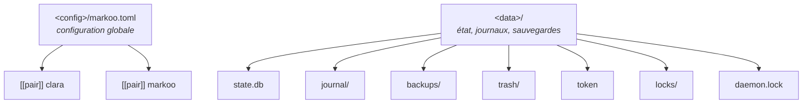
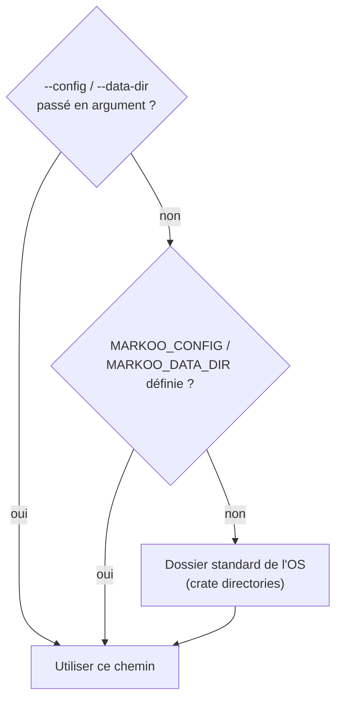
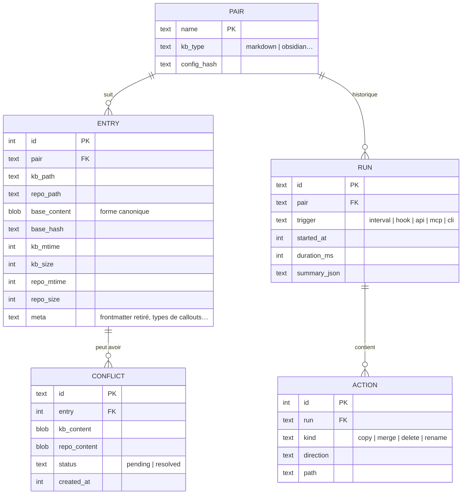

# 6. Configuration

> 🇬🇧 [English version](../en/06-configuration.md)

## Emplacements

Markoo range deux choses **hors de la base de connaissance (KB) et hors du repo**, pour ne polluer ni l'outil de KB (par ex. Obsidian) ni Git :

- la **configuration** (`<config>`) : le fichier `markoo.toml`, que l'utilisateur peut éditer ;
- l'**état** (`<data>`) : la base, le journal, les sauvegardes, la corbeille et le jeton d'API, que seul Markoo gère.



### Chemins par système

Chaque OS a sa propre convention ; Markoo les respecte au lieu d'imposer un chemin Unix.

| OS | `<config>` | `<data>` | Convention |
|----|------------|----------|------------|
| **Linux** | `~/.config/markoo/` | `~/.local/share/markoo/` | XDG (respecte `$XDG_CONFIG_HOME` et `$XDG_DATA_HOME`) |
| **macOS** | `~/Library/Application Support/dev.markoo.markoo/` | `~/Library/Application Support/dev.markoo.markoo/` | Apple : un seul dossier par application |
| **Windows** | `%APPDATA%\markoo\markoo\config\` | `%LOCALAPPDATA%\markoo\markoo\data\` | Known Folders |

Sous Windows, l'état va dans `%LOCALAPPDATA%` (non itinérant) et non dans `%APPDATA%` (itinérant) : `state.db` contient des chemins propres à la machine, et une base SQLite ne doit pas être recopiée d'un poste à l'autre par un profil itinérant.

La commande `markoo paths` affiche les chemins effectivement utilisés.

### Résolution



### Règles d'implémentation

- **Aucun chemin écrit en dur.** Le module `markoo-core::paths` est le seul à calculer `<config>` et `<data>`, avec `directories::ProjectDirs::from("dev", "markoo", "markoo")`.
- **Une seule source de vérité pour la CLI et l'app.** L'app Tauri n'utilise **pas** `app.path().app_data_dir()` pour les fichiers de Markoo : sous Linux et Windows, Tauri donnerait un autre dossier que la CLI, et chacune aurait sa propre base (conflits invisibles de l'autre côté). L'app appelle `markoo-core::paths` comme la CLI.
- L'`identifier` Tauri vaut `dev.markoo.markoo`, pour que les dossiers propres à Tauri (cache WebView, préférences de fenêtre) restent à côté sous macOS.
- Les tests passent un `<data>` temporaire via `MARKOO_DATA_DIR`, sans jamais toucher au dossier réel.

## Exemple complet

> Ce fichier peut être édité à la main ou via l'[interface de configuration](08-interface-de-configuration.md) ; les deux restent synchronisés et les commentaires sont conservés.

```toml
# <config>/markoo.toml

[general]
log_level = "info"
backups_keep = 20          # nombre de sauvegardes conservées par fichier

[schedule]
interval = "5m"
on_startup = true

[api]
enabled = true
port = 4848

[mcp]
http = true                # expose aussi /mcp sur l'API
allow_config_write = false # un agent peut-il modifier la configuration ?

# ---------------------------------------------------------------
[[pair]]
name    = "clara"
kb      = "~/Obsidian/Knowledge/Projets/Clara"
kb_type = "obsidian"       # markdown | obsidian ; logseq | foam | dendron après la v1. Détecté si omis
repo    = "~/Projets/lerebours/clara/docs"

include = ["**/*.md"]
exclude = ["brouillons/**", "**/_*.md"]

conflict  = "ask"          # ask | prefer-kb | prefer-repo | markers
direction = "both"         # both | kb-to-repo | repo-to-kb
target_changes = "protect" # protect | overwrite (modes à sens unique)
paused = false

[pair.transform]                # options génériques, valables pour tout type de KB
links          = "markdown"     # markdown | keep
filenames      = "preserve"     # preserve | kebab
assets_dir     = "assets"
frontmatter    = "filter"       # keep | filter | drop
strip_comments = false

[pair.kb_options]               # options propres à l'adaptateur (ici : obsidian)
callouts       = "github"       # github | keep
inline_embeds  = false
frontmatter_drop = ["cssclasses", "aliases", "publish"]

[pair.hooks]
install  = ["post-merge"]
branches = ["main"]

# ---------------------------------------------------------------
[[pair]]
name  = "markoo"
kb    = "~/Obsidian/Knowledge/Projets/Markoo"   # kb_type omis : détecté (.obsidian/ présent)
repo  = "~/Projets/opensource/markoo/documentation"
direction = "repo-to-kb"        # le repo fait référence, la KB ne fait que lire
target_changes = "protect"      # une édition dans la KB est signalée, jamais écrasée
```

## Référence des options de paire

| Clé | Type | Défaut | Description |
|-----|------|--------|-------------|
| `name` | texte | **requis** | Identifiant unique (CLI, API, MCP) |
| `kb` | chemin | **requis** | Dossier côté base de connaissance (KB) |
| `kb_type` | énum | détecté | Type de KB : `markdown`, `obsidian` en v1 (voir [Types de bases de connaissance pris en charge](09-bases-de-connaissance.md#types-de-bases-de-connaissance-pris-en-charge)) ; détecté par les adaptateurs si omis |
| `repo` | chemin | **requis** | Dossier côté dépôt Git |
| `include` | liste de globs | `["**/*.md"]` | Fichiers suivis |
| `exclude` | liste de globs | `[]` | Fichiers ignorés, en plus des exclusions fixes |
| `conflict` | énum | `ask` | Stratégie en cas de chevauchement |
| `direction` | énum | `both` | Sens : `both`, `kb-to-repo`, `repo-to-kb` (voir [Sens de synchronisation](03-algorithme-de-synchronisation.md#sens-de-synchronisation)) |
| `target_changes` | énum | `protect` | Modes à sens unique : `protect` (divergence signalée) ou `overwrite` (miroir strict) |
| `paused` | booléen | `false` | Suspend la paire pour tous les déclencheurs |
| `transform.*` | — | voir ci-dessus | Options génériques, voir [Transformations](04-transformations.md) |
| `kb_options.*` | — | selon l'adaptateur | Options propres à l'adaptateur (par ex. Obsidian : callouts, embeds, filtrage du frontmatter), voir [Adaptateur Obsidian](09-bases-de-connaissance.md#adaptateur-obsidian) |
| `hooks.install` | liste | `["post-merge"]` | Hooks mis en place par `markoo hook install` : `post-merge`, `post-checkout`, `post-commit`, `pre-commit`. Rien n'est installé tant que cette commande n'a pas été lancée, voir [Déclencheurs](05-declencheurs.md#2-hooks-git) |
| `hooks.branches` | liste | `[]` | Branches sur lesquelles les hooks agissent ; vide pour toutes |

### Stratégies de conflit

| Valeur | Comportement en cas de chevauchement |
|--------|--------------------------------------|
| `ask` | Conflit mis en attente, résolu par l'utilisateur (défaut) |
| `prefer-kb` | La version de la KB l'emporte **pour les blocs en conflit seulement** |
| `prefer-repo` | La version du repo l'emporte pour les blocs en conflit seulement |
| `markers` | Écrit des marqueurs `<<<<<<<` / `=======` / `>>>>>>>` des deux côtés |

### Validation au chargement

- `kb` et `repo` existent et sont des dossiers.
- Deux paires ne se chevauchent pas (même fichier suivi par deux paires) : erreur explicite. Les dossiers `kb` et `repo` d'une même paire ne se chevauchent pas non plus.
- Les clés inconnues dans une table `[[pair]]` sont refusées, pour qu'une faute de frappe comme `directon` ne change pas le sens en silence.
- `target_changes = "overwrite"` avec `direction = "both"` : avertissement, l'option est sans effet.
- `repo` se trouve dans un dépôt Git : simple avertissement s'il ne l'est pas, ce qui reste autorisé.
- `kb` est reconnu par l'adaptateur de son type : si `kb_type` est omis, chaque adaptateur tente la détection et le premier qui reconnaît le dossier l'emporte (`markdown` en dernier recours) ; si `kb_type` est indiqué et que la détection échoue, erreur explicite.
- Obsidian : `kb` se trouve dans un vault Obsidian (un `.obsidian/` existe dans un dossier parent) : nécessaire pour lire le dossier de pièces jointes.
- `kb_options` ne contient que des clés connues de l'adaptateur choisi : une clé inconnue donne un avertissement.

## Base d'état (`state.db`)


