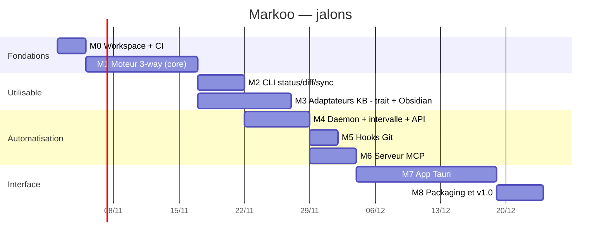

# 7. Feuille de route

> 🇬🇧 [English version](../en/07-roadmap.md)

> Les durées sont indicatives et servent surtout à ordonner le travail.

## Jalons

### M0 — Fondations
- Workspace Cargo (`markoo-core`, `markoo-cli`), `rustfmt`, `clippy`.
- CI GitHub Actions : build et tests sur macOS et Linux.
- Fixtures de test : une mini-KB (dossier Markdown simple, puis un mini-vault Obsidian) et un mini-repo.

**Terminé quand** : `cargo test` passe en CI.

### M1 — Moteur de synchro
- `scanner`, `state` (SQLite), `planner` (les 15 cas de la [classification](03-algorithme-de-synchronisation.md#classification)), `merge` (3-way), `applier` (atomique, sauvegardes, corbeille).
- Les trois sens (`both`, `kb-to-repo`, `repo-to-kb`) avec `protect` / `overwrite` et les divergences.
- Adaptateur `markdown` (identité, pas encore de conversion des liens) : simple base de référence pour tester le moteur, pas une cible produit.
- Détection des renommages exacts.

**Terminé quand** : chaque ligne du tableau de classification a un test, et une synchro rejouée ne produit aucune écriture.

### M2 — CLI
- `init`, `status`, `diff`, `sync [--dry-run]`, `conflicts`, `resolve`.
- `pair add|list|show|set|remove`, avec assistant interactif.
- Sortie colorée et `--json` pour les scripts.

**Terminé quand** : Markoo est utilisable au quotidien sur une vraie paire (KB ↔ `clara/docs`).

### M3 — Adaptateurs KB : trait + Obsidian (première KB)
- Trait `KbAdapter` dans `markoo-core::kb` : détection, organisation des fichiers, dialecte (`to_canonical` / `from_canonical`), résolution des noms (voir [Modèle d'adaptateur](09-bases-de-connaissance.md#modèle-dadaptateur)).
- Adaptateur `obsidian`, **première base de connaissance prise en charge** : wikilinks ↔ liens Markdown, ancres, pièces jointes, callouts, frontmatter ; détection via `.obsidian/` et `obsidian.json`.
- Dialecte `gfm` côté repo ; forme canonique = GFM avec liens relatifs.
- Tests golden et tests de propriété d'aller-retour, pour chaque adaptateur.

**Terminé quand** : l'aller-retour d'un vault Obsidian réel ne produit aucune différence et les liens fonctionnent sur GitHub.

### M4 — Daemon, intervalle, API
- `markoo daemon` : file de jobs, verrou, anti-rebond, planificateur.
- API HTTP (`axum`), jeton, flux SSE.
- Service `launchd` sur macOS.

**État** : terminé, et essayé avec un vrai `launchd` : `markoo daemon install` et `uninstall` fonctionnent, un démarrage raté est relancé et le service reste actif avec une configuration. Le démarrage à l'ouverture de session n'a pas été essayé. Les événements de progression se limitent au début et à la fin des jobs : le moteur ne signale pas sa progression pendant une synchro.

### M5 — Hooks Git
- `markoo hook install|uninstall`, cohabitation avec les hooks existants, husky et lefthook.

**État** : terminé. Les vrais hooks sont testés sur macOS et Linux seulement ; sous Windows, l'installation est testée, pas l'exécution des hooks par Git. husky et lefthook sont reconnus à leurs fichiers, sans avoir essayé les extraits proposés dans ces outils.

### M6 — Serveur MCP
- Outils et ressources décrits dans [Déclencheurs](05-declencheurs.md#4-serveur-mcp), en stdio et en HTTP.
- Test avec Claude Code.

**État** : terminé, essayé avec Claude Code en stdio et en HTTP sur une paire d'exemple. Les autres clients MCP n'ont pas été essayés.

### M7 — App Tauri
- Barre de menus, liste des paires, changements en attente, historique.
- Vue de conflit en trois colonnes avec éditeur.
- [Interface de configuration](08-interface-de-configuration.md) : assistant de création, choix du sens, filtres avec aperçu, transformations, déclencheurs.

### M8 — v1.0
- Binaires signés (macOS notarisé), formule Homebrew, documentation utilisateur.

## Après la v1

- Mode `watch` (événements du système de fichiers) en complément de l'intervalle.
- Fusion par paragraphe et fusion sémantique du frontmatter avancée.
- Proposition de message de commit / création de branche et PR côté repo.
- Adaptateurs `logseq`, `foam` et `dendron` (voir [Types de bases de connaissance pris en charge](09-bases-de-connaissance.md#types-de-bases-de-connaissance-pris-en-charge)).
- Dialectes côté repo en plus de `gfm` : GitLab, MkDocs, Docusaurus.
- Exploration de KB distantes (Notion, Confluence, Outline…) via un adaptateur adossé à une API plutôt qu'au système de fichiers.
- Plugin Obsidian qui affiche l'état Markoo dans la barre latérale (en s'appuyant sur l'API).
- Résolution de conflits assistée par un LLM (via MCP ou l'API Claude).

## Risques identifiés

| Risque | Impact | Parade |
|--------|--------|--------|
| Conversion de liens non réversible | Faux changements, boucles de synchro | Tests de propriété, commentaires `markoo:` pour l'information non représentable |
| Écriture pendant qu'Obsidian enregistre | Perte de frappe | Vérification juste avant l'écriture, écriture atomique |
| Base corrompue ou perdue | Tout apparaît comme « créé des deux côtés » | Cas 4 de la classification (contenus identiques = pas de conflit), sauvegarde de `state.db` |
| Ambiguïté de résolution des wikilinks | Lien vers la mauvaise note | Même algorithme que l'outil de KB (par ex. Obsidian), avertissements |
| Différences de dialecte entre outils de KB (par ex. format outliner de Logseq) | Conversion partielle ou avec perte | Les adaptateurs ne convertissent que ce qui fait l'aller-retour ; les constructions non prises en charge passent telles quelles |
| Grosses KB | Lenteur | Comparaison `mtime` + taille avant hash, scan parallèle (`rayon`) |
