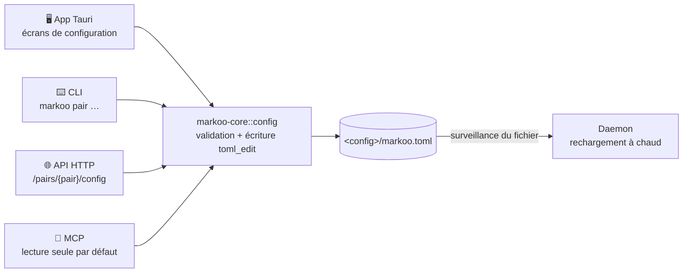
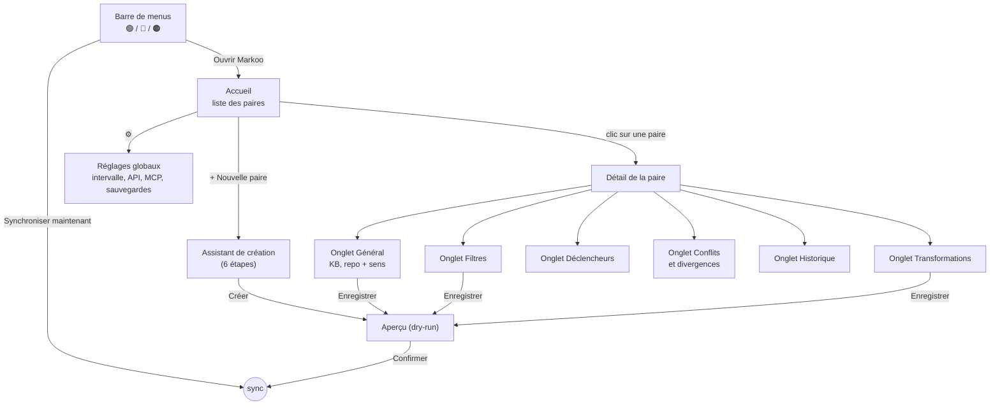
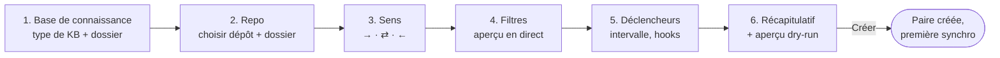
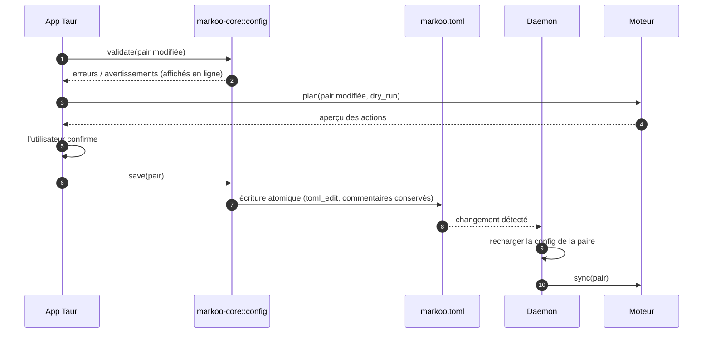

# 8. Interface de configuration

> 🇬🇧 [English version](../en/08-configuration-ui.md)

Markoo doit pouvoir se configurer **sans éditer de fichier à la main** : créer une paire, choisir la **base de connaissance (KB)** et son type, le dossier du repo, le **sens de synchronisation**, les filtres, les transformations et les déclencheurs.

> **État** : cette page décrit la cible. Ce qui existe aujourd'hui est listé dans la [feuille de route](07-feuille-de-route.md#m7--app-tauri). La page d'une paire ajoute un onglet **Changements**, qui liste le plan. Pour l'instant, l'intervalle est seulement global, les clés de frontmatter se saisissent en liste, et les options non implémentées ne sont pas affichées (noms de fichiers, `strip_comments`, `inline_embeds`). Les hooks lancent la commande `markoo`, qui doit être installée.

## Principes

1. **`markoo.toml` reste la source de vérité.** L'interface ne fait qu'éditer ce fichier. Elle utilise `toml_edit`, ce qui **conserve les commentaires et la mise en forme** de l'utilisateur. Une modification faite à la main dans le fichier apparaît dans l'interface, et inversement.
2. **Une seule logique de validation**, dans `markoo-core::config`. L'app, la CLI et l'API affichent les mêmes erreurs.
3. **Voir avant d'appliquer.** Tout changement qui modifie ce qui sera synchronisé (dossiers, type de KB, sens, filtres) est suivi d'un **aperçu** (dry-run) avant la première synchro.
4. **Les valeurs par défaut sont sûres** : bidirectionnel, `protect` pour les modes à sens unique, `ask` pour les conflits.

## Points d'accès



| Accès | Lecture | Écriture |
|-------|---------|----------|
| App Tauri | ✅ | ✅ |
| CLI | ✅ `markoo pair list` / `show` | ✅ `markoo pair add` / `edit` / `set` / `remove` |
| API HTTP | ✅ `GET /pairs/{pair}/config` | ✅ `POST /pairs`, `PATCH /pairs/{pair}/config`, `DELETE /pairs/{pair}` |
| MCP | ✅ `get_pair_config` | ❌ par défaut ; activable avec `mcp.allow_config_write = true` (outil `update_pair_config`) |

L'écriture de configuration par un agent IA est désactivée par défaut : changer un sens ou un dossier peut provoquer des écritures massives à la synchro suivante.

## Navigation dans l'app



## Écrans

### Accueil : liste des paires

```text
┌─ Markoo ──────────────────────────────────────────────────── ⚙️ ─┐
│                                                                  │
│  Paires                                        [ + Nouvelle ]    │
│                                                                  │
│  ● clara      Obsidian  Projets/Clara  ⇄  clara/docs             │
│               ✅ À jour · il y a 2 min · toutes les 5 min        │
│                                                                  │
│  ● markoo     Obsidian  Projets/Markoo  ←  markoo/documentation  │
│               ⚠️ 1 divergence · il y a 1 h · hook post-merge     │
│                                                                  │
│  ○ notes-api  Markdown  ~/notes/api  →  api/docs     (en pause)  │
│                                                                  │
└──────────────────────────────────────────────────────────────────┘
```

Chaque paire affiche le **type de sa KB** (icône ou libellé : Obsidian, Markdown…), puis le dossier de la KB et celui du repo. La flèche entre les deux dossiers indique toujours le sens : `⇄` bidirectionnel, `→` KB vers repo, `←` repo vers KB.

### Onglet Général : KB, repo et sens

```text
┌─ clara › Général ────────────────────────────────────────────────┐
│                                                                  │
│  Nom            [ clara                     ]                    │
│                                                                  │
│  Type de KB     [ Obsidian (détecté)    ▾ ]                      │
│  KB             [ ~/Obsidian/Knowledge/Projets/Clara ] [Choisir] │
│                 ✓ Vault Obsidian « Knowledge » détecté           │
│  Repo           [ ~/Projets/lerebours/clara/docs     ] [Choisir] │
│                 ✓ Dépôt Git, branche main                        │
│                                                                  │
│  Sens de synchronisation                                         │
│  ┌──────────────────┐ ┌──────────────────┐ ┌──────────────────┐  │
│  │   KB  →  Repo    │ │   KB  ⇄  Repo    │ │   KB  ←  Repo    │  │
│  │                  │ │   ◉ sélectionné  │ │                  │  │
│  │ La KB fait       │ │ On rédige des    │ │ Le repo fait     │  │
│  │ référence        │ │ deux côtés       │ │ référence        │  │
│  └──────────────────┘ └──────────────────┘ └──────────────────┘  │
│                                                                  │
│  Si la cible est modifiée (modes à sens unique)                  │
│   ◉ Protéger : signaler une divergence, ne rien écraser          │
│   ○ Écraser : miroir strict de la source (avec sauvegarde)       │
│                                                                  │
│  Conflits (mode bidirectionnel)                                  │
│   [ Me demander                                  ▾ ]             │
│                                                                  │
│                             [ Annuler ]  [ Enregistrer et voir ] │
└──────────────────────────────────────────────────────────────────┘
```

- Le **type de KB** est détecté à partir du dossier choisi (voir [Bases de connaissance](09-bases-de-connaissance.md#types-de-bases-de-connaissance-pris-en-charge)) ; on peut le forcer dans la liste. Le message sous le champ KB vient de l'adaptateur : vault Obsidian reconnu, simple dossier Markdown…
- Les options affichées dépendent du sens : « Si la cible est modifiée » n'apparaît que pour un mode à sens unique, et « Conflits » que pour le mode bidirectionnel.
- Le bouton **Enregistrer et voir** ouvre l'aperçu (dry-run) au lieu d'enregistrer directement quand le changement touche aux dossiers, au type de KB, au sens ou aux filtres.

### Onglet Filtres

```text
┌─ clara › Filtres ────────────────────────────────────────────────┐
│  Inclure    [ **/*.md                                  ] [+]     │
│  Exclure    [ brouillons/**                            ] [−]     │
│             [ **/_*.md                                 ] [−]     │
│                                                                  │
│  Aperçu en direct : 42 fichiers suivis · 7 exclus                │
│   ✓ architecture.md                                              │
│   ✓ adr/001-stack.md                                             │
│   ✗ brouillons/idees.md                 (exclu : brouillons/**)  │
└──────────────────────────────────────────────────────────────────┘
```

L'aperçu se recalcule à chaque frappe ; c'est le même scanner que la synchro, donc pas de surprise.

### Onglet Transformations

Interrupteurs et listes pour les options de [Transformations](04-transformations.md), en deux groupes :

- **Options génériques** (`[pair.transform]`) : conversion des liens, dossier des pièces jointes, frontmatter (cases à cocher par clé détectée dans les notes), noms de fichiers (`preserve` / `kebab`, avec un exemple de renommage).
- **Options de l'adaptateur** (`[pair.kb_options]`) : elles dépendent du type de KB. Pour Obsidian : wikilinks, callouts, embeds, clés de frontmatter retirées par défaut (voir [Adaptateur Obsidian](09-bases-de-connaissance.md#adaptateur-obsidian)). L'adaptateur `markdown` n'en a aucune.

Un panneau **avant / après** montre l'effet sur une note réelle de la paire.

### Onglet Déclencheurs

| Réglage | Contrôle |
|---------|----------|
| Intervalle | Valeur globale ou propre à la paire (`off`, `30s`, `5m`, `1h`…) |
| Hooks Git | Cases `post-merge`, `post-checkout`, `pre-commit` ; bouton **Installer / Désinstaller** ; branches concernées |
| API / MCP | Lecture seule : rappelle l'URL et la commande à copier |
| Pause | Interrupteur « suspendre cette paire » |

## Assistant de création



- **Étape 1** : on choisit d'abord le **type de KB** (détecté automatiquement quand c'est possible), puis le dossier. Les KB connues sont proposées par l'adaptateur : celui d'Obsidian lit le fichier `obsidian.json` de l'application (sous macOS `~/Library/Application Support/obsidian/`, sous Linux `~/.config/obsidian/`, sous Windows `%APPDATA%\obsidian\`) ; d'autres adaptateurs ne proposent rien et se contentent d'un sélecteur de dossier. On peut toujours choisir un dossier à la main.
- **Étape 2** : le sélecteur vérifie que le dossier est dans un dépôt Git et affiche la branche courante.
- **Étape 3** : les trois cartes de sens, avec le mode bidirectionnel présélectionné.
- **Étape 6, première synchro d'une nouvelle paire** : si les deux dossiers contiennent déjà des fichiers, l'aperçu met en évidence les fichiers présents des deux côtés avec un contenu différent (cas 5 de la [classification](03-algorithme-de-synchronisation.md#classification)) pour que l'utilisateur les traite avant de lancer.

## Enregistrement d'une modification



### Validation en direct

Les règles de [validation au chargement](06-configuration.md#validation-au-chargement) s'appliquent pendant la saisie, plus :

- nom de paire unique et utilisable dans une URL (`[a-z0-9-]+`) ;
- passage de `both` à un sens unique **refusé** tant qu'il reste des conflits en attente (voir [Changer de sens](03-algorithme-de-synchronisation.md#changer-de-sens)) ;
- choix de `overwrite` : avertissement explicite, avec le nombre de fichiers de la cible qui seraient modifiés ou mis à la corbeille.

## CLI équivalente

Tout ce que fait l'interface est faisable en ligne de commande :

```bash
markoo pair add clara --kb ~/Obsidian/Knowledge/Projets/Clara --kb-type obsidian --repo ~/Projets/lerebours/clara/docs --direction both
```

```bash
markoo pair set clara direction kb-to-repo --target-changes protect
```

```bash
markoo pair list
```

`--kb-type` est facultatif : sans lui, le type est détecté à partir du dossier. Sans arguments, `markoo pair add` lance le même assistant en mode interactif dans le terminal.
