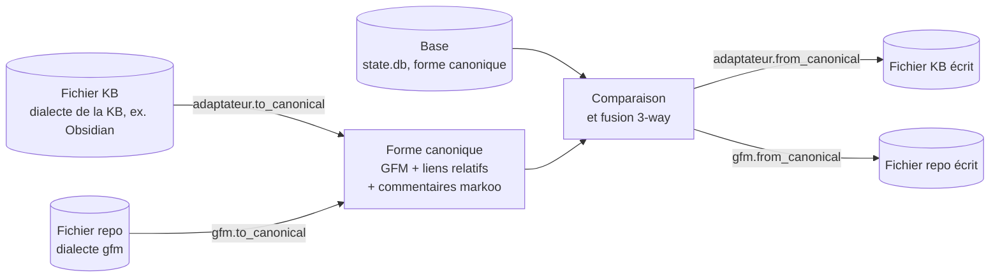
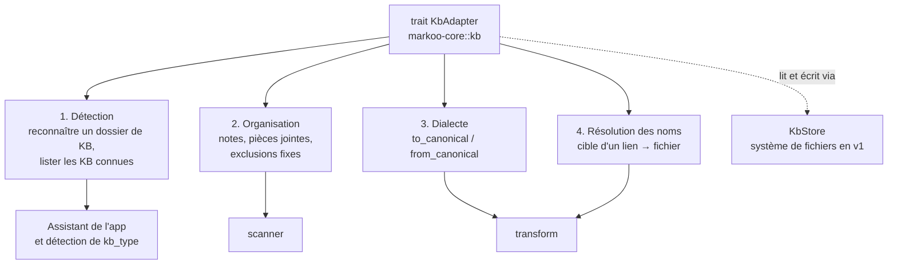
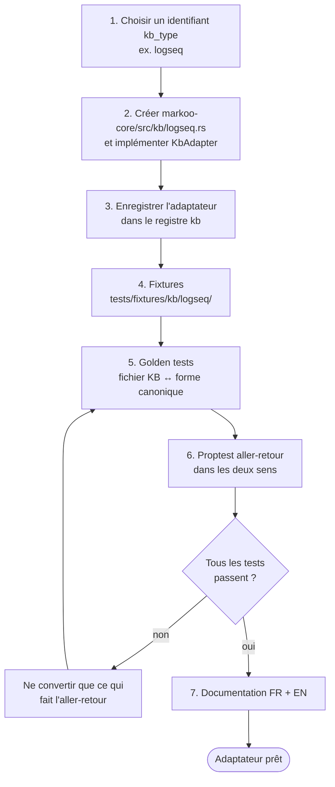

# 9. Bases de connaissance

> 🇬🇧 [English version](../en/09-knowledge-bases.md)

Markoo synchronise du Markdown entre une **base de connaissance (KB)** et un **dépôt Git local**. Obsidian n'est qu'**un** des types de KB possibles : chaque type est pris en charge par un **adaptateur** qui sait reconnaître la KB, connaît son organisation et convertit son dialecte Markdown vers une forme commune.

**Obsidian est la première base de connaissance implémentée** (adaptateur de référence, jalon M3). L'adaptateur `markdown`, qui ne convertit rien, sert de socle au moteur pour les tests du jalon M1 et de solution de repli ; ce n'est pas une cible produit.

> [!NOTE]
> En français, « base » désigne toujours l'**ancêtre de fusion** (état à la dernière synchro). On n'abrège donc jamais « base de connaissance » en « base » : on écrit « KB » ou le terme complet.

## Modèle d'adaptateur

Chaque côté d'une paire parle un **dialecte** : celui de la KB (wikilinks et callouts Obsidian, propriétés `clé:: valeur` de Logseq…) et celui du repo, `gfm` (GitHub Flavored Markdown). Les deux sont convertis vers une **forme canonique** unique ; c'est sur elle que Markoo compare, fusionne et stocke la base.



### Forme canonique

La forme canonique est du **GitHub Flavored Markdown standard avec des liens relatifs**, complété par des commentaires HTML invisibles `<!--markoo:…-->` qui portent ce que GFM ne sait pas représenter (cible d'un wikilink hors de la paire, type d'origine d'un callout, référence de bloc…).

**Invariant** : pour chaque adaptateur, l'aller-retour est sans perte et stable.

- `from_canonical(to_canonical(y)) == y` pour tout fichier `y` de la KB ;
- `to_canonical(from_canonical(x)) == x` pour le texte canonique `x` produit par Markoo ; un texte écrit à la main peut être normalisé une fois, puis ne change plus.

Une construction qui ne peut pas faire l'aller-retour **n'est pas convertie** : elle passe telle quelle des deux côtés. Les détails des conversions sont décrits dans [Transformations](04-transformations.md).

### Responsabilités d'un adaptateur



| Responsabilité | Rôle | Exemple Obsidian |
|----------------|------|------------------|
| **Détection** | Reconnaître un dossier de KB ; proposer les KB connues de l'outil | Dossier `.obsidian/` ; vaults listés dans `obsidian.json` |
| **Organisation** | Dire quels fichiers sont des notes, lesquels sont des pièces jointes, où ranger les nouvelles pièces jointes, quoi exclure toujours | Exclut `.obsidian/` et `.trash/` ; dossier des pièces jointes lu dans `.obsidian/app.json` |
| **Dialecte** | Convertir liens, embeds, callouts, propriétés et commentaires vers et depuis la forme canonique | `[[Note]]` ↔ `[Note](./note.md)` |
| **Résolution des noms** | Trouver le fichier désigné par la cible d'un lien | Par nom de note, chemin le plus court |

### Le trait `KbAdapter`

Esquisse cible. L'interface actuelle est plus petite : elle couvre le dialecte, les exclusions et les pièces jointes ; la détection et la résolution des noms sont dans le module de l'adaptateur (`markoo-core::kb::obsidian`), et `KbStore` n'existe pas encore.

```rust
/// Implémenté par chaque type de base de connaissance (module markoo-core::kb).
pub trait KbAdapter: Send + Sync {
    /// Identifiant utilisé dans la clé `kb_type` (ex. "obsidian").
    fn id(&self) -> &'static str;

    // 1. Détection
    /// Le dossier (ou l'un de ses parents) est-il une KB de ce type ?
    fn detect(&self, folder: &Path) -> Option<Detection>;
    /// KB connues de l'outil, proposées par l'assistant (peut être vide).
    fn known_kbs(&self) -> Vec<KnownKb>;

    // 2. Organisation
    fn layout(&self, root: &Path, opts: &KbOptions) -> Result<Layout>;

    // 3. Dialecte
    fn to_canonical(&self, text: &str, ctx: &ConvertCtx) -> Result<String>;
    fn from_canonical(&self, text: &str, ctx: &ConvertCtx) -> Result<String>;

    // 4. Résolution des noms
    fn resolve(&self, target: &str, from: &EntryPath, index: &NameIndex) -> Resolution;
}

pub struct Layout {
    pub notes: GlobSet,              // ex. **/*.md
    pub attachments: GlobSet,        // images, PDF…
    pub attachments_dir: PathBuf,    // où ranger les nouvelles pièces jointes
    pub excluded: GlobSet,           // exclusions fixes, en plus des filtres de la paire
}

/// Accès aux entrées de la KB : système de fichiers en v1,
/// une API distante resterait possible plus tard.
pub trait KbStore: Send + Sync {
    fn list(&self) -> Result<Vec<Entry>>;
    fn read(&self, path: &EntryPath) -> Result<Vec<u8>>;
    fn write(&self, path: &EntryPath, bytes: &[u8]) -> Result<()>;
}
```

### Dialecte du repo

Le côté repo a lui aussi un dialecte, **`gfm`** en v1 : liens Markdown relatifs, *alerts* GitHub (`> [!NOTE]`), frontmatter YAML. Comme la forme canonique est déjà du GFM, `gfm` est l'identité : les commentaires `markoo` restent dans les fichiers du repo, où GitHub ne les affiche pas. Les options génériques de `[pair.transform]` s'appliquent lors de la conversion côté KB. D'autres dialectes de repo (`gitlab`, `mkdocs`, `docusaurus`) pourraient être choisis par paire après la v1.

## Types de bases de connaissance pris en charge

| `kb_type` | KB | Statut | Remarques |
|-----------|----|--------|-----------|
| `markdown` | Dossier Markdown simple | v1 | Dialecte identité, aucune conversion. Repli pour tout outil inconnu. |
| `obsidian` | Obsidian | v1 (adaptateur de référence) | Wikilinks, embeds, callouts, frontmatter, dossier des pièces jointes lu dans `.obsidian/app.json`. |
| `logseq` | Logseq (graphes en fichiers) | après la v1 | Format plan (puces `- `), liens `[[page]]`, propriétés `clé:: valeur`, `pages/` + `journals/`, espaces de noms. |
| `foam` | Foam (VS Code) | après la v1 | Wikilinks + définitions de références de liens en fin de fichier. |
| `dendron` | Dendron | après la v1 | Noms hiérarchiques à points `a.b.c.md`, clé `id` dans le frontmatter. |
| KB distantes (Notion, Confluence, Outline…) | | exploration, non planifié | Demanderait un adaptateur adossé à une API plutôt qu'au système de fichiers. |

Si `kb_type` est absent de la configuration, Markoo appelle `detect()` de chaque adaptateur, du plus spécifique au plus général, et retient le premier qui reconnaît le dossier ; à défaut, il utilise `markdown`. Le type détecté est écrit dans `markoo.toml` à la création de la paire pour que le comportement ne change pas ensuite.

## Adaptateur Markdown

Adaptateur `markdown` : un dossier de fichiers `.md` sans outil particulier.

- **Détection** : reconnaît n'importe quel dossier ; c'est le repli quand aucun autre adaptateur ne s'applique. Il ne propose aucune KB connue.
- **Organisation** : les fichiers `*.md` sont des notes ; les fichiers référencés par une note sont des pièces jointes, rangées à côté de la note ou dans `assets_dir`.
- **Dialecte** : identité. Le contenu est déjà en forme canonique.
- **Résolution des noms** : chemins relatifs uniquement.

Son rôle est d'abord technique : le moteur du jalon M1 (scanner, état, planificateur, fusion) est testé avec lui, sans aucune conversion, avant l'arrivée de l'adaptateur Obsidian.

## Adaptateur Obsidian

Adaptateur `obsidian`, **première base de connaissance implémentée** et référence pour les suivants. Une KB Obsidian s'appelle un **vault**.

### Détection

- Un dossier est un vault s'il contient `.obsidian/`, ou si l'un de ses parents en contient un (la paire peut ne couvrir qu'un sous-dossier du vault).
- Les vaults connus sont lus dans le fichier `obsidian.json` de l'application, que l'assistant propose à l'étape 1 :

| Système | Emplacement de `obsidian.json` |
|---------|--------------------------------|
| macOS | `~/Library/Application Support/obsidian/` |
| Linux | `~/.config/obsidian/` |
| Windows | `%APPDATA%\obsidian\` |

### Organisation

- **Notes** : fichiers `*.md`. Les fichiers `.canvas` ne sont pas convertis.
- **Exclusions fixes** : `.obsidian/` et `.trash/`, quels que soient les filtres de la paire.
- **Pièces jointes** : une nouvelle pièce jointe venue du repo est rangée dans le dossier configuré dans Obsidian (clé `attachmentFolderPath` de `.obsidian/app.json`), ou à défaut à côté de la note.
- **Format des nouveaux liens** : avec `useMarkdownLinks` dans `.obsidian/app.json`, les liens venant du repo restent des liens Markdown au lieu de devenir des wikilinks. `newLinkFormat` n'est pas encore pris en compte pour ces nouveaux liens ; les liens déjà écrits depuis la racine du vault sont compris (voir [Transformations](04-transformations.md#résolution)).

### Dialecte

| Construction Obsidian | Forme canonique |
|-----------------------|-----------------|
| `[[Note]]`, `[[Note\|alias]]`, `[[Note#Titre]]` | Lien Markdown relatif, ancre au format GitHub |
| `![[image.png]]`, `![[image.png\|300]]` | `` ou `` |
| `![[Autre note]]` | Lien + commentaire `markoo:embed` |
| `> [!info]` et autres callouts | *Alert* GitHub (`> [!NOTE]`) ; type d'origine en commentaire |
| Propriétés (frontmatter YAML) | Frontmatter YAML, filtré selon les options |
| `%% commentaire %%`, `^bloc-id` | Conservés tels quels |

Le détail des règles (ancres, pièces jointes, callouts, frontmatter, noms de fichiers) est dans [Transformations](04-transformations.md).

### Résolution des noms

Comme Obsidian : correspondance exacte du chemin, sinon nom de note unique dans le vault, sinon le fichier le plus proche de la note courante (chemin le plus court), avec un avertissement en cas d'ambiguïté. L'index `nom → chemin` couvre **tout le vault**, pas seulement la paire, pour distinguer une cible hors de la paire d'une cible introuvable.

### Options

Les options propres à Obsidian sont dans `[pair.kb_options]` :

```toml
[pair.kb_options]                  # kb_type = "obsidian"
callouts         = "github"        # github | keep
inline_embeds    = false           # true : insérer le contenu des notes incluses
frontmatter_drop = ["cssclasses", "aliases", "publish"]
```

## Adaptateur Logseq (après la v1)

Graphes Logseq **en fichiers** (pas la version base de données). Organisation : `pages/`, `journals/`, pièces jointes dans `assets/`, exclusion de `logseq/` et `logseq/.recycle/` ; détection par `logseq/config.edn`. Dialecte : liens `[[page]]`, propriétés `clé:: valeur`, espaces de noms `a/b`. La structure en puces (`- `) est **conservée telle quelle** : la transformer en prose ferait perdre de l'information.

## Adaptateur Foam (après la v1)

Espaces de travail Foam dans VS Code. Wikilinks, plus les **définitions de références de liens** que Foam ajoute en fin de fichier (`[note]: note.md "Note"`) : elles sont déjà du Markdown standard, l'adaptateur se contente de les retirer ou de les restituer de façon réversible.

## Adaptateur Dendron (après la v1)

Hiérarchie par **points** dans les noms de fichiers (`projet.clara.archi.md`), détection par `dendron.yml`, identifiant stable dans la clé `id` du frontmatter. La résolution des noms suit la hiérarchie ; l'option `filenames` décide si `a.b.c.md` devient `a/b/c.md` côté repo.

## Bases de connaissance distantes (exploration)

Notion, Confluence, Outline… ne stockent pas leurs pages dans des fichiers. Un adaptateur adossé à une API serait nécessaire. Le trait `KbAdapter` lit et écrit les entrées à travers l'abstraction `KbStore` pour que ce soit possible un jour, mais la v1 ne gère que des KB **en fichiers** et rien n'est planifié.

## Ajouter un adaptateur



1. **Implémenter le trait** `KbAdapter` dans `markoo-core::kb`, avec ses quatre responsabilités, et l'ajouter au registre des adaptateurs (ordre de détection).
2. **Fixtures** : une petite KB réaliste dans `tests/fixtures/kb/<kb_type>/`, avec les constructions propres à l'outil et quelques cas limites.
3. **Golden tests** : paires `entrée.md` / `canonique.md` pour `to_canonical`, et l'inverse pour `from_canonical`.
4. **Test de propriété** (`proptest`) : `from_canonical(to_canonical(y)) == y` sur les fichiers de la KB et `to_canonical(from_canonical(x)) == x` sur du texte canonique. Toute construction qui échoue est laissée telle quelle plutôt que convertie.
5. **Documentation en français et en anglais** : une section dans ce document, une ligne dans le tableau des [types pris en charge](#types-de-bases-de-connaissance-pris-en-charge), les options de `[pair.kb_options]` dans [Configuration](06-configuration.md) et les termes nouveaux dans le [glossaire](glossaire.md).
