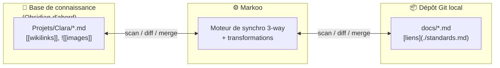

# Markoo — Documentation

> 🇬🇧 [English version](../en/README.md)

  <picture>
    <source media="(prefers-color-scheme: dark)" srcset="../../assets/logo-mark-name-dark.svg">
    
  </picture>

**Markoo** est un connecteur de synchronisation intelligent entre une **base de connaissance** (KB) et un ou plusieurs **dépôts Git** clonés localement. Chaque type de base de connaissance est géré par un adaptateur ; **Obsidian** est le premier implémenté. Il garde la documentation Markdown cohérente des deux côtés : la connaissance reste à jour vis-à-vis du projet, et le projet profite de ce qui est rédigé dans la connaissance.

## Sommaire

| # | Document | Contenu |
|---|----------|---------|
| 1 | [Vision et périmètre](01-vision-et-perimetre.md) | Problème, objectifs, non-objectifs, cas d'usage |
| 2 | [Architecture](02-architecture.md) | Workspace Rust, crates, app Tauri, flux de données |
| 3 | [Algorithme de synchronisation](03-algorithme-de-synchronisation.md) | Détection des changements, sens de synchro, fusion 3-way, conflits, renommages |
| 4 | [Transformations](04-transformations.md) | Pipeline de conversion ; règles de l'adaptateur Obsidian : liens, pièces jointes, frontmatter, noms de fichiers |
| 5 | [Déclencheurs](05-declencheurs.md) | Intervalle, hooks Git, API HTTP, serveur MCP |
| 6 | [Configuration](06-configuration.md) | Format `markoo.toml`, emplacements par OS (`<config>`, `<data>`) |
| 7 | [Feuille de route](07-feuille-de-route.md) | Jalons et critères de fin |
| 8 | [Interface de configuration](08-interface-de-configuration.md) | Écrans, assistant, choix du sens, CLI et API de configuration |
| 9 | [Bases de connaissance](09-bases-de-connaissance.md) | Modèle d'adaptateur, types pris en charge (Obsidian d'abord), ajouter un adaptateur |
| — | [Glossaire](glossaire.md) | Vocabulaire du projet |

## Décisions déjà prises

| Sujet | Décision |
|-------|----------|
| Langage | Rust (workspace Cargo) |
| Bases de connaissance | Plusieurs types via des adaptateurs ; **Obsidian** est le premier implémenté |
| Interface | Application desktop **Tauri 2** + CLI |
| Sens | Par paire : KB → repo, repo → KB, ou bidirectionnel (défaut) |
| Conflits | Fusion 3-way automatique ; l'utilisateur tranche uniquement les vrais conflits |
| Liens | Conversion du dialecte de la KB (ex. `[[wikilinks]]` Obsidian) ↔ liens Markdown standards |
| Déclencheurs | Intervalle de temps, hook Git, API HTTP locale, serveur MCP |
| Stockage | Hors de la base de connaissance et du repo, dans les dossiers standards de chaque OS (Linux, macOS, Windows) |
